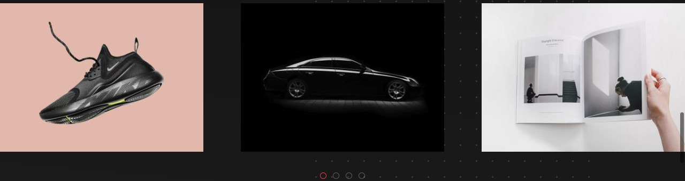
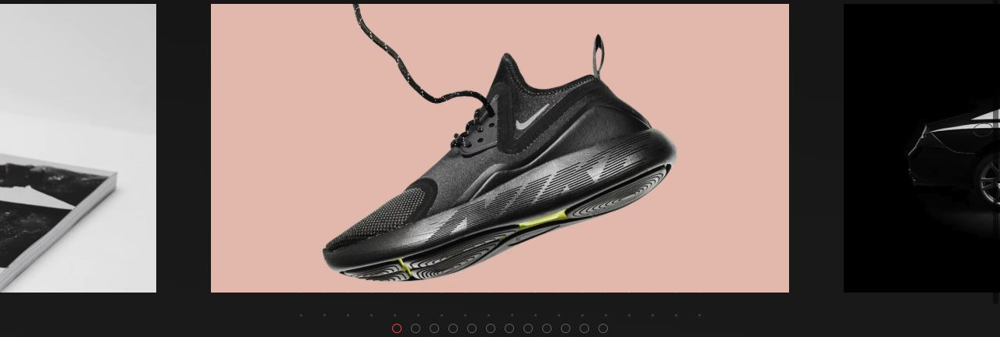

# Caroselli: Design Escapes e Vision

[Indice del catalogo](README.md)

La differenza riguarda la composizione e il comportamento oltre allo stile. Le osservazioni qui sotto derivano dalle anteprime desktop e dalle opzioni UIkit presenti nelle demo.

## Design Escapes / Latest Homes

Fotografie ampie, spazi ridotti e testo sotto il media: località in evidenza e nome della casa. Il ritaglio lascia intravedere la scheda successiva. Utile per alloggi, prodotti o contenuti con un’etichetta sempre leggibile.

[Apri la demo](https://demo.yootheme.com/joomla/themes/design-escapes/index.php)

## Vision / Things we've made

Tre progetti affiancati nel desktop, distanze più ampie e navigazione a puntini. Titoli e azioni sono sovrapposti al media con transizioni; il markup imposta avanzamento per gruppi. Utile per portfolio e lavori da esplorare.

[Apri la demo](https://demo.yootheme.com/joomla/themes/vision/index.php)

## Design Escapes / Creating Unique Experiences

Carosello di immagini con slide attiva centrata e frecce laterali. Le immagini adiacenti restano parzialmente visibili.

[Apri la demo](https://demo.yootheme.com/joomla/themes/design-escapes/index.php?option=com_content&view=article&id=4&Itemid=110)

## Vision / Showcase

Carosello centrato di progetti con testo sovrapposto, frecce e puntini. Il markup configura avanzamento automatico ogni 6 secondi.

[Apri la demo](https://demo.yootheme.com/joomla/themes/vision/index.php?option=com_content&view=article&id=8&Itemid=119)

## Cosa comporta per gli helper

Questi esempi suggeriscono due composizioni da valutare separatamente: scheda con testo sotto il media e scheda con testo sovrapposto. Centratura, avanzamento per gruppi, puntini, frecce e autoplay sono opzioni di comportamento. Spaziature, proporzioni e tipografia possono diventare preset del tema. I nomi e i parametri dell’API restano da concordare.
