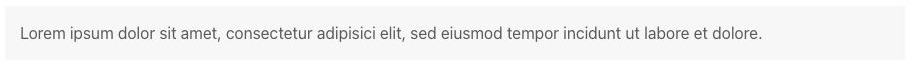
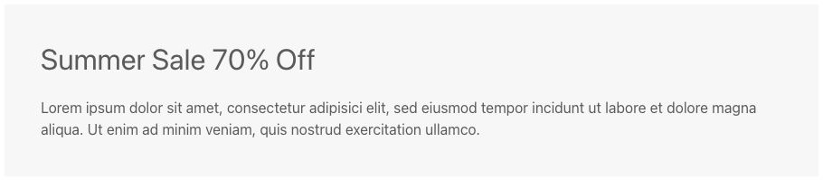
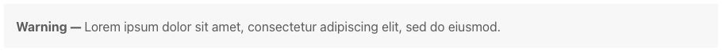
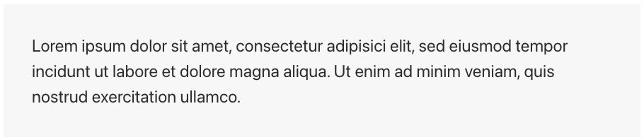

# Alert - Componenti di base

[Indice del catalogo](../README.md) · [PDF offline](../../../output/pdf/catalogo-widget-yootheme.pdf)

Messaggi di servizio e avvisi contestuali.

**Contenuti:** Titolo e testo del messaggio.

Fonte grafica: UIkit (demo elementi). Le demo generiche non dichiarano il tema originale di ogni preset; non viene dedotto dalle immagini.

| Variante | Demo |
|---|---|
| Stile base | [Esempio](https://demo.yootheme.com/joomla/elements/uikit/basic-elements/alert#alert-style-default) |
| Titolo con spaziatura interna | [Esempio](https://demo.yootheme.com/joomla/elements/uikit/basic-elements/alert#alert-title-padding) |
| Titolo in linea | [Esempio](https://demo.yootheme.com/joomla/elements/uikit/basic-elements/alert#alert-inline-title) |
| Testo introduttivo in evidenza | [Esempio](https://demo.yootheme.com/joomla/elements/uikit/basic-elements/alert#alert-content-lead) |

### Stile base

Presentazione di riferimento della famiglia, utile per confrontare le altre varianti.

[Apri la demo](https://demo.yootheme.com/joomla/elements/uikit/basic-elements/alert#alert-style-default) · Riferimento: `alert-style-default`.

### Titolo con spaziatura interna

Il titolo è inserito in un contenitore con margine interno.

[Apri la demo](https://demo.yootheme.com/joomla/elements/uikit/basic-elements/alert#alert-title-padding) · Riferimento: `alert-title-padding`.

### Titolo in linea

Titolo e testo proseguono sulla stessa riga.

[Apri la demo](https://demo.yootheme.com/joomla/elements/uikit/basic-elements/alert#alert-inline-title) · Riferimento: `alert-inline-title`.

### Testo introduttivo in evidenza

Il testo usa una misura maggiore per assumere il ruolo di introduzione.

[Apri la demo](https://demo.yootheme.com/joomla/elements/uikit/basic-elements/alert#alert-content-lead) · Riferimento: `alert-content-lead`.

