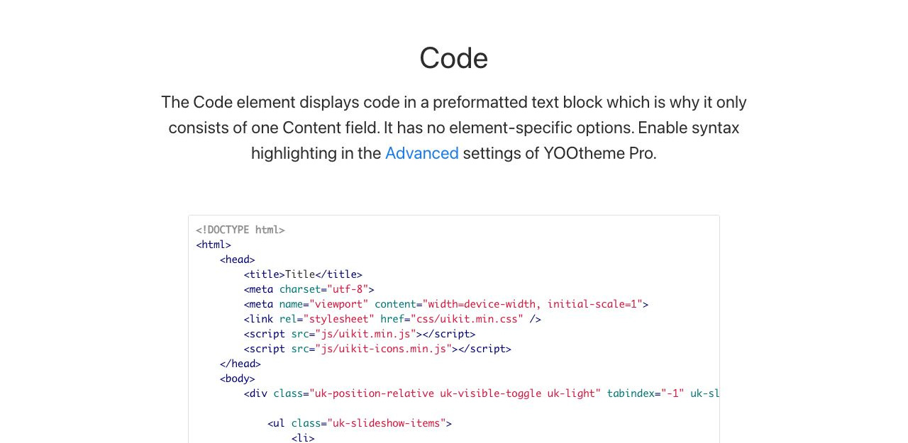

# Code - Componenti di base

[Indice del catalogo](../README.md) · [PDF offline](../../../output/pdf/catalogo-widget-yootheme.pdf)

Frammenti di codice da leggere o copiare.

**Contenuti:** Codice e linguaggio.

Fonte grafica: UIkit (demo elementi). Le demo generiche non dichiarano il tema originale di ogni preset; non viene dedotto dalle immagini.

| Variante | Demo |
|---|---|
| Esempio base | [Esempio](https://demo.yootheme.com/joomla/elements/uikit/basic-elements/code#tm-main) |

### Esempio base

Esempio introduttivo del componente nella demo ufficiale.

[Apri la demo](https://demo.yootheme.com/joomla/elements/uikit/basic-elements/code#tm-main) · Riferimento: `tm-main`.

