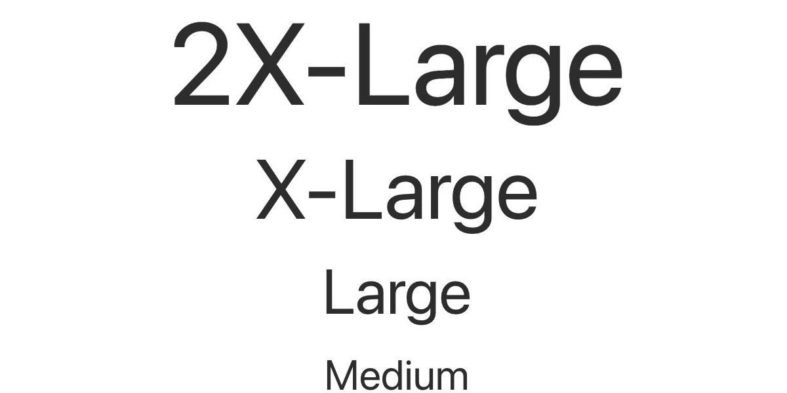
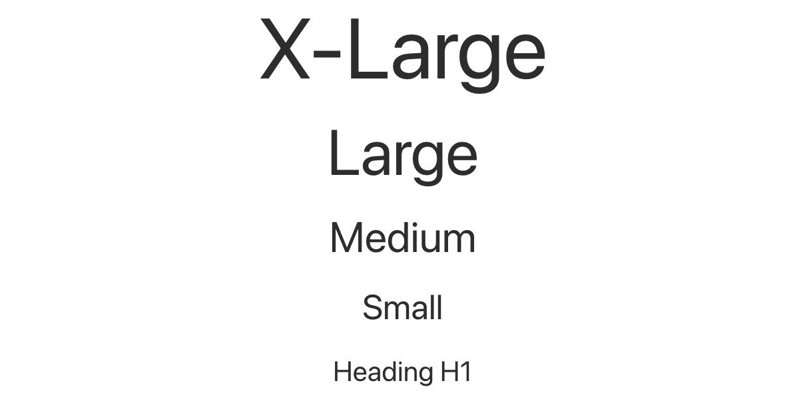
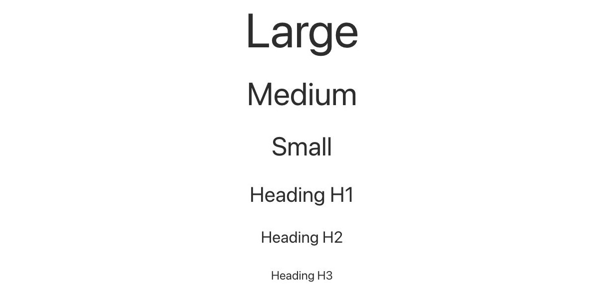
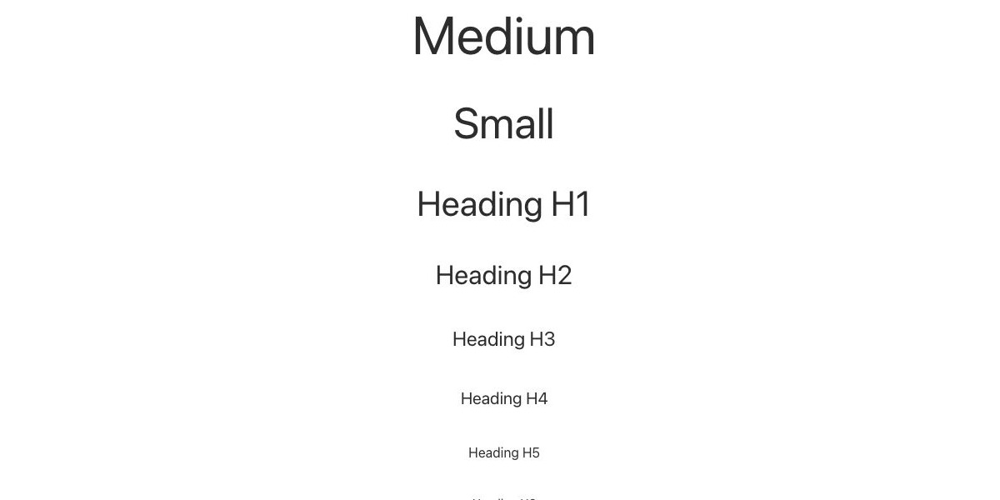
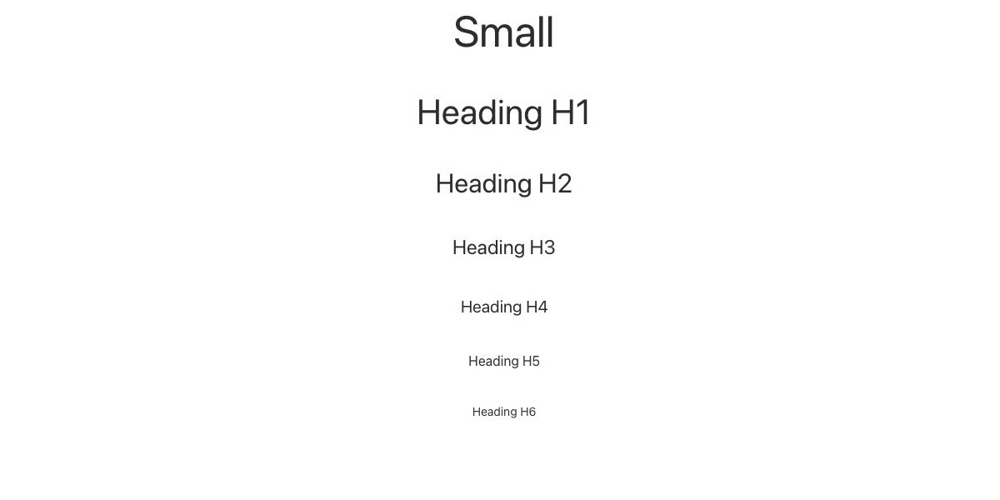
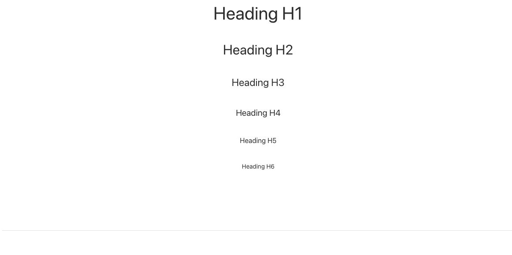
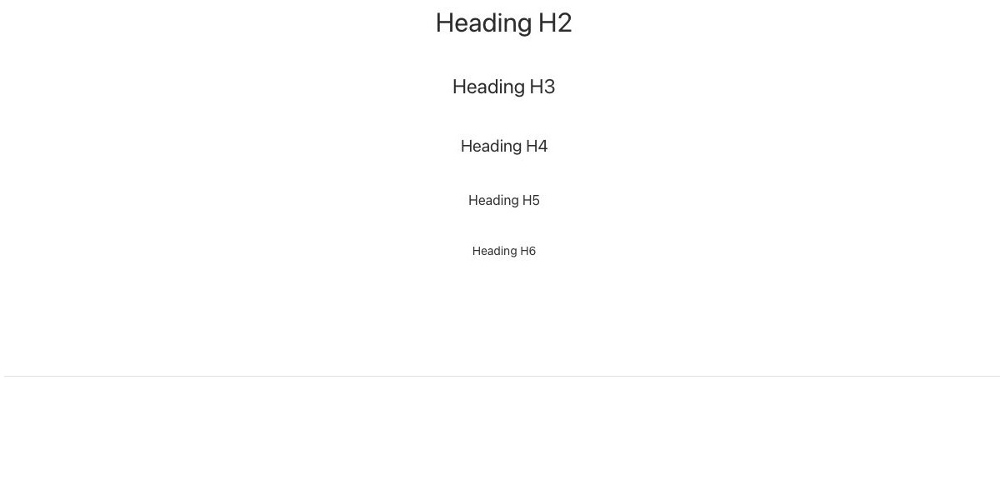
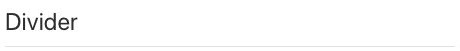
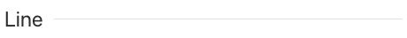
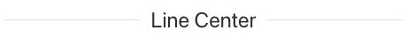

# Headline - Componenti di base

[Indice del catalogo](../README.md) · [PDF offline](../../../output/pdf/catalogo-widget-yootheme.pdf)

Titoli, introduzioni e gerarchia tipografica.

**Contenuti:** Testo e livello semantico del titolo.

Fonte grafica: UIkit (demo elementi). Le demo generiche non dichiarano il tema originale di ogni preset; non viene dedotto dalle immagini.

| Variante | Demo |
|---|---|
| Style 2xlarge | [Esempio](https://demo.yootheme.com/joomla/elements/uikit/basic-elements/headline#headline-style-2xlarge) |
| Style xlarge | [Esempio](https://demo.yootheme.com/joomla/elements/uikit/basic-elements/headline#headline-style-xlarge) |
| Style large | [Esempio](https://demo.yootheme.com/joomla/elements/uikit/basic-elements/headline#headline-style-large) |
| Style medium | [Esempio](https://demo.yootheme.com/joomla/elements/uikit/basic-elements/headline#headline-style-medium) |
| Style small | [Esempio](https://demo.yootheme.com/joomla/elements/uikit/basic-elements/headline#headline-style-small) |
| Style h1 | [Esempio](https://demo.yootheme.com/joomla/elements/uikit/basic-elements/headline#headline-style-h1) |
| Style h2 | [Esempio](https://demo.yootheme.com/joomla/elements/uikit/basic-elements/headline#headline-style-h2) |
| Style h3 | [Esempio](https://demo.yootheme.com/joomla/elements/uikit/basic-elements/headline#headline-style-h3) |
| Style h4 | [Esempio](https://demo.yootheme.com/joomla/elements/uikit/basic-elements/headline#headline-style-h4) |
| Style h5 | [Esempio](https://demo.yootheme.com/joomla/elements/uikit/basic-elements/headline#headline-style-h5) |
| Style h6 | [Esempio](https://demo.yootheme.com/joomla/elements/uikit/basic-elements/headline#headline-style-h6) |
| Decoration bullet | [Esempio](https://demo.yootheme.com/joomla/elements/uikit/basic-elements/headline#headline-decoration-bullet) |
| Decoration divider | [Esempio](https://demo.yootheme.com/joomla/elements/uikit/basic-elements/headline#headline-decoration-divider) |
| Decoration line | [Esempio](https://demo.yootheme.com/joomla/elements/uikit/basic-elements/headline#headline-decoration-line) |
| Decoration line center | [Esempio](https://demo.yootheme.com/joomla/elements/uikit/basic-elements/headline#headline-decoration-line-center) |

### Style 2xlarge

Dimensione tipografica 2xlarge per il titolo, da distinguere dal suo livello semantico HTML.

[Apri la demo](https://demo.yootheme.com/joomla/elements/uikit/basic-elements/headline#headline-style-2xlarge) · Riferimento: `headline-style-2xlarge`.

### Style xlarge

Dimensione tipografica xlarge per il titolo, da distinguere dal suo livello semantico HTML.

[Apri la demo](https://demo.yootheme.com/joomla/elements/uikit/basic-elements/headline#headline-style-xlarge) · Riferimento: `headline-style-xlarge`.

### Style large

Dimensione tipografica large per il titolo, da distinguere dal suo livello semantico HTML.

[Apri la demo](https://demo.yootheme.com/joomla/elements/uikit/basic-elements/headline#headline-style-large) · Riferimento: `headline-style-large`.

### Style medium

Dimensione tipografica medium per il titolo, da distinguere dal suo livello semantico HTML.

[Apri la demo](https://demo.yootheme.com/joomla/elements/uikit/basic-elements/headline#headline-style-medium) · Riferimento: `headline-style-medium`.

### Style small

Dimensione tipografica small per il titolo, da distinguere dal suo livello semantico HTML.

[Apri la demo](https://demo.yootheme.com/joomla/elements/uikit/basic-elements/headline#headline-style-small) · Riferimento: `headline-style-small`.

### Style h1

Dimensione tipografica h1 per il titolo, da distinguere dal suo livello semantico HTML.

[Apri la demo](https://demo.yootheme.com/joomla/elements/uikit/basic-elements/headline#headline-style-h1) · Riferimento: `headline-style-h1`.

### Style h2

Dimensione tipografica h2 per il titolo, da distinguere dal suo livello semantico HTML.

[Apri la demo](https://demo.yootheme.com/joomla/elements/uikit/basic-elements/headline#headline-style-h2) · Riferimento: `headline-style-h2`.

### Style h3

Dimensione tipografica h3 per il titolo, da distinguere dal suo livello semantico HTML.

[Apri la demo](https://demo.yootheme.com/joomla/elements/uikit/basic-elements/headline#headline-style-h3) · Riferimento: `headline-style-h3`.

### Style h4

Dimensione tipografica h4 per il titolo, da distinguere dal suo livello semantico HTML.

[Apri la demo](https://demo.yootheme.com/joomla/elements/uikit/basic-elements/headline#headline-style-h4) · Riferimento: `headline-style-h4`.

### Style h5

Dimensione tipografica h5 per il titolo, da distinguere dal suo livello semantico HTML.

[Apri la demo](https://demo.yootheme.com/joomla/elements/uikit/basic-elements/headline#headline-style-h5) · Riferimento: `headline-style-h5`.

### Style h6

Dimensione tipografica h6 per il titolo, da distinguere dal suo livello semantico HTML.

[Apri la demo](https://demo.yootheme.com/joomla/elements/uikit/basic-elements/headline#headline-style-h6) · Riferimento: `headline-style-h6`.

### Decoration bullet

Una decorazione accompagna il titolo o il media: bullet.

[Apri la demo](https://demo.yootheme.com/joomla/elements/uikit/basic-elements/headline#headline-decoration-bullet) · Riferimento: `headline-decoration-bullet`.

### Decoration divider

Linee divisorie separano le voci o le parti del contenuto.

[Apri la demo](https://demo.yootheme.com/joomla/elements/uikit/basic-elements/headline#headline-decoration-divider) · Riferimento: `headline-decoration-divider`.

### Decoration line

Una decorazione accompagna il titolo o il media: line.

[Apri la demo](https://demo.yootheme.com/joomla/elements/uikit/basic-elements/headline#headline-decoration-line) · Riferimento: `headline-decoration-line`.

### Decoration line center

Una decorazione accompagna il titolo o il media: line center.

[Apri la demo](https://demo.yootheme.com/joomla/elements/uikit/basic-elements/headline#headline-decoration-line-center) · Riferimento: `headline-decoration-line-center`.

