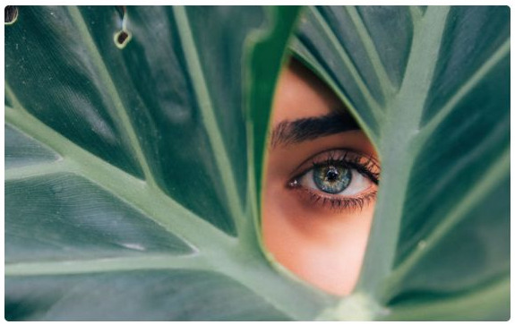
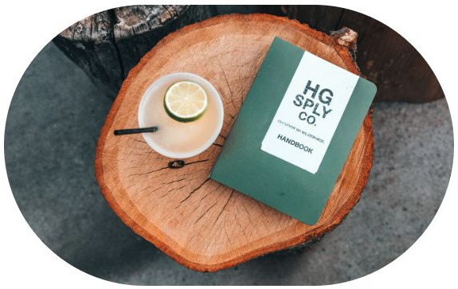
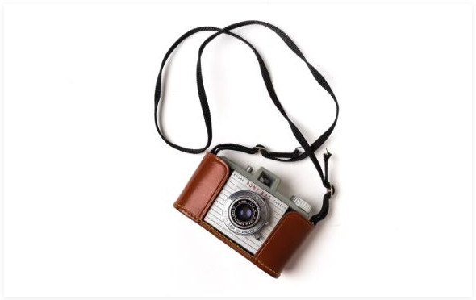
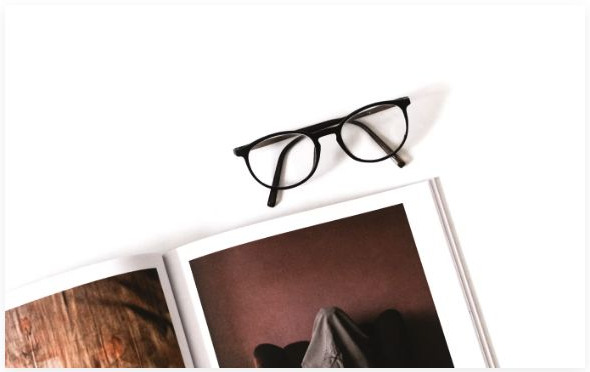
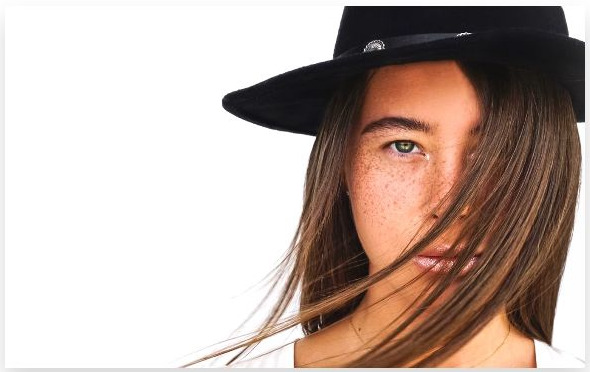
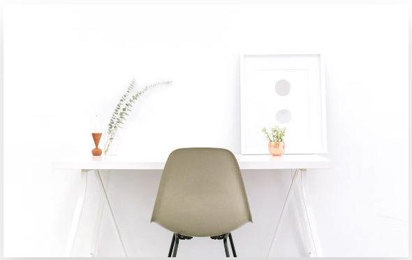
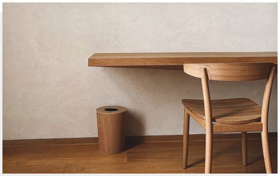

# Image - Componenti di base

[Indice del catalogo](../README.md) · [PDF offline](../../../output/pdf/catalogo-widget-yootheme.pdf)

Immagini singole con decorazioni, forme o apertura modale.

**Contenuti:** Media, testo alternativo e link opzionale.

Fonte grafica: UIkit (demo elementi). Le demo generiche non dichiarano il tema originale di ogni preset; non viene dedotto dalle immagini.

| Variante | Demo |
|---|---|
| Border rounded | [Esempio](https://demo.yootheme.com/joomla/elements/uikit/basic-elements/image#image-border-rounded) |
| Border pill | [Esempio](https://demo.yootheme.com/joomla/elements/uikit/basic-elements/image#image-border-pill) |
| Border circle | [Esempio](https://demo.yootheme.com/joomla/elements/uikit/basic-elements/image#image-border-circle) |
| Box shadow small | [Esempio](https://demo.yootheme.com/joomla/elements/uikit/basic-elements/image#image-box-shadow-small) |
| Box shadow medium | [Esempio](https://demo.yootheme.com/joomla/elements/uikit/basic-elements/image#image-box-shadow-medium) |
| Box shadow large | [Esempio](https://demo.yootheme.com/joomla/elements/uikit/basic-elements/image#image-box-shadow-large) |
| Box shadow xlarge | [Esempio](https://demo.yootheme.com/joomla/elements/uikit/basic-elements/image#image-box-shadow-xlarge) |
| Box decoration default | [Esempio](https://demo.yootheme.com/joomla/elements/uikit/basic-elements/image#image-box-decoration-default) |
| Box decoration floating shadow | [Esempio](https://demo.yootheme.com/joomla/elements/uikit/basic-elements/image#image-box-decoration-floating-shadow) |
| Box decoration mask | [Esempio](https://demo.yootheme.com/joomla/elements/uikit/basic-elements/image#image-box-decoration-mask) |
| SVG integrato | [Esempio](https://demo.yootheme.com/joomla/elements/uikit/basic-elements/image#image-svg-inline) |
| Apertura di immagini in modale | [Esempio](https://demo.yootheme.com/joomla/elements/uikit/basic-elements/image#image-modal-image) |
| Apertura di video in modale | [Esempio](https://demo.yootheme.com/joomla/elements/uikit/basic-elements/image#image-modal-video) |

### Border rounded

Angoli arrotondati.

[Apri la demo](https://demo.yootheme.com/joomla/elements/uikit/basic-elements/image#image-border-rounded) · Riferimento: `image-border-rounded`.

### Border pill

Ritaglio fortemente arrotondato.

[Apri la demo](https://demo.yootheme.com/joomla/elements/uikit/basic-elements/image#image-border-pill) · Riferimento: `image-border-pill`.

### Border circle

Ritaglio circolare.

[Apri la demo](https://demo.yootheme.com/joomla/elements/uikit/basic-elements/image#image-border-circle) · Riferimento: `image-border-circle`.

### Box shadow small

Un’ombra separa visivamente l’immagine dallo sfondo; la demo confronta intensità e dimensione della decorazione.

[Apri la demo](https://demo.yootheme.com/joomla/elements/uikit/basic-elements/image#image-box-shadow-small) · Riferimento: `image-box-shadow-small`.

### Box shadow medium

Un’ombra separa visivamente l’immagine dallo sfondo; la demo confronta intensità e dimensione della decorazione.

[Apri la demo](https://demo.yootheme.com/joomla/elements/uikit/basic-elements/image#image-box-shadow-medium) · Riferimento: `image-box-shadow-medium`.

### Box shadow large

Un’ombra separa visivamente l’immagine dallo sfondo; la demo confronta intensità e dimensione della decorazione.

[Apri la demo](https://demo.yootheme.com/joomla/elements/uikit/basic-elements/image#image-box-shadow-large) · Riferimento: `image-box-shadow-large`.

### Box shadow xlarge

Un’ombra separa visivamente l’immagine dallo sfondo; la demo confronta intensità e dimensione della decorazione.

[Apri la demo](https://demo.yootheme.com/joomla/elements/uikit/basic-elements/image#image-box-shadow-xlarge) · Riferimento: `image-box-shadow-xlarge`.

### Box decoration default

Una decorazione accompagna il titolo o il media: default.

[Apri la demo](https://demo.yootheme.com/joomla/elements/uikit/basic-elements/image#image-box-decoration-default) · Riferimento: `image-box-decoration-default`.

### Box decoration floating shadow

Un’ombra separa visivamente l’immagine dallo sfondo; la demo confronta intensità e dimensione della decorazione.

[Apri la demo](https://demo.yootheme.com/joomla/elements/uikit/basic-elements/image#image-box-decoration-floating-shadow) · Riferimento: `image-box-decoration-floating-shadow`.

### Box decoration mask

Una decorazione accompagna il titolo o il media: mask.

[Apri la demo](https://demo.yootheme.com/joomla/elements/uikit/basic-elements/image#image-box-decoration-mask) · Riferimento: `image-box-decoration-mask`.

### SVG integrato

L’immagine SVG è integrata nel markup della pagina.

[Apri la demo](https://demo.yootheme.com/joomla/elements/uikit/basic-elements/image#image-svg-inline) · Riferimento: `image-svg-inline`.

### Apertura di immagini in modale

Il collegamento apre una finestra modale.

[Apri la demo](https://demo.yootheme.com/joomla/elements/uikit/basic-elements/image#image-modal-image) · Riferimento: `image-modal-image`.

### Apertura di video in modale

Il collegamento apre una finestra modale.

[Apri la demo](https://demo.yootheme.com/joomla/elements/uikit/basic-elements/image#image-modal-video) · Riferimento: `image-modal-video`.

