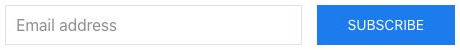
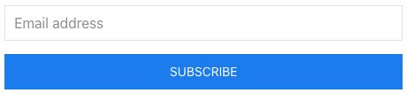
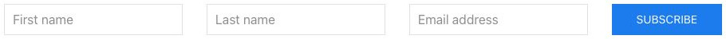
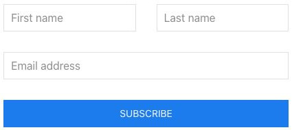
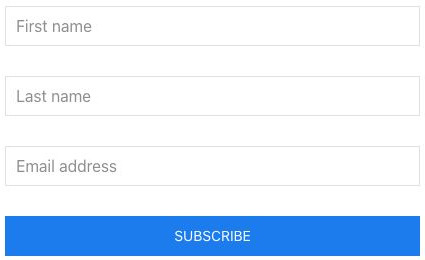
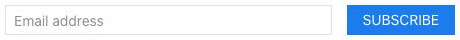
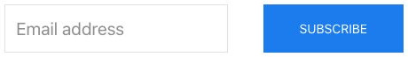
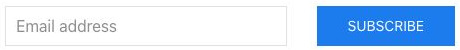
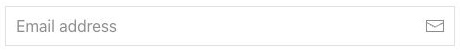

# Newsletter - Componenti di base

[Indice del catalogo](../README.md) · [PDF offline](../../../output/pdf/catalogo-widget-yootheme.pdf)

Moduli di iscrizione a una newsletter.

**Contenuti:** Campi, etichette e servizio destinatario configurato.

Fonte grafica: UIkit (demo elementi). Le demo generiche non dichiarano il tema originale di ogni preset; non viene dedotto dalle immagini.

| Variante | Demo |
|---|---|
| Size default | [Esempio](https://demo.yootheme.com/joomla/elements/uikit/basic-elements/newsletter#newsletter-size-default) |
| Disposizione verticale | [Esempio](https://demo.yootheme.com/joomla/elements/uikit/basic-elements/newsletter#newsletter-layout-stacked) |
| Campi del nome affiancati | [Esempio](https://demo.yootheme.com/joomla/elements/uikit/basic-elements/newsletter#newsletter-name-fields-grid) |
| Modulo con righe e colonne | [Esempio](https://demo.yootheme.com/joomla/elements/uikit/basic-elements/newsletter#newsletter-name-fields-stacked-grid) |
| Campi del nome in verticale | [Esempio](https://demo.yootheme.com/joomla/elements/uikit/basic-elements/newsletter#newsletter-name-fields-stacked) |
| Size small | [Esempio](https://demo.yootheme.com/joomla/elements/uikit/basic-elements/newsletter#newsletter-size-small) |
| Size large | [Esempio](https://demo.yootheme.com/joomla/elements/uikit/basic-elements/newsletter#newsletter-size-large) |
| Campo essenziale | [Esempio](https://demo.yootheme.com/joomla/elements/uikit/basic-elements/newsletter#newsletter-style-blank) |
| Invio tramite icona | [Esempio](https://demo.yootheme.com/joomla/elements/uikit/basic-elements/newsletter#newsletter-mode-icon) |

### Size default

Variante di dimensione default del componente.

[Apri la demo](https://demo.yootheme.com/joomla/elements/uikit/basic-elements/newsletter#newsletter-size-default) · Riferimento: `newsletter-size-default`.

### Disposizione verticale

Le parti del contenuto sono impilate invece di affiancate.

[Apri la demo](https://demo.yootheme.com/joomla/elements/uikit/basic-elements/newsletter#newsletter-layout-stacked) · Riferimento: `newsletter-layout-stacked`.

### Campi del nome affiancati

I campi del modulo sono organizzati su una griglia orizzontale.

[Apri la demo](https://demo.yootheme.com/joomla/elements/uikit/basic-elements/newsletter#newsletter-name-fields-grid) · Riferimento: `newsletter-name-fields-grid`.

### Modulo con righe e colonne

Il modulo combina campi affiancati e righe a tutta larghezza.

[Apri la demo](https://demo.yootheme.com/joomla/elements/uikit/basic-elements/newsletter#newsletter-name-fields-stacked-grid) · Riferimento: `newsletter-name-fields-stacked-grid`.

### Campi del nome in verticale

I campi del modulo sono disposti uno sotto l’altro.

[Apri la demo](https://demo.yootheme.com/joomla/elements/uikit/basic-elements/newsletter#newsletter-name-fields-stacked) · Riferimento: `newsletter-name-fields-stacked`.

### Size small

Variante di dimensione small del componente.

[Apri la demo](https://demo.yootheme.com/joomla/elements/uikit/basic-elements/newsletter#newsletter-size-small) · Riferimento: `newsletter-size-small`.

### Size large

Variante di dimensione large del componente.

[Apri la demo](https://demo.yootheme.com/joomla/elements/uikit/basic-elements/newsletter#newsletter-size-large) · Riferimento: `newsletter-size-large`.

### Campo essenziale

Il campo del modulo usa una presentazione senza il normale contenitore visibile.

[Apri la demo](https://demo.yootheme.com/joomla/elements/uikit/basic-elements/newsletter#newsletter-style-blank) · Riferimento: `newsletter-style-blank`.

### Invio tramite icona

L’azione di invio usa un’icona accanto al campo.

[Apri la demo](https://demo.yootheme.com/joomla/elements/uikit/basic-elements/newsletter#newsletter-mode-icon) · Riferimento: `newsletter-mode-icon`.

