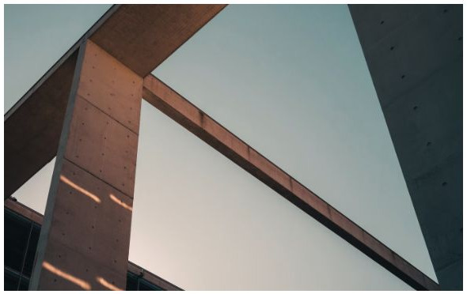
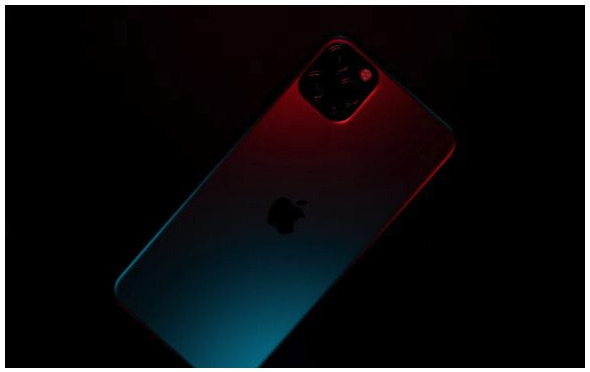
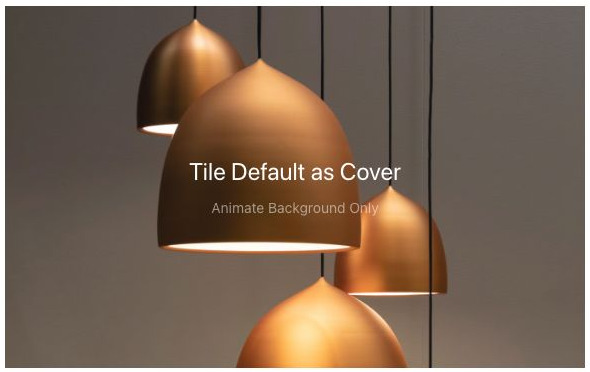
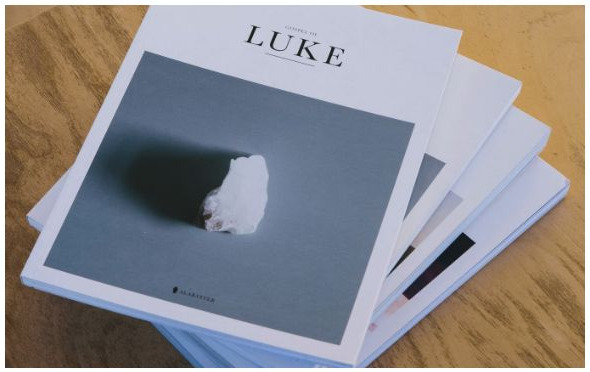
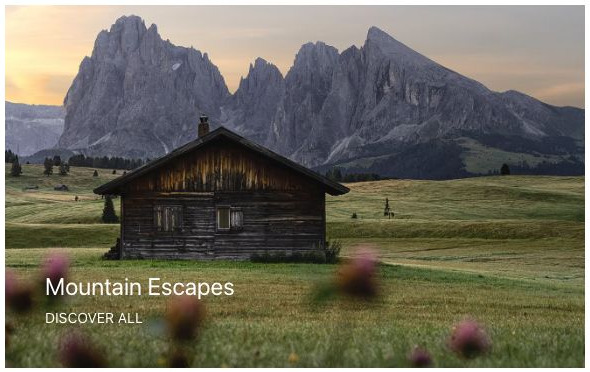
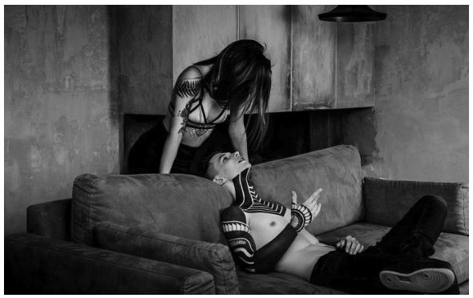
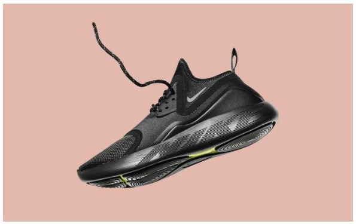
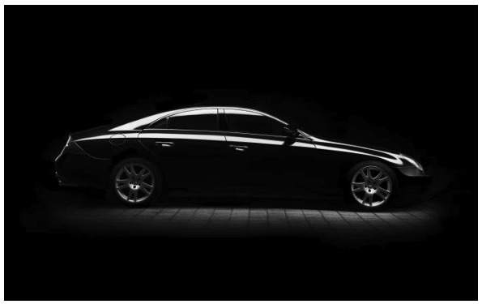
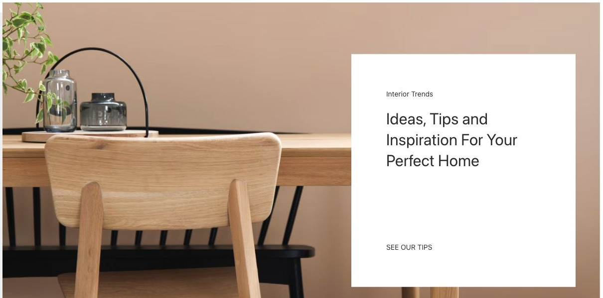

# Overlay - Componenti di base

[Indice del catalogo](../README.md) · [PDF offline](../../../output/pdf/catalogo-widget-yootheme.pdf)

Immagine o video con un livello di testo sovrapposto.

**Contenuti:** Media e contenuto sovrapposto.

Fonte grafica: UIkit (demo elementi). Le demo generiche non dichiarano il tema originale di ogni preset; non viene dedotto dalle immagini.

| Variante | Demo |
|---|---|
| Contenuto al centro a sinistra | [Esempio](https://demo.yootheme.com/joomla/elements/uikit/basic-elements/overlay#overlay-content-center-left) |
| Tile default cover hover | [Esempio](https://demo.yootheme.com/joomla/elements/uikit/basic-elements/overlay#overlay-tile-default-cover-hover) |
| Tile default caption hover | [Esempio](https://demo.yootheme.com/joomla/elements/uikit/basic-elements/overlay#overlay-tile-default-caption-hover) |
| Tile default cover hover bg only | [Esempio](https://demo.yootheme.com/joomla/elements/uikit/basic-elements/overlay#overlay-tile-default-cover-hover-bg-only) |
| Overlay default cover hover | [Esempio](https://demo.yootheme.com/joomla/elements/uikit/basic-elements/overlay#overlay-overlay-default-cover-hover) |
| Overlay default caption hover | [Esempio](https://demo.yootheme.com/joomla/elements/uikit/basic-elements/overlay#overlay-overlay-default-caption-hover) |
| Posizione centrale in alto | [Esempio](https://demo.yootheme.com/joomla/elements/uikit/basic-elements/overlay#overlay-position-top-center) |
| Posizione centrale in basso | [Esempio](https://demo.yootheme.com/joomla/elements/uikit/basic-elements/overlay#overlay-position-bottom-center) |
| Riduzione dell’immagine | [Esempio](https://demo.yootheme.com/joomla/elements/uikit/basic-elements/overlay#overlay-image-transition-scale-down) |
| Ingrandimento dell’immagine | [Esempio](https://demo.yootheme.com/joomla/elements/uikit/basic-elements/overlay#overlay-image-transition-scale-up) |
| Image transition hover image | [Esempio](https://demo.yootheme.com/joomla/elements/uikit/basic-elements/overlay#overlay-image-transition-hover-image) |
| Testo con transizione verticale | [Esempio](https://demo.yootheme.com/joomla/elements/uikit/basic-elements/overlay#overlay-text-transition-slide-top-bottom) |
| Testo con transizione orizzontale | [Esempio](https://demo.yootheme.com/joomla/elements/uikit/basic-elements/overlay#overlay-text-transition-slide-left-right) |
| Collegamento su titolo e pulsante | [Esempio](https://demo.yootheme.com/joomla/elements/uikit/basic-elements/overlay#overlay-link-title-button) |
| Intera scheda cliccabile | [Esempio](https://demo.yootheme.com/joomla/elements/uikit/basic-elements/overlay#overlay-link-all) |
| Contenuto al centro a destra | [Esempio](https://demo.yootheme.com/joomla/elements/uikit/basic-elements/overlay#overlay-content-center-right) |
| Didascalia in riquadro a destra | [Esempio](https://demo.yootheme.com/joomla/elements/uikit/basic-elements/overlay#overlay-content-tile-caption-right-center) |

### Contenuto al centro a sinistra

Il testo è centrato verticalmente nella parte sinistra del media.

[Apri la demo](https://demo.yootheme.com/joomla/elements/uikit/basic-elements/overlay#overlay-content-center-left) · Riferimento: `overlay-content-center-left`.

### Tile default cover hover

Una parte del contenuto cambia o compare al passaggio del mouse.

[Apri la demo](https://demo.yootheme.com/joomla/elements/uikit/basic-elements/overlay#overlay-tile-default-cover-hover) · Riferimento: `overlay-tile-default-cover-hover`.

### Tile default caption hover

Una parte del contenuto cambia o compare al passaggio del mouse.

[Apri la demo](https://demo.yootheme.com/joomla/elements/uikit/basic-elements/overlay#overlay-tile-default-caption-hover) · Riferimento: `overlay-tile-default-caption-hover`.

### Tile default cover hover bg only

Una parte del contenuto cambia o compare al passaggio del mouse.

[Apri la demo](https://demo.yootheme.com/joomla/elements/uikit/basic-elements/overlay#overlay-tile-default-cover-hover-bg-only) · Riferimento: `overlay-tile-default-cover-hover-bg-only`.

### Overlay default cover hover

Una parte del contenuto cambia o compare al passaggio del mouse.

[Apri la demo](https://demo.yootheme.com/joomla/elements/uikit/basic-elements/overlay#overlay-overlay-default-cover-hover) · Riferimento: `overlay-overlay-default-cover-hover`.

### Overlay default caption hover

Una parte del contenuto cambia o compare al passaggio del mouse.

[Apri la demo](https://demo.yootheme.com/joomla/elements/uikit/basic-elements/overlay#overlay-overlay-default-caption-hover) · Riferimento: `overlay-overlay-default-caption-hover`.

### Posizione centrale in alto

Il contenuto è centrato nella parte superiore del media.

[Apri la demo](https://demo.yootheme.com/joomla/elements/uikit/basic-elements/overlay#overlay-position-top-center) · Riferimento: `overlay-position-top-center`.

### Posizione centrale in basso

Il contenuto è centrato sul bordo inferiore del media.

[Apri la demo](https://demo.yootheme.com/joomla/elements/uikit/basic-elements/overlay#overlay-position-bottom-center) · Riferimento: `overlay-position-bottom-center`.

### Riduzione dell’immagine

La transizione riduce la scala del media.

[Apri la demo](https://demo.yootheme.com/joomla/elements/uikit/basic-elements/overlay#overlay-image-transition-scale-down) · Riferimento: `overlay-image-transition-scale-down`.

### Ingrandimento dell’immagine

La transizione aumenta la scala del media.

[Apri la demo](https://demo.yootheme.com/joomla/elements/uikit/basic-elements/overlay#overlay-image-transition-scale-up) · Riferimento: `overlay-image-transition-scale-up`.

### Image transition hover image

Una parte del contenuto cambia o compare al passaggio del mouse.

[Apri la demo](https://demo.yootheme.com/joomla/elements/uikit/basic-elements/overlay#overlay-image-transition-hover-image) · Riferimento: `overlay-image-transition-hover-image`.

### Testo con transizione verticale

Il testo entra o esce con movimenti dall’alto e dal basso.

[Apri la demo](https://demo.yootheme.com/joomla/elements/uikit/basic-elements/overlay#overlay-text-transition-slide-top-bottom) · Riferimento: `overlay-text-transition-slide-top-bottom`.

### Testo con transizione orizzontale

Il testo entra o esce lateralmente.

[Apri la demo](https://demo.yootheme.com/joomla/elements/uikit/basic-elements/overlay#overlay-text-transition-slide-left-right) · Riferimento: `overlay-text-transition-slide-left-right`.

### Collegamento su titolo e pulsante

Titolo e azione esplicita rimandano alla destinazione.

[Apri la demo](https://demo.yootheme.com/joomla/elements/uikit/basic-elements/overlay#overlay-link-title-button) · Riferimento: `overlay-link-title-button`.

### Intera scheda cliccabile

Il collegamento comprende l’intera scheda.

[Apri la demo](https://demo.yootheme.com/joomla/elements/uikit/basic-elements/overlay#overlay-link-all) · Riferimento: `overlay-link-all`.

### Contenuto al centro a destra

Il testo è centrato verticalmente nella parte destra del media.

[Apri la demo](https://demo.yootheme.com/joomla/elements/uikit/basic-elements/overlay#overlay-content-center-right) · Riferimento: `overlay-content-center-right`.

### Didascalia in riquadro a destra

Il testo è raccolto in un riquadro sul lato destro dell’immagine.

[Apri la demo](https://demo.yootheme.com/joomla/elements/uikit/basic-elements/overlay#overlay-content-tile-caption-right-center) · Riferimento: `overlay-content-tile-caption-right-center`.

