# Panel - Componenti di base

[Indice del catalogo](../README.md) · [PDF offline](../../../output/pdf/catalogo-widget-yootheme.pdf)

Scheda singola da riusare nelle griglie e nei caroselli.

**Contenuti:** Immagine, titolo, meta, testo e azione.

Fonte grafica: UIkit (demo elementi). Le demo generiche non dichiarano il tema originale di ogni preset; non viene dedotto dalle immagini.

| Variante | Demo |
|---|---|
| Immagine sopra | [Esempio](https://demo.yootheme.com/joomla/elements/uikit/basic-elements/panel#panel-image-top) |
| Style card default | [Esempio](https://demo.yootheme.com/joomla/elements/uikit/basic-elements/panel#panel-style-card-default) |
| Style card hover | [Esempio](https://demo.yootheme.com/joomla/elements/uikit/basic-elements/panel#panel-style-card-hover) |
| Senza contenitore decorativo | [Esempio](https://demo.yootheme.com/joomla/elements/uikit/basic-elements/panel#panel-style-none) |
| Collegamento su titolo e immagine | [Esempio](https://demo.yootheme.com/joomla/elements/uikit/basic-elements/panel#panel-link-title-image) |
| Pannello come collegamento | [Esempio](https://demo.yootheme.com/joomla/elements/uikit/basic-elements/panel#panel-link-panel) |
| Intera scheda cliccabile | [Esempio](https://demo.yootheme.com/joomla/elements/uikit/basic-elements/panel#panel-link-all) |
| Titolo a sinistra, metadati sotto | [Esempio](https://demo.yootheme.com/joomla/elements/uikit/basic-elements/panel#panel-title-left-meta-below) |
| Titolo a sinistra, metadati sopra | [Esempio](https://demo.yootheme.com/joomla/elements/uikit/basic-elements/panel#panel-title-left-meta-above) |
| Contenuto allineato a sinistra | [Esempio](https://demo.yootheme.com/joomla/elements/uikit/basic-elements/panel#panel-content-force-left) |
| Immagine a sinistra | [Esempio](https://demo.yootheme.com/joomla/elements/uikit/basic-elements/panel#panel-image-left) |
| Immagine a destra | [Esempio](https://demo.yootheme.com/joomla/elements/uikit/basic-elements/panel#panel-image-right) |
| Image between | [Esempio](https://demo.yootheme.com/joomla/elements/uikit/basic-elements/panel#panel-image-between) |
| Content columns image right | [Esempio](https://demo.yootheme.com/joomla/elements/uikit/basic-elements/panel#panel-content-columns-image-right) |

### Immagine sopra

Immagine sopra al contenuto.

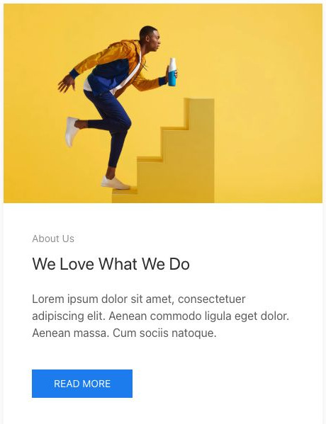

[Apri la demo](https://demo.yootheme.com/joomla/elements/uikit/basic-elements/panel#panel-image-top) · Riferimento: `panel-image-top`.

### Style card default

Il contenuto è raccolto in schede con un contenitore riconoscibile.

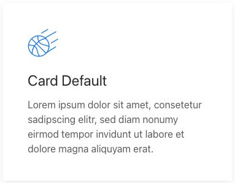

[Apri la demo](https://demo.yootheme.com/joomla/elements/uikit/basic-elements/panel#panel-style-card-default) · Riferimento: `panel-style-card-default`.

### Style card hover

Una parte del contenuto cambia o compare al passaggio del mouse.

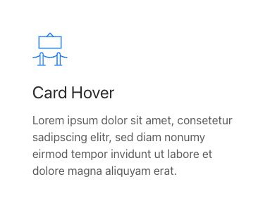

[Apri la demo](https://demo.yootheme.com/joomla/elements/uikit/basic-elements/panel#panel-style-card-hover) · Riferimento: `panel-style-card-hover`.

### Senza contenitore decorativo

Il contenuto è presentato senza la cornice di una card.

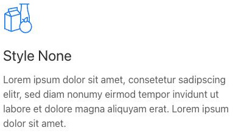

[Apri la demo](https://demo.yootheme.com/joomla/elements/uikit/basic-elements/panel#panel-style-none) · Riferimento: `panel-style-none`.

### Collegamento su titolo e immagine

Titolo e immagine sono le aree interattive della scheda.

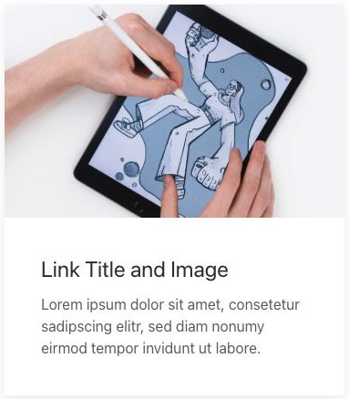

[Apri la demo](https://demo.yootheme.com/joomla/elements/uikit/basic-elements/panel#panel-link-title-image) · Riferimento: `panel-link-title-image`.

### Pannello come collegamento

Il pannello è trattato come area di collegamento.

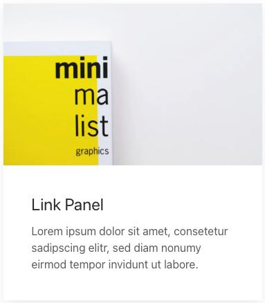

[Apri la demo](https://demo.yootheme.com/joomla/elements/uikit/basic-elements/panel#panel-link-panel) · Riferimento: `panel-link-panel`.

### Intera scheda cliccabile

Il collegamento comprende l’intera scheda.

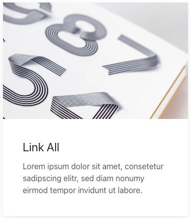

[Apri la demo](https://demo.yootheme.com/joomla/elements/uikit/basic-elements/panel#panel-link-all) · Riferimento: `panel-link-all`.

### Titolo a sinistra, metadati sotto

La composizione affianca il titolo e colloca i metadati dopo il contenuto principale.

[Apri la demo](https://demo.yootheme.com/joomla/elements/uikit/basic-elements/panel#panel-title-left-meta-below) · Riferimento: `panel-title-left-meta-below`.

### Titolo a sinistra, metadati sopra

La composizione affianca il titolo e colloca i metadati prima del contenuto principale.

[Apri la demo](https://demo.yootheme.com/joomla/elements/uikit/basic-elements/panel#panel-title-left-meta-above) · Riferimento: `panel-title-left-meta-above`.

### Contenuto allineato a sinistra

La scheda forza l’allineamento a sinistra dei contenuti.

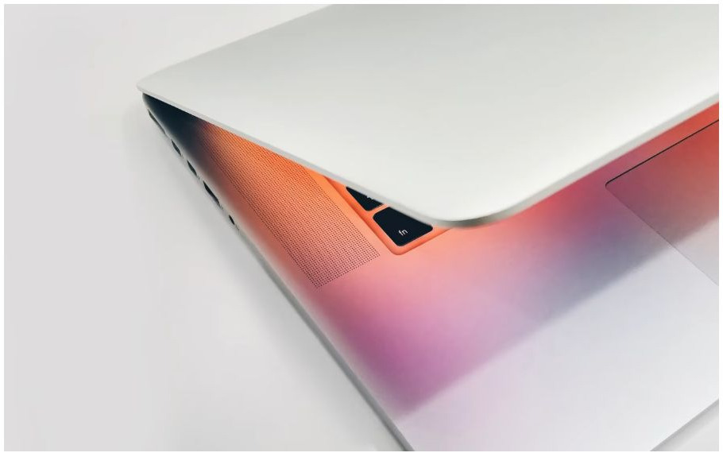

[Apri la demo](https://demo.yootheme.com/joomla/elements/uikit/basic-elements/panel#panel-content-force-left) · Riferimento: `panel-content-force-left`.

### Immagine a sinistra

Immagine affiancata a sinistra del testo.

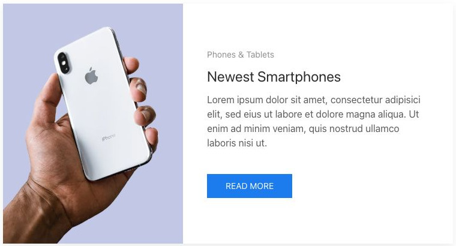

[Apri la demo](https://demo.yootheme.com/joomla/elements/uikit/basic-elements/panel#panel-image-left) · Riferimento: `panel-image-left`.

### Immagine a destra

Immagine affiancata a destra del testo.

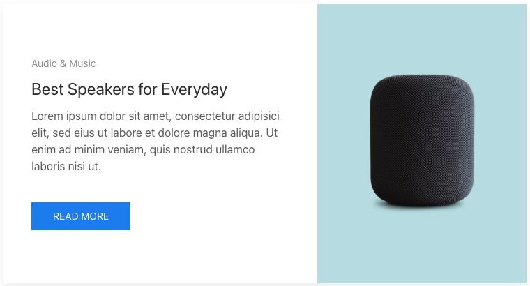

[Apri la demo](https://demo.yootheme.com/joomla/elements/uikit/basic-elements/panel#panel-image-right) · Riferimento: `panel-image-right`.

### Image between

Immagine inserita fra titolo e testo.

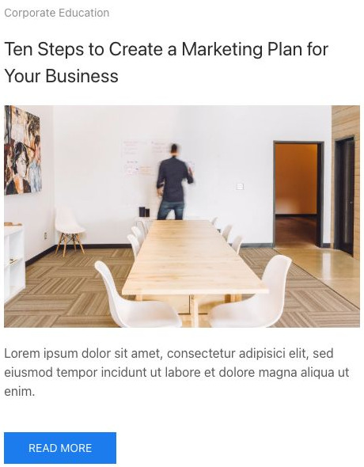

[Apri la demo](https://demo.yootheme.com/joomla/elements/uikit/basic-elements/panel#panel-image-between) · Riferimento: `panel-image-between`.

### Content columns image right

Immagine affiancata a destra del testo.

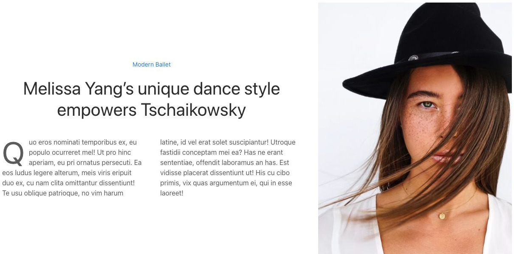

[Apri la demo](https://demo.yootheme.com/joomla/elements/uikit/basic-elements/panel#panel-content-columns-image-right) · Riferimento: `panel-content-columns-image-right`.

