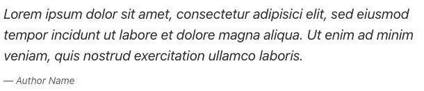
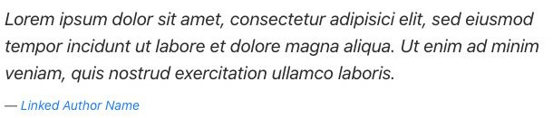

# Quotation - Componenti di base

[Indice del catalogo](../README.md) · [PDF offline](../../../output/pdf/catalogo-widget-yootheme.pdf)

Citazioni e testimonianze testuali.

**Contenuti:** Testo, autore e link opzionale.

Fonte grafica: UIkit (demo elementi). Le demo generiche non dichiarano il tema originale di ogni preset; non viene dedotto dalle immagini.

| Variante | Demo |
|---|---|
| Citazione con autore | [Esempio](https://demo.yootheme.com/joomla/elements/uikit/basic-elements/quotation#quotation-author) |
| Autore con collegamento | [Esempio](https://demo.yootheme.com/joomla/elements/uikit/basic-elements/quotation#quotation-author-link) |

### Citazione con autore

L’attribuzione compare dopo il testo della citazione.

[Apri la demo](https://demo.yootheme.com/joomla/elements/uikit/basic-elements/quotation#quotation-author) · Riferimento: `quotation-author`.

### Autore con collegamento

Il nome dell’autore è un collegamento.

[Apri la demo](https://demo.yootheme.com/joomla/elements/uikit/basic-elements/quotation#quotation-author-link) · Riferimento: `quotation-author-link`.

