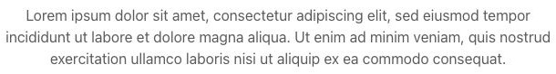
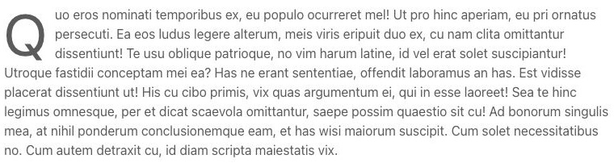
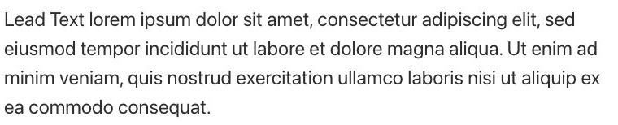
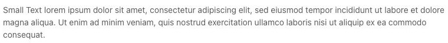
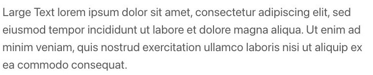
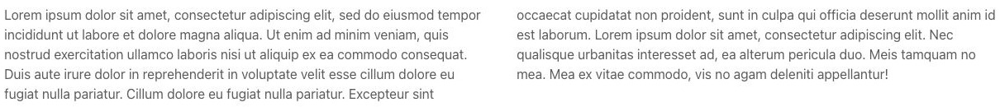
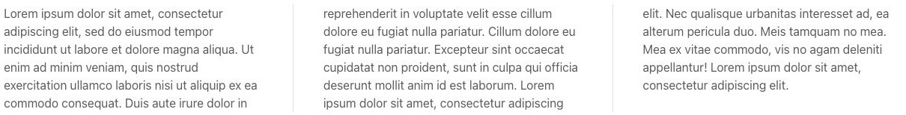

# Text - Componenti di base

[Indice del catalogo](../README.md) · [PDF offline](../../../output/pdf/catalogo-widget-yootheme.pdf)

Corpo editoriale, introduzioni e testo in colonne.

**Contenuti:** Testo formattato.

Fonte grafica: UIkit (demo elementi). Le demo generiche non dichiarano il tema originale di ogni preset; non viene dedotto dalle immagini.

| Variante | Demo |
|---|---|
| Stile base | [Esempio](https://demo.yootheme.com/joomla/elements/uikit/basic-elements/text#text-style-default) |
| Capolettera | [Esempio](https://demo.yootheme.com/joomla/elements/uikit/basic-elements/text#text-drop-cap) |
| Style meta | [Esempio](https://demo.yootheme.com/joomla/elements/uikit/basic-elements/text#text-style-meta) |
| Style lead | [Esempio](https://demo.yootheme.com/joomla/elements/uikit/basic-elements/text#text-style-lead) |
| Size small | [Esempio](https://demo.yootheme.com/joomla/elements/uikit/basic-elements/text#text-size-small) |
| Size large | [Esempio](https://demo.yootheme.com/joomla/elements/uikit/basic-elements/text#text-size-large) |
| Testo su due colonne | [Esempio](https://demo.yootheme.com/joomla/elements/uikit/basic-elements/text#text-columns-halves) |
| Testo su tre colonne con divisori | [Esempio](https://demo.yootheme.com/joomla/elements/uikit/basic-elements/text#text-columns-thirds-dividers) |

### Stile base

Presentazione di riferimento della famiglia, utile per confrontare le altre varianti.

[Apri la demo](https://demo.yootheme.com/joomla/elements/uikit/basic-elements/text#text-style-default) · Riferimento: `text-style-default`.

### Capolettera

Variazione di drop cap.

[Apri la demo](https://demo.yootheme.com/joomla/elements/uikit/basic-elements/text#text-drop-cap) · Riferimento: `text-drop-cap`.

### Style meta

Variazione di style meta.

[Apri la demo](https://demo.yootheme.com/joomla/elements/uikit/basic-elements/text#text-style-meta) · Riferimento: `text-style-meta`.

### Style lead

Variazione di style lead.

[Apri la demo](https://demo.yootheme.com/joomla/elements/uikit/basic-elements/text#text-style-lead) · Riferimento: `text-style-lead`.

### Size small

Variante di dimensione small del componente.

[Apri la demo](https://demo.yootheme.com/joomla/elements/uikit/basic-elements/text#text-size-small) · Riferimento: `text-size-small`.

### Size large

Variante di dimensione large del componente.

[Apri la demo](https://demo.yootheme.com/joomla/elements/uikit/basic-elements/text#text-size-large) · Riferimento: `text-size-large`.

### Testo su due colonne

Disposizione su due colonne.

[Apri la demo](https://demo.yootheme.com/joomla/elements/uikit/basic-elements/text#text-columns-halves) · Riferimento: `text-columns-halves`.

### Testo su tre colonne con divisori

Disposizione su tre colonne.

[Apri la demo](https://demo.yootheme.com/joomla/elements/uikit/basic-elements/text#text-columns-thirds-dividers) · Riferimento: `text-columns-thirds-dividers`.

