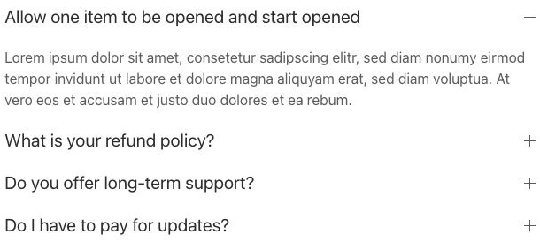
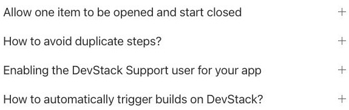
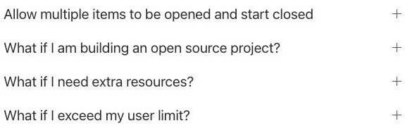
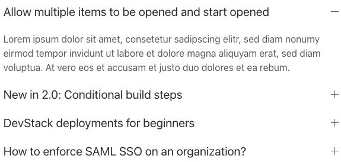
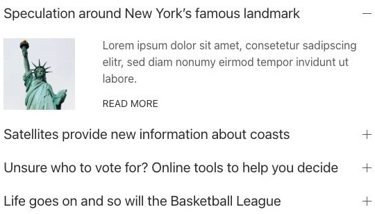
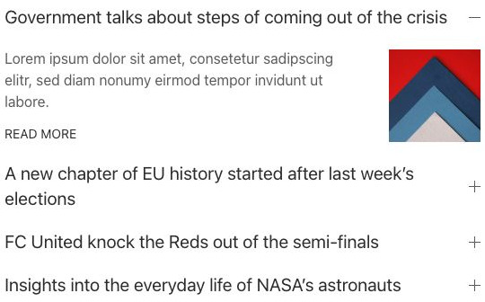
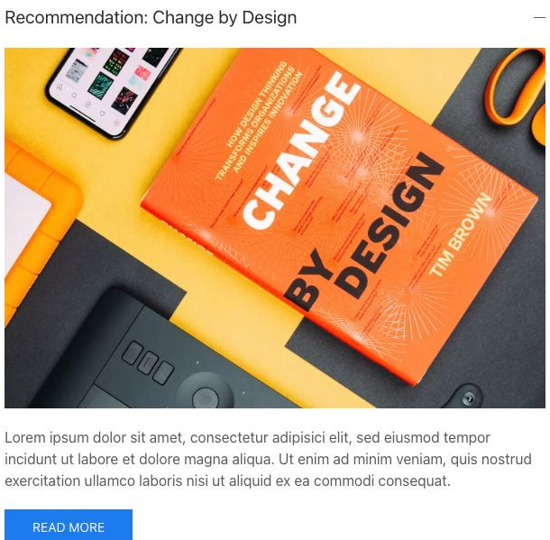

# Accordion - Elementi a raccolta

[Indice del catalogo](../README.md) · [PDF offline](../../../output/pdf/catalogo-widget-yootheme.pdf)

FAQ, dettagli tecnici e informazioni secondarie da aprire quando servono.

**Contenuti:** Titolo di apertura e contenuto di ogni pannello.

Fonte grafica: UIkit (demo elementi). Le demo generiche non dichiarano il tema originale di ogni preset; non viene dedotto dalle immagini.

| Variante | Demo |
|---|---|
| Un pannello aperto, apertura esclusiva | [Esempio](https://demo.yootheme.com/joomla/elements/uikit/multiple-items-elements/accordion#accordion-behavior-one-item-start-opened) |
| Tutto chiuso, apertura esclusiva | [Esempio](https://demo.yootheme.com/joomla/elements/uikit/multiple-items-elements/accordion#accordion-behavior-one-item-start-closed) |
| Tutto chiuso, apertura multipla | [Esempio](https://demo.yootheme.com/joomla/elements/uikit/multiple-items-elements/accordion#accordion-behavior-multiple-items-start-closed) |
| Pannelli aperti, apertura multipla | [Esempio](https://demo.yootheme.com/joomla/elements/uikit/multiple-items-elements/accordion#accordion-behavior-multiple-items-start-opened) |
| Immagine a sinistra | [Esempio](https://demo.yootheme.com/joomla/elements/uikit/multiple-items-elements/accordion#accordion-image-left) |
| Immagine a destra | [Esempio](https://demo.yootheme.com/joomla/elements/uikit/multiple-items-elements/accordion#accordion-image-right) |
| Immagine sopra | [Esempio](https://demo.yootheme.com/joomla/elements/uikit/multiple-items-elements/accordion#accordion-image-top) |

### Un pannello aperto, apertura esclusiva

Mantiene un solo pannello aperto alla volta. La demo parte con contenuto già aperto.

[Apri la demo](https://demo.yootheme.com/joomla/elements/uikit/multiple-items-elements/accordion#accordion-behavior-one-item-start-opened) · Riferimento: `accordion-behavior-one-item-start-opened`.

### Tutto chiuso, apertura esclusiva

Mantiene un solo pannello aperto alla volta. I pannelli iniziano chiusi.

[Apri la demo](https://demo.yootheme.com/joomla/elements/uikit/multiple-items-elements/accordion#accordion-behavior-one-item-start-closed) · Riferimento: `accordion-behavior-one-item-start-closed`.

### Tutto chiuso, apertura multipla

Consente più pannelli aperti insieme. I pannelli iniziano chiusi.

[Apri la demo](https://demo.yootheme.com/joomla/elements/uikit/multiple-items-elements/accordion#accordion-behavior-multiple-items-start-closed) · Riferimento: `accordion-behavior-multiple-items-start-closed`.

### Pannelli aperti, apertura multipla

Consente più pannelli aperti insieme. La demo parte con contenuto già aperto.

[Apri la demo](https://demo.yootheme.com/joomla/elements/uikit/multiple-items-elements/accordion#accordion-behavior-multiple-items-start-opened) · Riferimento: `accordion-behavior-multiple-items-start-opened`.

### Immagine a sinistra

Immagine affiancata a sinistra del testo.

[Apri la demo](https://demo.yootheme.com/joomla/elements/uikit/multiple-items-elements/accordion#accordion-image-left) · Riferimento: `accordion-image-left`.

### Immagine a destra

Immagine affiancata a destra del testo.

[Apri la demo](https://demo.yootheme.com/joomla/elements/uikit/multiple-items-elements/accordion#accordion-image-right) · Riferimento: `accordion-image-right`.

### Immagine sopra

Immagine sopra al contenuto.

[Apri la demo](https://demo.yootheme.com/joomla/elements/uikit/multiple-items-elements/accordion#accordion-image-top) · Riferimento: `accordion-image-top`.

