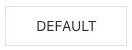
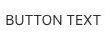
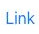
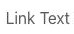
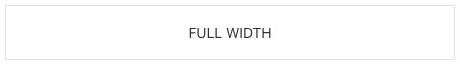
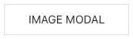
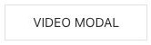
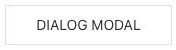
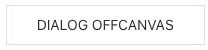

# Button - Elementi a raccolta

[Indice del catalogo](../README.md) · [PDF offline](../../../output/pdf/catalogo-widget-yootheme.pdf)

Azioni singole o gruppi di azioni, anche per aprire dialoghi e media.

**Contenuti:** Etichetta, link o contenuto del dialogo, icona opzionale.

Fonte grafica: UIkit (demo elementi). Le demo generiche non dichiarano il tema originale di ogni preset; non viene dedotto dalle immagini.

| Variante | Demo |
|---|---|
| Stile base | [Esempio](https://demo.yootheme.com/joomla/elements/uikit/multiple-items-elements/button#button-style-default) |
| Pulsante testuale | [Esempio](https://demo.yootheme.com/joomla/elements/uikit/multiple-items-elements/button#button-style-text) |
| Aspetto da collegamento | [Esempio](https://demo.yootheme.com/joomla/elements/uikit/multiple-items-elements/button#button-style-link) |
| Collegamento integrato nel testo | [Esempio](https://demo.yootheme.com/joomla/elements/uikit/multiple-items-elements/button#button-style-link-text) |
| Larghezza completa | [Esempio](https://demo.yootheme.com/joomla/elements/uikit/multiple-items-elements/button#button-full-width-default) |
| Gap small | [Esempio](https://demo.yootheme.com/joomla/elements/uikit/multiple-items-elements/button#button-gap-small) |
| Gap medium | [Esempio](https://demo.yootheme.com/joomla/elements/uikit/multiple-items-elements/button#button-gap-medium) |
| Gap large | [Esempio](https://demo.yootheme.com/joomla/elements/uikit/multiple-items-elements/button#button-gap-large) |
| Icona a sinistra | [Esempio](https://demo.yootheme.com/joomla/elements/uikit/multiple-items-elements/button#button-icon-left) |
| Icona a destra | [Esempio](https://demo.yootheme.com/joomla/elements/uikit/multiple-items-elements/button#button-icon-right) |
| Apertura di immagini in modale | [Esempio](https://demo.yootheme.com/joomla/elements/uikit/multiple-items-elements/button#button-modal-image) |
| Apertura di video in modale | [Esempio](https://demo.yootheme.com/joomla/elements/uikit/multiple-items-elements/button#button-modal-video) |
| Dialogo modale | [Esempio](https://demo.yootheme.com/joomla/elements/uikit/multiple-items-elements/button#button-dialog-modal) |
| Pannello laterale offcanvas | [Esempio](https://demo.yootheme.com/joomla/elements/uikit/multiple-items-elements/button#button-dialog-offcanvas) |

### Stile base

Presentazione di riferimento della famiglia, utile per confrontare le altre varianti.

[Apri la demo](https://demo.yootheme.com/joomla/elements/uikit/multiple-items-elements/button#button-style-default) · Riferimento: `button-style-default`.

### Pulsante testuale

Azione presentata come testo, senza il contenitore di un pulsante tradizionale.

[Apri la demo](https://demo.yootheme.com/joomla/elements/uikit/multiple-items-elements/button#button-style-text) · Riferimento: `button-style-text`.

### Aspetto da collegamento

L’azione mantiene l’aspetto di un collegamento testuale.

[Apri la demo](https://demo.yootheme.com/joomla/elements/uikit/multiple-items-elements/button#button-style-link) · Riferimento: `button-style-link`.

### Collegamento integrato nel testo

Il link si integra nella tipografia del contenuto.

[Apri la demo](https://demo.yootheme.com/joomla/elements/uikit/multiple-items-elements/button#button-style-link-text) · Riferimento: `button-style-link-text`.

### Larghezza completa

Il pulsante occupa la larghezza disponibile del contenitore.

[Apri la demo](https://demo.yootheme.com/joomla/elements/uikit/multiple-items-elements/button#button-full-width-default) · Riferimento: `button-full-width-default`.

### Gap small

Spaziatura ridotta fra gli elementi.

[Apri la demo](https://demo.yootheme.com/joomla/elements/uikit/multiple-items-elements/button#button-gap-small) · Riferimento: `button-gap-small`.

### Gap medium

Spaziatura media fra gli elementi.

[Apri la demo](https://demo.yootheme.com/joomla/elements/uikit/multiple-items-elements/button#button-gap-medium) · Riferimento: `button-gap-medium`.

### Gap large

Spaziatura ampia fra gli elementi.

[Apri la demo](https://demo.yootheme.com/joomla/elements/uikit/multiple-items-elements/button#button-gap-large) · Riferimento: `button-gap-large`.

### Icona a sinistra

L’icona precede l’etichetta o il campo.

[Apri la demo](https://demo.yootheme.com/joomla/elements/uikit/multiple-items-elements/button#button-icon-left) · Riferimento: `button-icon-left`.

### Icona a destra

L’icona segue l’etichetta.

[Apri la demo](https://demo.yootheme.com/joomla/elements/uikit/multiple-items-elements/button#button-icon-right) · Riferimento: `button-icon-right`.

### Apertura di immagini in modale

Il collegamento apre una finestra modale.

[Apri la demo](https://demo.yootheme.com/joomla/elements/uikit/multiple-items-elements/button#button-modal-image) · Riferimento: `button-modal-image`.

### Apertura di video in modale

Il collegamento apre una finestra modale.

[Apri la demo](https://demo.yootheme.com/joomla/elements/uikit/multiple-items-elements/button#button-modal-video) · Riferimento: `button-modal-video`.

### Dialogo modale

Il collegamento apre una finestra modale.

[Apri la demo](https://demo.yootheme.com/joomla/elements/uikit/multiple-items-elements/button#button-dialog-modal) · Riferimento: `button-dialog-modal`.

### Pannello laterale offcanvas

Il contenuto si apre in un pannello laterale.

[Apri la demo](https://demo.yootheme.com/joomla/elements/uikit/multiple-items-elements/button#button-dialog-offcanvas) · Riferimento: `button-dialog-offcanvas`.

