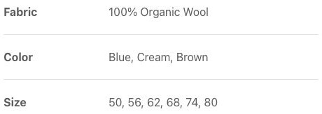
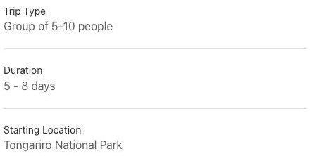
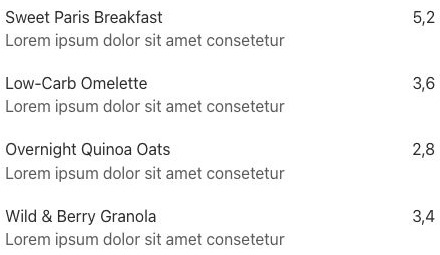
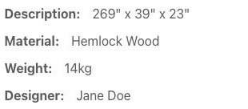
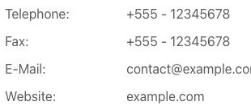
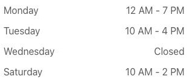
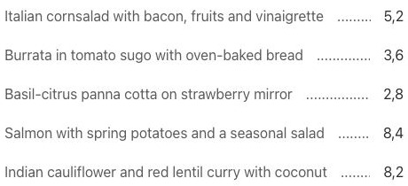
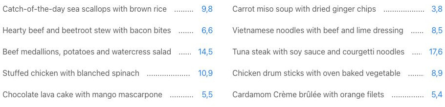
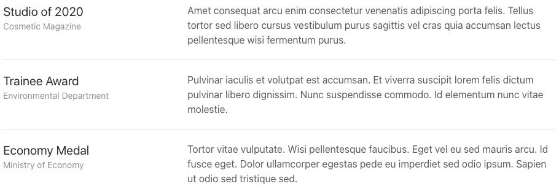

# Description List - Elementi a raccolta

[Indice del catalogo](../README.md) · [PDF offline](../../../output/pdf/catalogo-widget-yootheme.pdf)

Specifiche, listini e coppie etichetta-valore.

**Contenuti:** Titolo, descrizione, metadati e link opzionale.

Fonte grafica: UIkit (demo elementi). Le demo generiche non dichiarano il tema originale di ogni preset; non viene dedotto dalle immagini.

| Variante | Demo |
|---|---|
| Divider title width fixed | [Esempio](https://demo.yootheme.com/joomla/elements/uikit/multiple-items-elements/description-list#description-list-divider-title-width-fixed) |
| Markers | [Esempio](https://demo.yootheme.com/joomla/elements/uikit/multiple-items-elements/description-list#description-list-markers) |
| Disposizione verticale | [Esempio](https://demo.yootheme.com/joomla/elements/uikit/multiple-items-elements/description-list#description-list-layout-stacked) |
| Colonne con metadati a destra | [Esempio](https://demo.yootheme.com/joomla/elements/uikit/multiple-items-elements/description-list#description-list-layout-grid-meta-right) |
| Titoli con larghezza automatica | [Esempio](https://demo.yootheme.com/joomla/elements/uikit/multiple-items-elements/description-list#description-list-title-width-auto) |
| Larghezza fissa dei titoli | [Esempio](https://demo.yootheme.com/joomla/elements/uikit/multiple-items-elements/description-list#description-list-title-width-fixed) |
| Titoli nello spazio disponibile | [Esempio](https://demo.yootheme.com/joomla/elements/uikit/multiple-items-elements/description-list#description-list-title-width-expand) |
| Linea guida fra etichetta e valore | [Esempio](https://demo.yootheme.com/joomla/elements/uikit/multiple-items-elements/description-list#description-list-leader) |
| Linee guida su due colonne | [Esempio](https://demo.yootheme.com/joomla/elements/uikit/multiple-items-elements/description-list#description-list-leader-columns-halves) |
| Metadati sotto il titolo | [Esempio](https://demo.yootheme.com/joomla/elements/uikit/multiple-items-elements/description-list#description-list-meta-below-title) |

### Divider title width fixed

Linee divisorie separano le voci o le parti del contenuto.

[Apri la demo](https://demo.yootheme.com/joomla/elements/uikit/multiple-items-elements/description-list#description-list-divider-title-width-fixed) · Riferimento: `description-list-divider-title-width-fixed`.

### Markers

Variazione di markers.

[Apri la demo](https://demo.yootheme.com/joomla/elements/uikit/multiple-items-elements/description-list#description-list-markers) · Riferimento: `description-list-markers`.

### Disposizione verticale

Le parti del contenuto sono impilate invece di affiancate.

[Apri la demo](https://demo.yootheme.com/joomla/elements/uikit/multiple-items-elements/description-list#description-list-layout-stacked) · Riferimento: `description-list-layout-stacked`.

### Colonne con metadati a destra

Titolo e descrizione occupano una zona distinta dal valore o metadato allineato a destra.

[Apri la demo](https://demo.yootheme.com/joomla/elements/uikit/multiple-items-elements/description-list#description-list-layout-grid-meta-right) · Riferimento: `description-list-layout-grid-meta-right`.

### Titoli con larghezza automatica

Larghezza determinata dal contenuto.

[Apri la demo](https://demo.yootheme.com/joomla/elements/uikit/multiple-items-elements/description-list#description-list-title-width-auto) · Riferimento: `description-list-title-width-auto`.

### Larghezza fissa dei titoli

La colonna dei titoli mantiene una misura fissa e allinea le descrizioni.

[Apri la demo](https://demo.yootheme.com/joomla/elements/uikit/multiple-items-elements/description-list#description-list-title-width-fixed) · Riferimento: `description-list-title-width-fixed`.

### Titoli nello spazio disponibile

La colonna dei titoli si espande nello spazio rimasto disponibile.

[Apri la demo](https://demo.yootheme.com/joomla/elements/uikit/multiple-items-elements/description-list#description-list-title-width-expand) · Riferimento: `description-list-title-width-expand`.

### Linea guida fra etichetta e valore

Una linea guida collega etichette e valori.

[Apri la demo](https://demo.yootheme.com/joomla/elements/uikit/multiple-items-elements/description-list#description-list-leader) · Riferimento: `description-list-leader`.

### Linee guida su due colonne

Una linea guida collega etichette e valori. Disposizione su due colonne.

[Apri la demo](https://demo.yootheme.com/joomla/elements/uikit/multiple-items-elements/description-list#description-list-leader-columns-halves) · Riferimento: `description-list-leader-columns-halves`.

### Metadati sotto il titolo

L’informazione aggiuntiva è collocata subito sotto il titolo.

[Apri la demo](https://demo.yootheme.com/joomla/elements/uikit/multiple-items-elements/description-list#description-list-meta-below-title) · Riferimento: `description-list-meta-below-title`.

