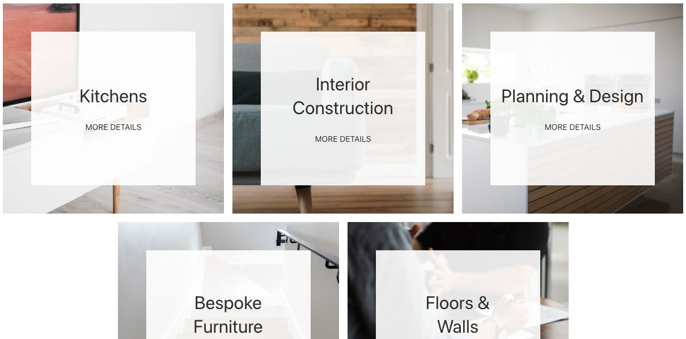
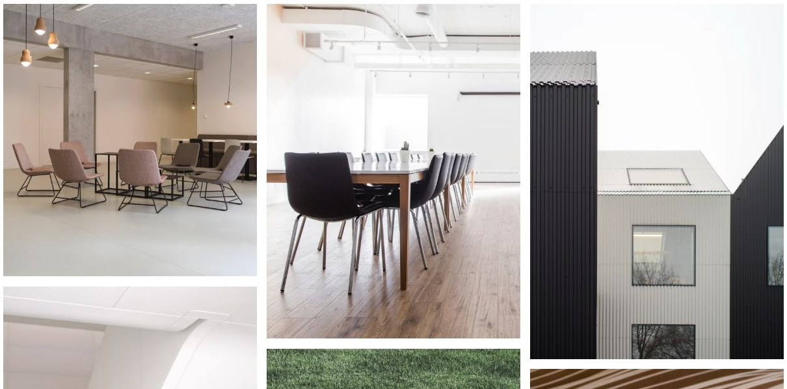
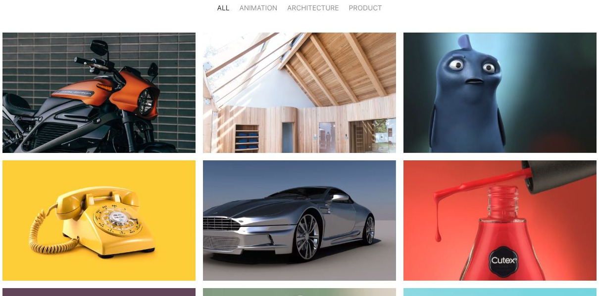
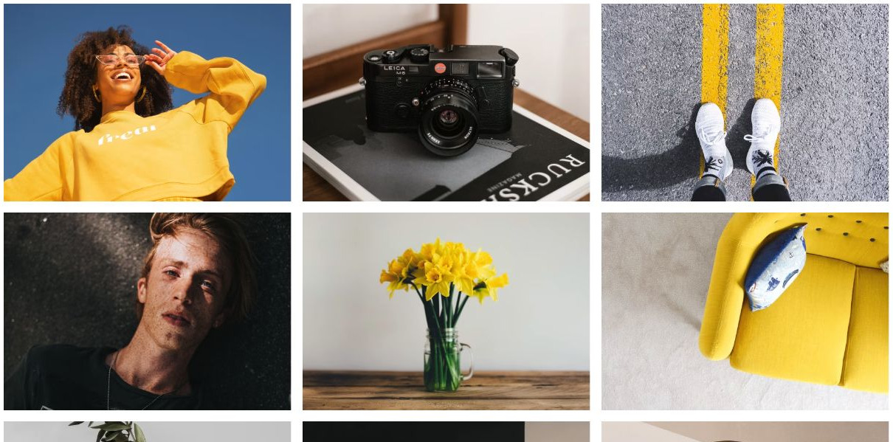
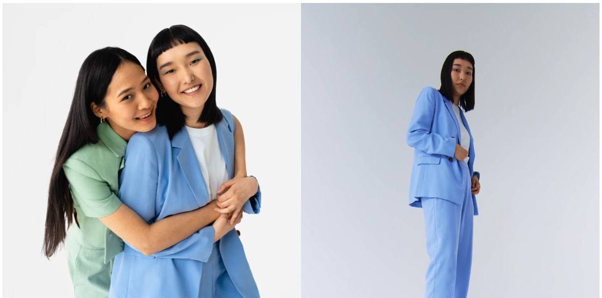
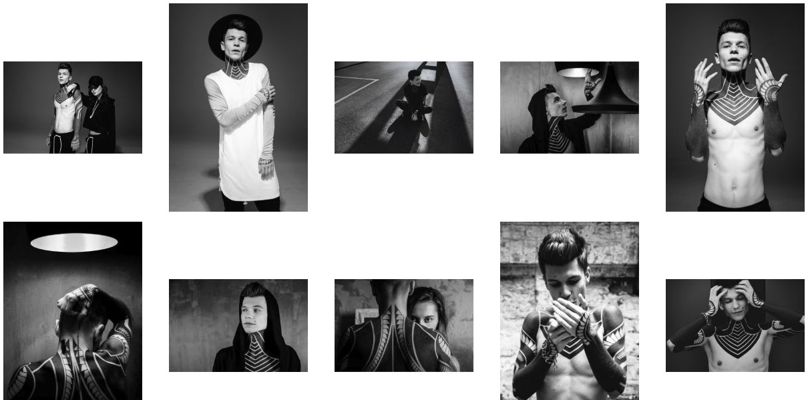
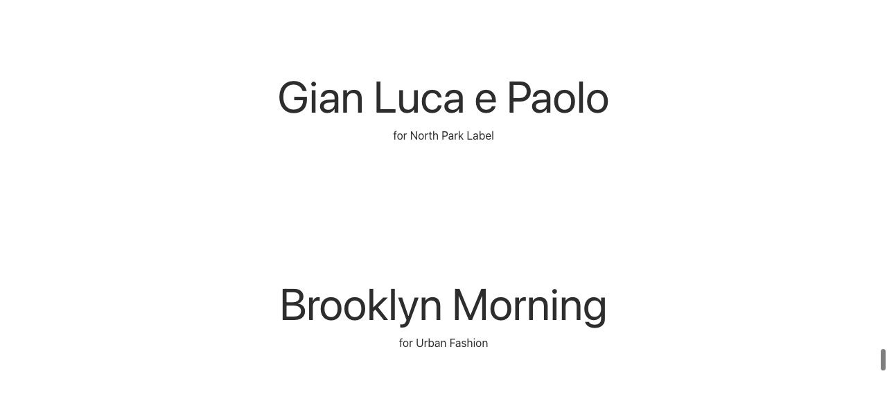

# Gallery - Elementi a raccolta

[Indice del catalogo](../README.md) · [PDF offline](../../../output/pdf/catalogo-widget-yootheme.pdf)

Portfolio e raccolte fotografiche in cui l’immagine è il contenuto principale.

**Contenuti:** Immagini, didascalie, eventuali tag e destinazioni lightbox.

Fonte grafica: UIkit (demo elementi). Le demo generiche non dichiarano il tema originale di ogni preset; non viene dedotto dalle immagini.

| Variante | Demo |
|---|---|
| Immagine alternativa al passaggio del mouse | [Esempio](https://demo.yootheme.com/joomla/elements/uikit/multiple-items-elements/gallery#gallery-hover-image) |
| Colonne unite e righe distanziate | [Esempio](https://demo.yootheme.com/joomla/elements/uikit/multiple-items-elements/gallery#gallery-gaps-column-none-row-default) |
| Ultima riga centrata | [Esempio](https://demo.yootheme.com/joomla/elements/uikit/multiple-items-elements/gallery#gallery-center-columns) |
| Griglia masonry | [Esempio](https://demo.yootheme.com/joomla/elements/uikit/multiple-items-elements/gallery#gallery-masonry) |
| Movimento durante lo scroll | [Esempio](https://demo.yootheme.com/joomla/elements/uikit/multiple-items-elements/gallery#gallery-parallax) |
| Filtro per categorie | [Esempio](https://demo.yootheme.com/joomla/elements/uikit/multiple-items-elements/gallery#gallery-filter) |
| Apertura in lightbox | [Esempio](https://demo.yootheme.com/joomla/elements/uikit/multiple-items-elements/gallery#gallery-lightbox) |
| Lightbox con miniature | [Esempio](https://demo.yootheme.com/joomla/elements/uikit/multiple-items-elements/gallery#gallery-lightbox-thumbnav) |
| Immagini verticali e orizzontali | [Esempio](https://demo.yootheme.com/joomla/elements/uikit/multiple-items-elements/gallery#gallery-mixed-image-orientation) |
| Cambio immagine al passaggio del mouse | [Esempio](https://demo.yootheme.com/joomla/elements/uikit/multiple-items-elements/gallery#gallery-hover-image-only) |

### Immagine alternativa al passaggio del mouse

Una parte del contenuto cambia o compare al passaggio del mouse.

[Apri la demo](https://demo.yootheme.com/joomla/elements/uikit/multiple-items-elements/gallery#gallery-hover-image) · Riferimento: `gallery-hover-image`.

### Colonne unite e righe distanziate

Nessuno spazio orizzontale fra le celle; resta la separazione verticale.

[Apri la demo](https://demo.yootheme.com/joomla/elements/uikit/multiple-items-elements/gallery#gallery-gaps-column-none-row-default) · Riferimento: `gallery-gaps-column-none-row-default`.

### Ultima riga centrata

Gli elementi di una riga incompleta sono centrati nel contenitore.

[Apri la demo](https://demo.yootheme.com/joomla/elements/uikit/multiple-items-elements/gallery#gallery-center-columns) · Riferimento: `gallery-center-columns`.

### Griglia masonry

Altezze diverse con disposizione compatta.

[Apri la demo](https://demo.yootheme.com/joomla/elements/uikit/multiple-items-elements/gallery#gallery-masonry) · Riferimento: `gallery-masonry`.

### Movimento durante lo scroll

Movimento collegato allo scorrimento della pagina.

[Apri la demo](https://demo.yootheme.com/joomla/elements/uikit/multiple-items-elements/gallery#gallery-parallax) · Riferimento: `gallery-parallax`.

### Filtro per categorie

Navigazione per filtrare gli elementi.

[Apri la demo](https://demo.yootheme.com/joomla/elements/uikit/multiple-items-elements/gallery#gallery-filter) · Riferimento: `gallery-filter`.

### Apertura in lightbox

Apertura del media in una galleria modale.

[Apri la demo](https://demo.yootheme.com/joomla/elements/uikit/multiple-items-elements/gallery#gallery-lightbox) · Riferimento: `gallery-lightbox`.

### Lightbox con miniature

Miniature per selezionare il contenuto. Apertura del media in una galleria modale.

[Apri la demo](https://demo.yootheme.com/joomla/elements/uikit/multiple-items-elements/gallery#gallery-lightbox-thumbnav) · Riferimento: `gallery-lightbox-thumbnav`.

### Immagini verticali e orizzontali

Mantiene immagini con orientamenti diversi.

[Apri la demo](https://demo.yootheme.com/joomla/elements/uikit/multiple-items-elements/gallery#gallery-mixed-image-orientation) · Riferimento: `gallery-mixed-image-orientation`.

### Cambio immagine al passaggio del mouse

Una parte del contenuto cambia o compare al passaggio del mouse.

[Apri la demo](https://demo.yootheme.com/joomla/elements/uikit/multiple-items-elements/gallery#gallery-hover-image-only) · Riferimento: `gallery-hover-image-only`.

