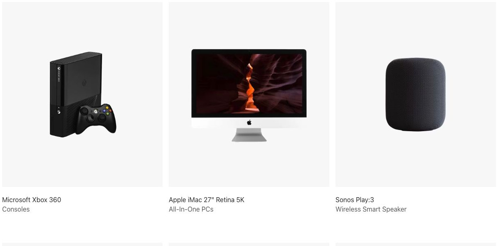
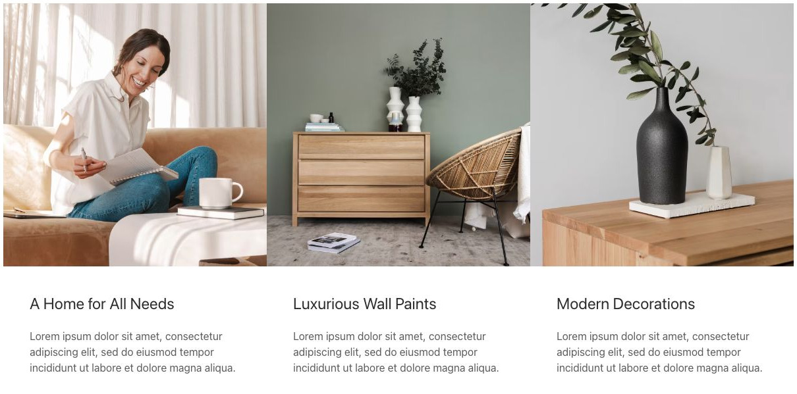
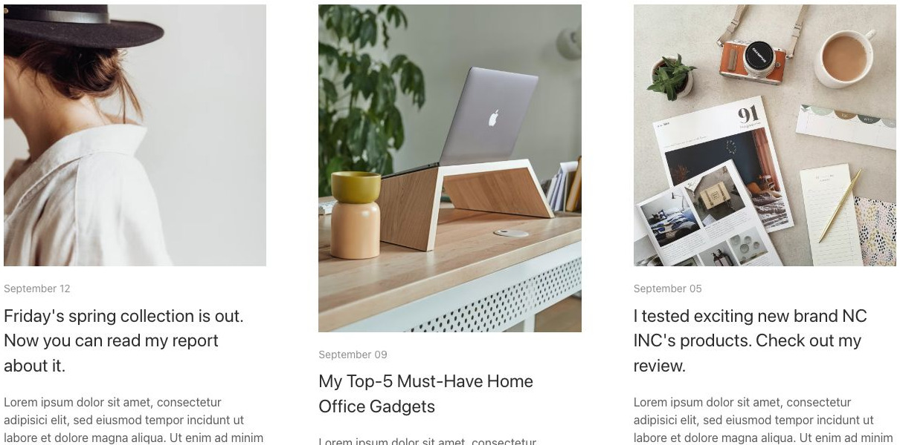
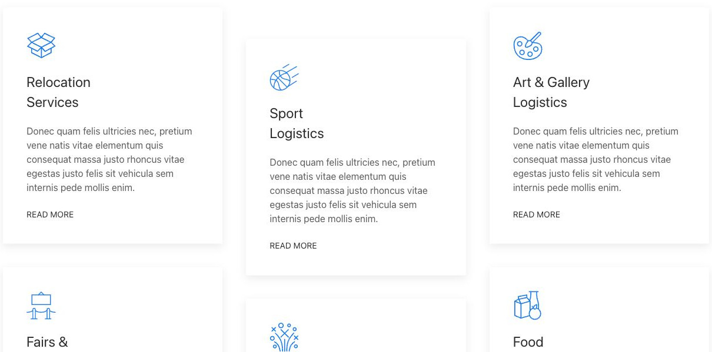
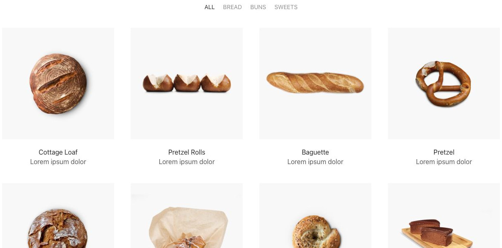
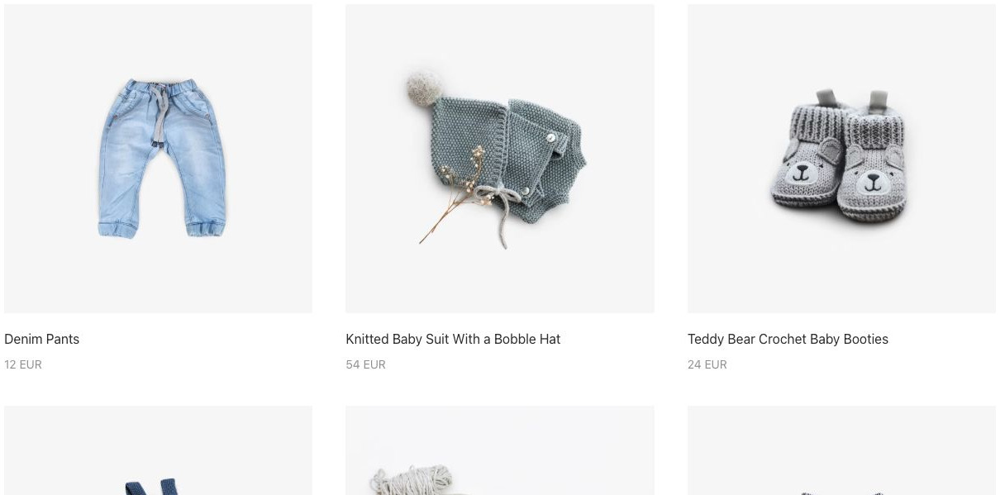
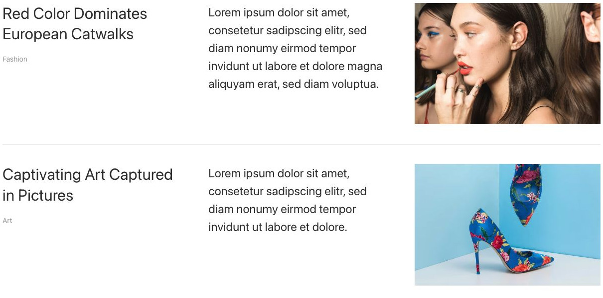
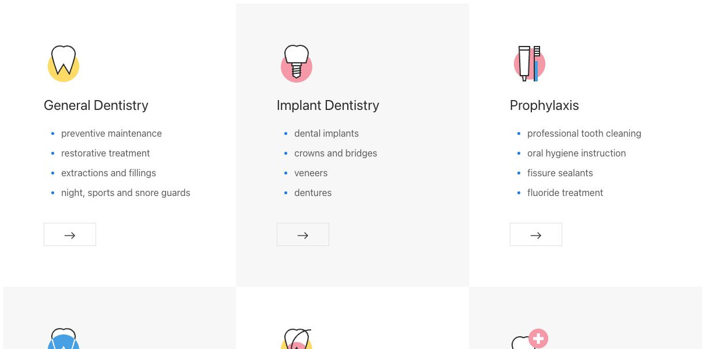

# Grid - Elementi a raccolta

[Indice del catalogo](../README.md) · [PDF offline](../../../output/pdf/catalogo-widget-yootheme.pdf)

Schede di prodotti, servizi, articoli o persone da confrontare a colpo d’occhio.

**Contenuti:** Titolo, testo, immagine o icona, metadati e link.

Fonte grafica: UIkit (demo elementi). Le demo generiche non dichiarano il tema originale di ogni preset; non viene dedotto dalle immagini.

| Variante | Demo |
|---|---|
| Panel style card | [Esempio](https://demo.yootheme.com/joomla/elements/uikit/multiple-items-elements/grid#grid-panel-style-card) |
| Spazi stretti fra colonne, ampi fra righe | [Esempio](https://demo.yootheme.com/joomla/elements/uikit/multiple-items-elements/grid#grid-gaps-column-small-row-large) |
| Colonne automatiche | [Esempio](https://demo.yootheme.com/joomla/elements/uikit/multiple-items-elements/grid#grid-columns-auto) |
| Divisori fra gli elementi | [Esempio](https://demo.yootheme.com/joomla/elements/uikit/multiple-items-elements/grid#grid-divider) |
| Celle senza spazi | [Esempio](https://demo.yootheme.com/joomla/elements/uikit/multiple-items-elements/grid#grid-gaps-none) |
| Ultima riga centrata | [Esempio](https://demo.yootheme.com/joomla/elements/uikit/multiple-items-elements/grid#grid-center-columns) |
| Griglia masonry | [Esempio](https://demo.yootheme.com/joomla/elements/uikit/multiple-items-elements/grid#grid-masonry) |
| Movimento durante lo scroll | [Esempio](https://demo.yootheme.com/joomla/elements/uikit/multiple-items-elements/grid#grid-parallax) |
| Filtro per categorie | [Esempio](https://demo.yootheme.com/joomla/elements/uikit/multiple-items-elements/grid#grid-filter) |
| Apertura in lightbox | [Esempio](https://demo.yootheme.com/joomla/elements/uikit/multiple-items-elements/grid#grid-lightbox) |
| Panel title left image right | [Esempio](https://demo.yootheme.com/joomla/elements/uikit/multiple-items-elements/grid#grid-panel-title-left-image-right) |
| Disposizione a scacchiera | [Esempio](https://demo.yootheme.com/joomla/elements/uikit/multiple-items-elements/grid#grid-tile-checked) |
| Filtro con pulsanti pill | [Esempio](https://demo.yootheme.com/joomla/elements/uikit/multiple-items-elements/grid#grid-filter-pill) |
| Allineamento delle colonne durante lo scroll | [Esempio](https://demo.yootheme.com/joomla/elements/uikit/multiple-items-elements/grid#grid-justify-columns) |

### Panel style card

Il contenuto è raccolto in schede con un contenitore riconoscibile.

[Apri la demo](https://demo.yootheme.com/joomla/elements/uikit/multiple-items-elements/grid#grid-panel-style-card) · Riferimento: `grid-panel-style-card`.

### Spazi stretti fra colonne, ampi fra righe

Le due direzioni della griglia hanno spaziature diverse.

[Apri la demo](https://demo.yootheme.com/joomla/elements/uikit/multiple-items-elements/grid#grid-gaps-column-small-row-large) · Riferimento: `grid-gaps-column-small-row-large`.

### Colonne automatiche

La larghezza delle colonne segue quella dei contenuti.

[Apri la demo](https://demo.yootheme.com/joomla/elements/uikit/multiple-items-elements/grid#grid-columns-auto) · Riferimento: `grid-columns-auto`.

### Divisori fra gli elementi

Linee divisorie separano le voci o le parti del contenuto.

[Apri la demo](https://demo.yootheme.com/joomla/elements/uikit/multiple-items-elements/grid#grid-divider) · Riferimento: `grid-divider`.

### Celle senza spazi

Gli elementi della griglia sono accostati senza interstizi.

[Apri la demo](https://demo.yootheme.com/joomla/elements/uikit/multiple-items-elements/grid#grid-gaps-none) · Riferimento: `grid-gaps-none`.

### Ultima riga centrata

Gli elementi di una riga incompleta sono centrati nel contenitore.

[Apri la demo](https://demo.yootheme.com/joomla/elements/uikit/multiple-items-elements/grid#grid-center-columns) · Riferimento: `grid-center-columns`.

### Griglia masonry

Altezze diverse con disposizione compatta.

[Apri la demo](https://demo.yootheme.com/joomla/elements/uikit/multiple-items-elements/grid#grid-masonry) · Riferimento: `grid-masonry`.

### Movimento durante lo scroll

Movimento collegato allo scorrimento della pagina.

[Apri la demo](https://demo.yootheme.com/joomla/elements/uikit/multiple-items-elements/grid#grid-parallax) · Riferimento: `grid-parallax`.

### Filtro per categorie

Navigazione per filtrare gli elementi.

[Apri la demo](https://demo.yootheme.com/joomla/elements/uikit/multiple-items-elements/grid#grid-filter) · Riferimento: `grid-filter`.

### Apertura in lightbox

Apertura del media in una galleria modale.

[Apri la demo](https://demo.yootheme.com/joomla/elements/uikit/multiple-items-elements/grid#grid-lightbox) · Riferimento: `grid-lightbox`.

### Panel title left image right

Immagine affiancata a destra del testo.

[Apri la demo](https://demo.yootheme.com/joomla/elements/uikit/multiple-items-elements/grid#grid-panel-title-left-image-right) · Riferimento: `grid-panel-title-left-image-right`.

### Disposizione a scacchiera

I contenitori alternati distinguono visivamente le celle della griglia.

[Apri la demo](https://demo.yootheme.com/joomla/elements/uikit/multiple-items-elements/grid#grid-tile-checked) · Riferimento: `grid-tile-checked`.

### Filtro con pulsanti pill

Navigazione per filtrare gli elementi.

[Apri la demo](https://demo.yootheme.com/joomla/elements/uikit/multiple-items-elements/grid#grid-filter-pill) · Riferimento: `grid-filter-pill`.

### Allineamento delle colonne durante lo scroll

Le colonne si riallineano durante lo scroll.

[Apri la demo](https://demo.yootheme.com/joomla/elements/uikit/multiple-items-elements/grid#grid-justify-columns) · Riferimento: `grid-justify-columns`.

