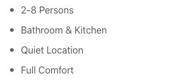
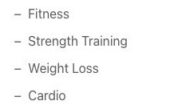
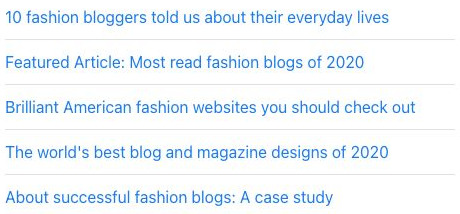
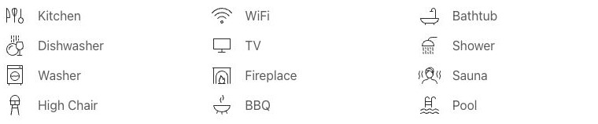
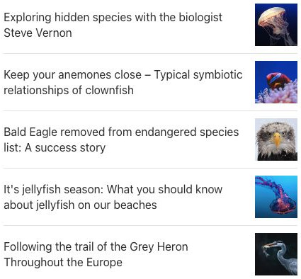

# List - Elementi a raccolta

[Indice del catalogo](../README.md) · [PDF offline](../../../output/pdf/catalogo-widget-yootheme.pdf)

Elenchi di vantaggi, contatti, caratteristiche o voci sintetiche.

**Contenuti:** Testo, icone o immagini e link opzionali.

Fonte grafica: UIkit (demo elementi). Le demo generiche non dichiarano il tema originale di ogni preset; non viene dedotto dalle immagini.

| Variante | Demo |
|---|---|
| Marcatori a pallino | [Esempio](https://demo.yootheme.com/joomla/elements/uikit/multiple-items-elements/list#list-marker-image-bullet) |
| Elenco in linea con virgole | [Esempio](https://demo.yootheme.com/joomla/elements/uikit/multiple-items-elements/list#list-type-horizontal-comma) |
| Elenco in linea con trattini | [Esempio](https://demo.yootheme.com/joomla/elements/uikit/multiple-items-elements/list#list-type-horizontal-dash) |
| Marcatori a trattino | [Esempio](https://demo.yootheme.com/joomla/elements/uikit/multiple-items-elements/list#list-marker-hyphen) |
| Marcatori a icona | [Esempio](https://demo.yootheme.com/joomla/elements/uikit/multiple-items-elements/list#list-marker-icon) |
| Voci con divisori | [Esempio](https://demo.yootheme.com/joomla/elements/uikit/multiple-items-elements/list#list-style-divider) |
| Columns thirds | [Esempio](https://demo.yootheme.com/joomla/elements/uikit/multiple-items-elements/list#list-columns-thirds) |
| Image left style divider | [Esempio](https://demo.yootheme.com/joomla/elements/uikit/multiple-items-elements/list#list-image-left-style-divider) |
| Image right style divider | [Esempio](https://demo.yootheme.com/joomla/elements/uikit/multiple-items-elements/list#list-image-right-style-divider) |

### Marcatori a pallino

Ogni voce dell’elenco è preceduta da un marcatore.

[Apri la demo](https://demo.yootheme.com/joomla/elements/uikit/multiple-items-elements/list#list-marker-image-bullet) · Riferimento: `list-marker-image-bullet`.

### Elenco in linea con virgole

Le voci sono disposte in linea e separate da virgole.

[Apri la demo](https://demo.yootheme.com/joomla/elements/uikit/multiple-items-elements/list#list-type-horizontal-comma) · Riferimento: `list-type-horizontal-comma`.

### Elenco in linea con trattini

Le voci sono disposte in linea e separate da trattini.

[Apri la demo](https://demo.yootheme.com/joomla/elements/uikit/multiple-items-elements/list#list-type-horizontal-dash) · Riferimento: `list-type-horizontal-dash`.

### Marcatori a trattino

Ogni voce è preceduta da un trattino.

[Apri la demo](https://demo.yootheme.com/joomla/elements/uikit/multiple-items-elements/list#list-marker-hyphen) · Riferimento: `list-marker-hyphen`.

### Marcatori a icona

Le voci usano un’icona come marcatore.

[Apri la demo](https://demo.yootheme.com/joomla/elements/uikit/multiple-items-elements/list#list-marker-icon) · Riferimento: `list-marker-icon`.

### Voci con divisori

Linee divisorie separano le voci o le parti del contenuto.

[Apri la demo](https://demo.yootheme.com/joomla/elements/uikit/multiple-items-elements/list#list-style-divider) · Riferimento: `list-style-divider`.

### Columns thirds

Disposizione su tre colonne.

[Apri la demo](https://demo.yootheme.com/joomla/elements/uikit/multiple-items-elements/list#list-columns-thirds) · Riferimento: `list-columns-thirds`.

### Image left style divider

Immagine affiancata a sinistra del testo.

[Apri la demo](https://demo.yootheme.com/joomla/elements/uikit/multiple-items-elements/list#list-image-left-style-divider) · Riferimento: `list-image-left-style-divider`.

### Image right style divider

Immagine affiancata a destra del testo.

[Apri la demo](https://demo.yootheme.com/joomla/elements/uikit/multiple-items-elements/list#list-image-right-style-divider) · Riferimento: `list-image-right-style-divider`.

