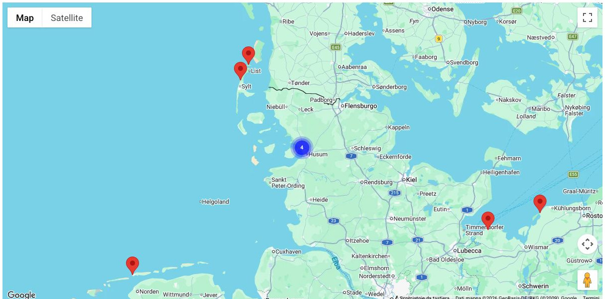
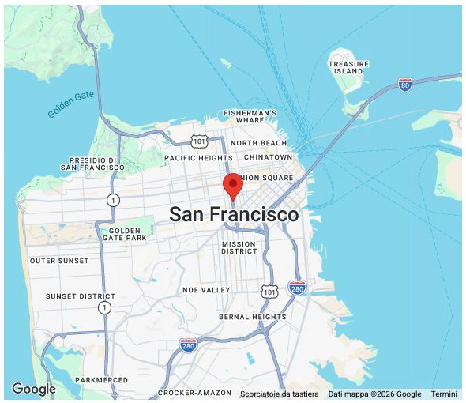
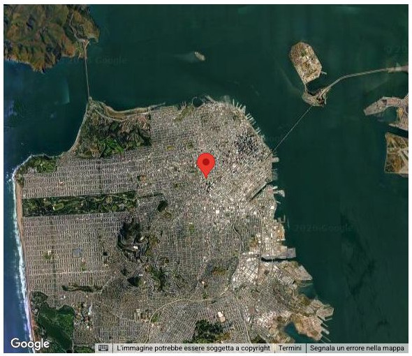
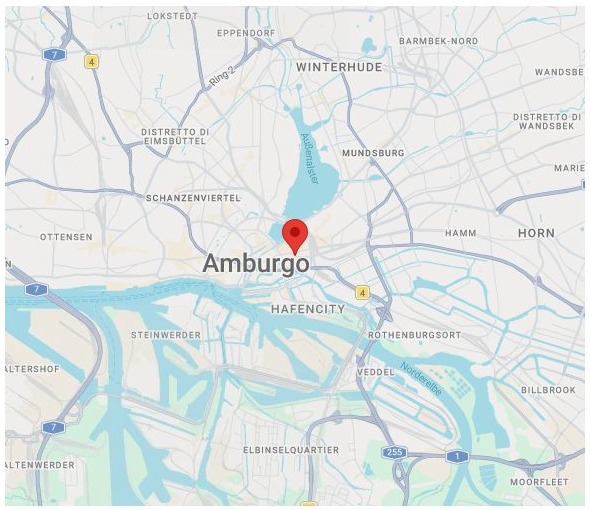
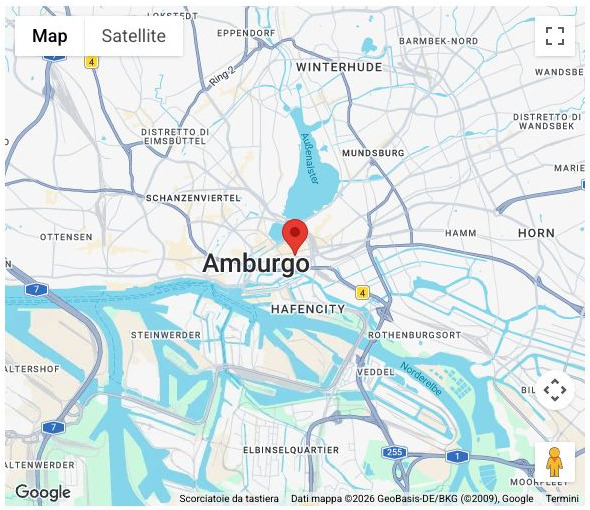
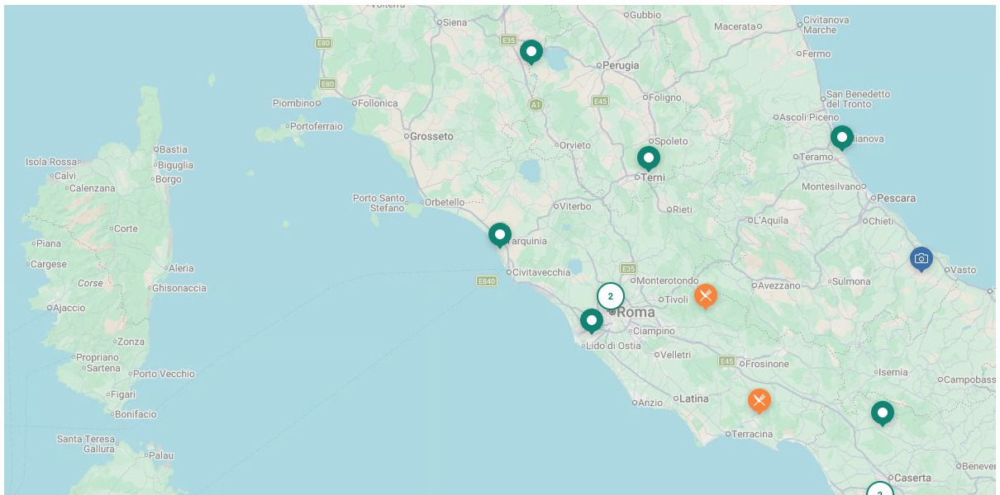
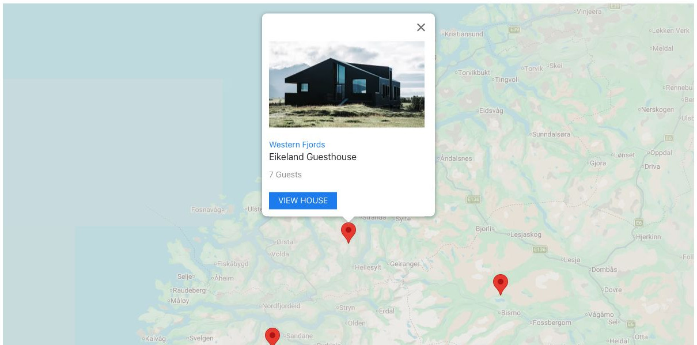

# Map - Elementi a raccolta

[Indice del catalogo](../README.md) · [PDF offline](../../../output/pdf/catalogo-widget-yootheme.pdf)

Sedi, destinazioni, punti di interesse e insiemi di luoghi.

**Contenuti:** Coordinate, etichette e contenuto dei marker.

Fonte grafica: UIkit (demo elementi). Le demo generiche non dichiarano il tema originale di ogni preset; non viene dedotto dalle immagini.

| Variante | Demo |
|---|---|
| Raggruppamento dei marker | [Esempio](https://demo.yootheme.com/joomla/elements/uikit/multiple-items-elements/map#map-marker-clustering) |
| Mappa stradale | [Esempio](https://demo.yootheme.com/joomla/elements/uikit/multiple-items-elements/map#map-type-roadmap) |
| Mappa satellitare | [Esempio](https://demo.yootheme.com/joomla/elements/uikit/multiple-items-elements/map#map-type-satellite) |
| Mappa con interazioni limitate | [Esempio](https://demo.yootheme.com/joomla/elements/uikit/multiple-items-elements/map#map-no-zoom-no-dragging) |
| Controlli della mappa visibili | [Esempio](https://demo.yootheme.com/joomla/elements/uikit/multiple-items-elements/map#map-controls-enabled) |
| Marker personalizzati e raggruppati | [Esempio](https://demo.yootheme.com/joomla/elements/uikit/multiple-items-elements/map#map-marker-clustering-custom-markers) |
| Schede sui marker | [Esempio](https://demo.yootheme.com/joomla/elements/uikit/multiple-items-elements/map#map-marker-popups) |

### Raggruppamento dei marker

Raggruppa i punti vicini della mappa.

[Apri la demo](https://demo.yootheme.com/joomla/elements/uikit/multiple-items-elements/map#map-marker-clustering) · Riferimento: `map-marker-clustering`.

### Mappa stradale

La base cartografica privilegia strade, confini ed etichette.

[Apri la demo](https://demo.yootheme.com/joomla/elements/uikit/multiple-items-elements/map#map-type-roadmap) · Riferimento: `map-type-roadmap`.

### Mappa satellitare

La base cartografica usa immagini satellitari.

[Apri la demo](https://demo.yootheme.com/joomla/elements/uikit/multiple-items-elements/map#map-type-satellite) · Riferimento: `map-type-satellite`.

### Mappa con interazioni limitate

Zoom e trascinamento sono disattivati nella demo.

[Apri la demo](https://demo.yootheme.com/joomla/elements/uikit/multiple-items-elements/map#map-no-zoom-no-dragging) · Riferimento: `map-no-zoom-no-dragging`.

### Controlli della mappa visibili

La demo mostra gli strumenti di navigazione della mappa.

[Apri la demo](https://demo.yootheme.com/joomla/elements/uikit/multiple-items-elements/map#map-controls-enabled) · Riferimento: `map-controls-enabled`.

### Marker personalizzati e raggruppati

Raggruppa i punti vicini della mappa.

[Apri la demo](https://demo.yootheme.com/joomla/elements/uikit/multiple-items-elements/map#map-marker-clustering-custom-markers) · Riferimento: `map-marker-clustering-custom-markers`.

### Schede sui marker

I punti della mappa possono mostrare un pannello informativo.

[Apri la demo](https://demo.yootheme.com/joomla/elements/uikit/multiple-items-elements/map#map-marker-popups) · Riferimento: `map-marker-popups`.

