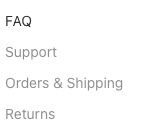
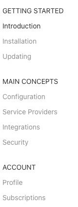
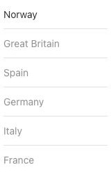
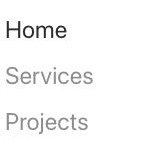
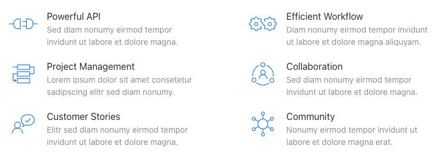

# Nav - Elementi a raccolta

[Indice del catalogo](../README.md) · [PDF offline](../../../output/pdf/catalogo-widget-yootheme.pdf)

Menu verticali, navigazioni di sezione e gruppi gerarchici.

**Contenuti:** Voci, intestazioni, link e sottotitoli.

Fonte grafica: UIkit (demo elementi). Le demo generiche non dichiarano il tema originale di ogni preset; non viene dedotto dalle immagini.

| Variante | Demo |
|---|---|
| Stile base | [Esempio](https://demo.yootheme.com/joomla/elements/uikit/multiple-items-elements/nav#nav-style-default) |
| Menu con intestazioni | [Esempio](https://demo.yootheme.com/joomla/elements/uikit/multiple-items-elements/nav#nav-menu-headings) |
| Style default dividers | [Esempio](https://demo.yootheme.com/joomla/elements/uikit/multiple-items-elements/nav#nav-style-default-dividers) |
| Navigazione con tipografia grande | [Esempio](https://demo.yootheme.com/joomla/elements/uikit/multiple-items-elements/nav#nav-style-primary) |
| Navigazione con sottotitoli | [Esempio](https://demo.yootheme.com/joomla/elements/uikit/multiple-items-elements/nav#nav-style-secondary-subtitles) |

### Stile base

Presentazione di riferimento della famiglia, utile per confrontare le altre varianti.

[Apri la demo](https://demo.yootheme.com/joomla/elements/uikit/multiple-items-elements/nav#nav-style-default) · Riferimento: `nav-style-default`.

### Menu con intestazioni

Le voci della navigazione sono raggruppate sotto intestazioni.

[Apri la demo](https://demo.yootheme.com/joomla/elements/uikit/multiple-items-elements/nav#nav-menu-headings) · Riferimento: `nav-menu-headings`.

### Style default dividers

Linee divisorie separano le voci o le parti del contenuto.

[Apri la demo](https://demo.yootheme.com/joomla/elements/uikit/multiple-items-elements/nav#nav-style-default-dividers) · Riferimento: `nav-style-default-dividers`.

### Navigazione con tipografia grande

Navigazione con tipografia più grande e maggiore evidenza delle singole voci.

[Apri la demo](https://demo.yootheme.com/joomla/elements/uikit/multiple-items-elements/nav#nav-style-primary) · Riferimento: `nav-style-primary`.

### Navigazione con sottotitoli

Le voci della navigazione includono un sottotitolo descrittivo.

[Apri la demo](https://demo.yootheme.com/joomla/elements/uikit/multiple-items-elements/nav#nav-style-secondary-subtitles) · Riferimento: `nav-style-secondary-subtitles`.

