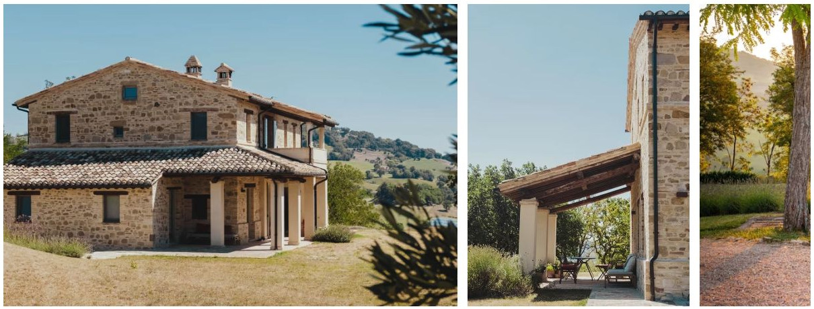
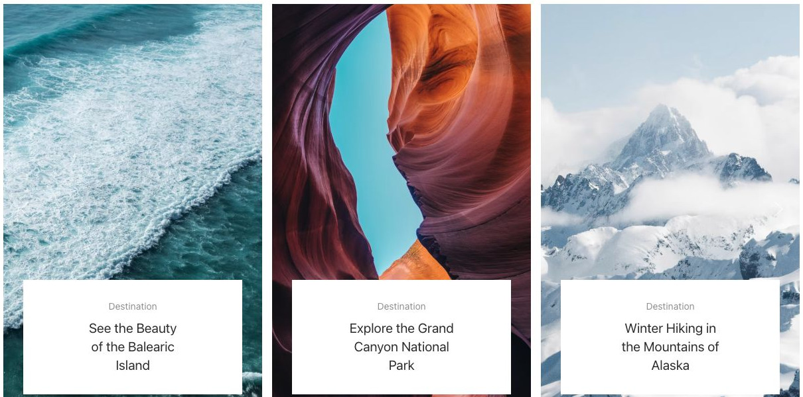
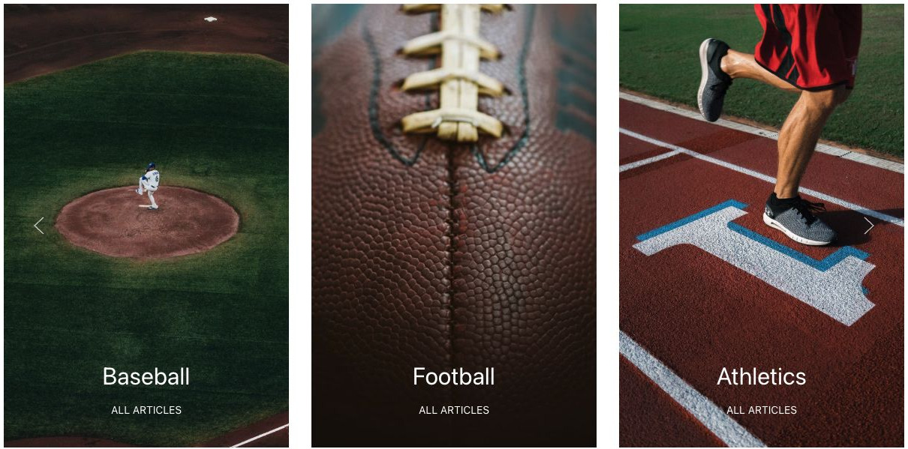
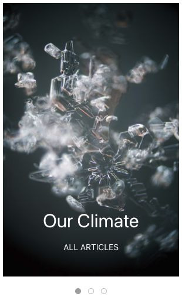
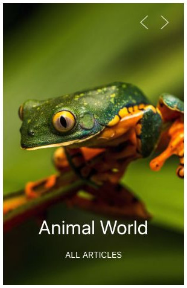
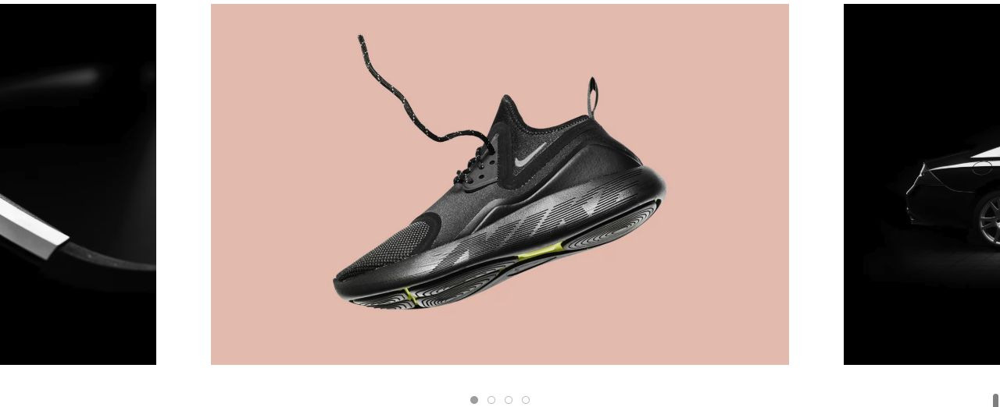

# Overlay Slider - Elementi a raccolta

[Indice del catalogo](../README.md) · [PDF offline](../../../output/pdf/catalogo-widget-yootheme.pdf)

Caroselli visivi per progetti, destinazioni e categorie con testo sopra le immagini.

**Contenuti:** Immagini di copertina, titoli brevi e link.

Fonte grafica: UIkit (demo elementi). Le demo generiche non dichiarano il tema originale di ogni preset; non viene dedotto dalle immagini.

| Variante | Demo |
|---|---|
| Larghezze automatiche | [Esempio](https://demo.yootheme.com/joomla/elements/uikit/multiple-items-elements/overlay-slider#overlay-slider-item-width-auto) |
| Spazi ridotti | [Esempio](https://demo.yootheme.com/joomla/elements/uikit/multiple-items-elements/overlay-slider#overlay-slider-column-gap-small) |
| Scorrimento per gruppi | [Esempio](https://demo.yootheme.com/joomla/elements/uikit/multiple-items-elements/overlay-slider#overlay-slider-sets) |
| Slide attiva centrata | [Esempio](https://demo.yootheme.com/joomla/elements/uikit/multiple-items-elements/overlay-slider#overlay-slider-center) |
| Dotnav center slidenav outside | [Esempio](https://demo.yootheme.com/joomla/elements/uikit/multiple-items-elements/overlay-slider#overlay-slider-dotnav-center-slidenav-outside) |
| Puntini centrati | [Esempio](https://demo.yootheme.com/joomla/elements/uikit/multiple-items-elements/overlay-slider#overlay-slider-dotnav-center) |
| Frecce in alto a destra | [Esempio](https://demo.yootheme.com/joomla/elements/uikit/multiple-items-elements/overlay-slider#overlay-slider-slidenav-top-right) |
| Testo in basso a sinistra | [Esempio](https://demo.yootheme.com/joomla/elements/uikit/multiple-items-elements/overlay-slider#overlay-slider-overlay-text-bottom-left) |
| Parallax center active | [Esempio](https://demo.yootheme.com/joomla/elements/uikit/multiple-items-elements/overlay-slider#overlay-slider-parallax-center-active) |
| Riquadro in basso a sinistra | [Esempio](https://demo.yootheme.com/joomla/elements/uikit/multiple-items-elements/overlay-slider#overlay-slider-overlay-tile-bottom-left) |
| Testo con transizione verticale | [Esempio](https://demo.yootheme.com/joomla/elements/uikit/multiple-items-elements/overlay-slider#overlay-slider-text-transition-slide-top-bottom) |
| Overlay completo al passaggio del mouse | [Esempio](https://demo.yootheme.com/joomla/elements/uikit/multiple-items-elements/overlay-slider#overlay-slider-overlay-primary-cover-hover) |

### Larghezze automatiche

Larghezza determinata dal contenuto.

[Apri la demo](https://demo.yootheme.com/joomla/elements/uikit/multiple-items-elements/overlay-slider#overlay-slider-item-width-auto) · Riferimento: `overlay-slider-item-width-auto`.

### Spazi ridotti

Spaziatura ridotta fra gli elementi.

[Apri la demo](https://demo.yootheme.com/joomla/elements/uikit/multiple-items-elements/overlay-slider#overlay-slider-column-gap-small) · Riferimento: `overlay-slider-column-gap-small`.

### Scorrimento per gruppi

Gli elementi visibili avanzano insieme.

[Apri la demo](https://demo.yootheme.com/joomla/elements/uikit/multiple-items-elements/overlay-slider#overlay-slider-sets) · Riferimento: `overlay-slider-sets`.

### Slide attiva centrata

La slide attiva è centrata e lascia intravedere quelle adiacenti.

[Apri la demo](https://demo.yootheme.com/joomla/elements/uikit/multiple-items-elements/overlay-slider#overlay-slider-center) · Riferimento: `overlay-slider-center`.

### Dotnav center slidenav outside

Puntini per selezionare il contenuto. Frecce per passare all’elemento precedente o successivo.

[Apri la demo](https://demo.yootheme.com/joomla/elements/uikit/multiple-items-elements/overlay-slider#overlay-slider-dotnav-center-slidenav-outside) · Riferimento: `overlay-slider-dotnav-center-slidenav-outside`.

### Puntini centrati

La slide attiva è centrata e lascia intravedere quelle adiacenti. Puntini per selezionare il contenuto.

[Apri la demo](https://demo.yootheme.com/joomla/elements/uikit/multiple-items-elements/overlay-slider#overlay-slider-dotnav-center) · Riferimento: `overlay-slider-dotnav-center`.

### Frecce in alto a destra

Frecce per passare all’elemento precedente o successivo.

[Apri la demo](https://demo.yootheme.com/joomla/elements/uikit/multiple-items-elements/overlay-slider#overlay-slider-slidenav-top-right) · Riferimento: `overlay-slider-slidenav-top-right`.

### Testo in basso a sinistra

Il testo è sovrapposto alla parte inferiore sinistra del media.

[Apri la demo](https://demo.yootheme.com/joomla/elements/uikit/multiple-items-elements/overlay-slider#overlay-slider-overlay-text-bottom-left) · Riferimento: `overlay-slider-overlay-text-bottom-left`.

### Parallax center active

Movimento collegato allo scorrimento della pagina.

[Apri la demo](https://demo.yootheme.com/joomla/elements/uikit/multiple-items-elements/overlay-slider#overlay-slider-parallax-center-active) · Riferimento: `overlay-slider-parallax-center-active`.

### Riquadro in basso a sinistra

Il contenuto è raccolto in un riquadro sovrapposto nell’angolo inferiore sinistro.

[Apri la demo](https://demo.yootheme.com/joomla/elements/uikit/multiple-items-elements/overlay-slider#overlay-slider-overlay-tile-bottom-left) · Riferimento: `overlay-slider-overlay-tile-bottom-left`.

### Testo con transizione verticale

Il testo entra o esce con movimenti dall’alto e dal basso.

[Apri la demo](https://demo.yootheme.com/joomla/elements/uikit/multiple-items-elements/overlay-slider#overlay-slider-text-transition-slide-top-bottom) · Riferimento: `overlay-slider-text-transition-slide-top-bottom`.

### Overlay completo al passaggio del mouse

Una parte del contenuto cambia o compare al passaggio del mouse.

[Apri la demo](https://demo.yootheme.com/joomla/elements/uikit/multiple-items-elements/overlay-slider#overlay-slider-overlay-primary-cover-hover) · Riferimento: `overlay-slider-overlay-primary-cover-hover`.

