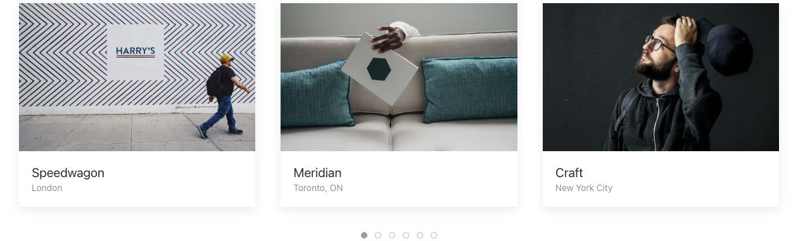
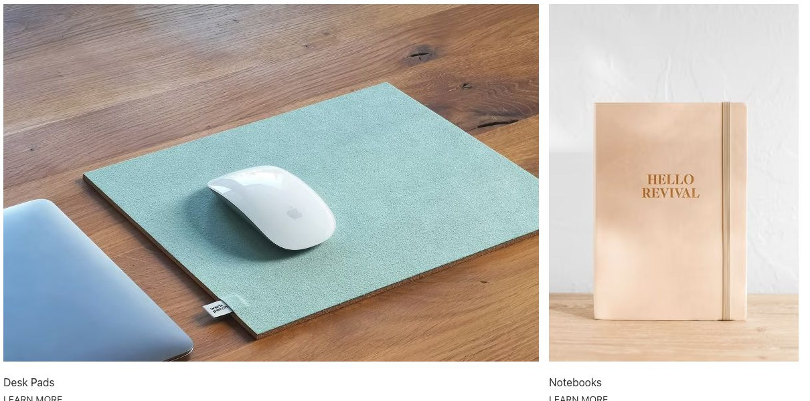
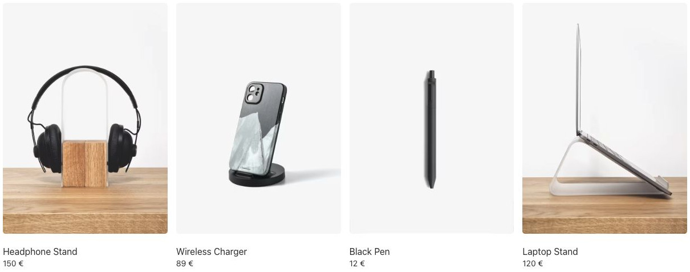
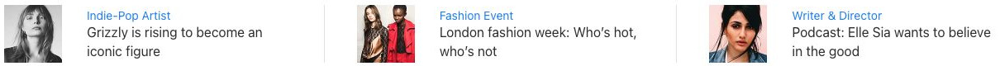
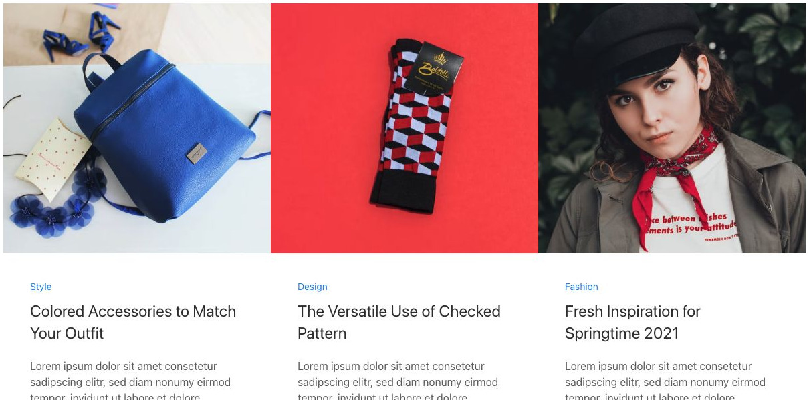
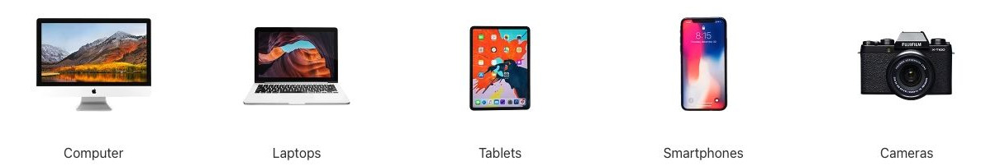
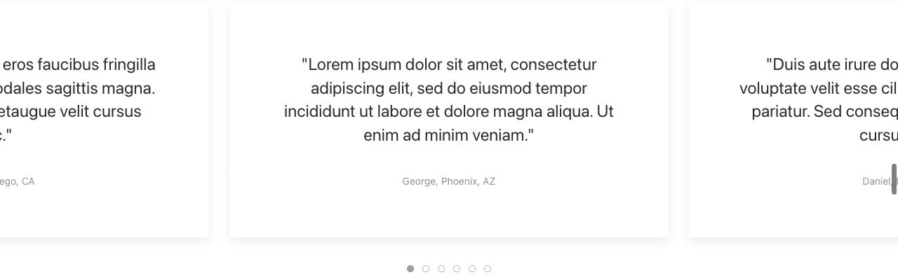
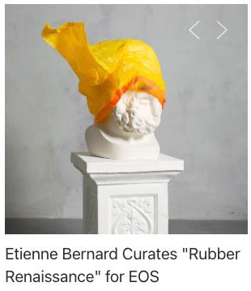
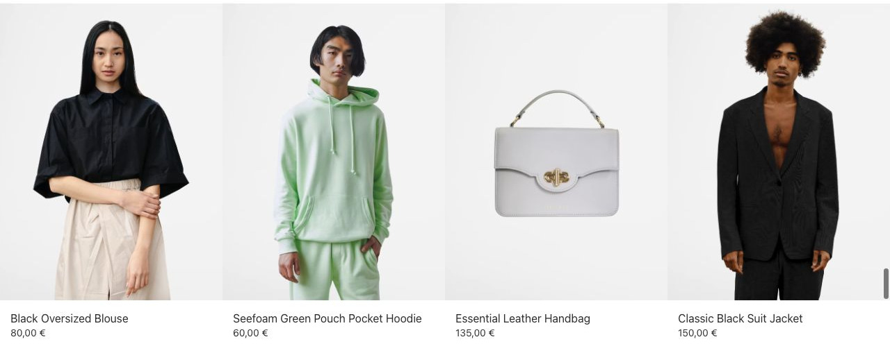
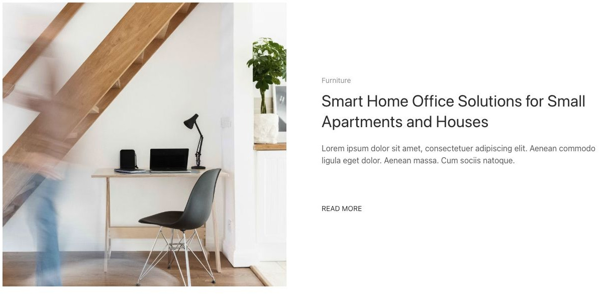

# Panel Slider - Elementi a raccolta

[Indice del catalogo](../README.md) · [PDF offline](../../../output/pdf/catalogo-widget-yootheme.pdf)

Caroselli di prodotti, testimonianze, articoli e servizi con testo leggibile accanto o sotto l’immagine.

**Contenuti:** Una raccolta di schede con media e contenuto.

Fonte grafica: UIkit (demo elementi). Le demo generiche non dichiarano il tema originale di ogni preset; non viene dedotto dalle immagini.

| Variante | Demo |
|---|---|
| Schede con contenitore | [Esempio](https://demo.yootheme.com/joomla/elements/uikit/multiple-items-elements/panel-slider#panel-slider-card-default) |
| Larghezze automatiche | [Esempio](https://demo.yootheme.com/joomla/elements/uikit/multiple-items-elements/panel-slider#panel-slider-item-width-auto) |
| Spazi ridotti | [Esempio](https://demo.yootheme.com/joomla/elements/uikit/multiple-items-elements/panel-slider#panel-slider-column-gap-small) |
| Divisori fra gli elementi | [Esempio](https://demo.yootheme.com/joomla/elements/uikit/multiple-items-elements/panel-slider#panel-slider-divider) |
| Senza spazi | [Esempio](https://demo.yootheme.com/joomla/elements/uikit/multiple-items-elements/panel-slider#panel-slider-column-gap-none) |
| Scorrimento per gruppi | [Esempio](https://demo.yootheme.com/joomla/elements/uikit/multiple-items-elements/panel-slider#panel-slider-sets) |
| Slide attiva centrata | [Esempio](https://demo.yootheme.com/joomla/elements/uikit/multiple-items-elements/panel-slider#panel-slider-center) |
| Puntini centrati | [Esempio](https://demo.yootheme.com/joomla/elements/uikit/multiple-items-elements/panel-slider#panel-slider-dotnav-center) |
| Frecce in alto a destra | [Esempio](https://demo.yootheme.com/joomla/elements/uikit/multiple-items-elements/panel-slider#panel-slider-slidenav-top-right) |
| Media al passaggio del mouse | [Esempio](https://demo.yootheme.com/joomla/elements/uikit/multiple-items-elements/panel-slider#panel-slider-hover) |
| Immagini di altezze diverse | [Esempio](https://demo.yootheme.com/joomla/elements/uikit/multiple-items-elements/panel-slider#panel-slider-different-image-heights) |
| Immagine a sinistra | [Esempio](https://demo.yootheme.com/joomla/elements/uikit/multiple-items-elements/panel-slider#panel-slider-image-left) |

### Schede con contenitore

Il contenuto è raccolto in schede con un contenitore riconoscibile.

[Apri la demo](https://demo.yootheme.com/joomla/elements/uikit/multiple-items-elements/panel-slider#panel-slider-card-default) · Riferimento: `panel-slider-card-default`.

### Larghezze automatiche

Larghezza determinata dal contenuto.

[Apri la demo](https://demo.yootheme.com/joomla/elements/uikit/multiple-items-elements/panel-slider#panel-slider-item-width-auto) · Riferimento: `panel-slider-item-width-auto`.

### Spazi ridotti

Spaziatura ridotta fra gli elementi.

[Apri la demo](https://demo.yootheme.com/joomla/elements/uikit/multiple-items-elements/panel-slider#panel-slider-column-gap-small) · Riferimento: `panel-slider-column-gap-small`.

### Divisori fra gli elementi

Linee divisorie separano le voci o le parti del contenuto.

[Apri la demo](https://demo.yootheme.com/joomla/elements/uikit/multiple-items-elements/panel-slider#panel-slider-divider) · Riferimento: `panel-slider-divider`.

### Senza spazi

Spaziatura assente fra gli elementi.

[Apri la demo](https://demo.yootheme.com/joomla/elements/uikit/multiple-items-elements/panel-slider#panel-slider-column-gap-none) · Riferimento: `panel-slider-column-gap-none`.

### Scorrimento per gruppi

Gli elementi visibili avanzano insieme.

[Apri la demo](https://demo.yootheme.com/joomla/elements/uikit/multiple-items-elements/panel-slider#panel-slider-sets) · Riferimento: `panel-slider-sets`.

### Slide attiva centrata

La slide attiva è centrata e lascia intravedere quelle adiacenti.

[Apri la demo](https://demo.yootheme.com/joomla/elements/uikit/multiple-items-elements/panel-slider#panel-slider-center) · Riferimento: `panel-slider-center`.

### Puntini centrati

La slide attiva è centrata e lascia intravedere quelle adiacenti. Puntini per selezionare il contenuto.

[Apri la demo](https://demo.yootheme.com/joomla/elements/uikit/multiple-items-elements/panel-slider#panel-slider-dotnav-center) · Riferimento: `panel-slider-dotnav-center`.

### Frecce in alto a destra

Frecce per passare all’elemento precedente o successivo.

[Apri la demo](https://demo.yootheme.com/joomla/elements/uikit/multiple-items-elements/panel-slider#panel-slider-slidenav-top-right) · Riferimento: `panel-slider-slidenav-top-right`.

### Media al passaggio del mouse

Una parte del contenuto cambia o compare al passaggio del mouse.

[Apri la demo](https://demo.yootheme.com/joomla/elements/uikit/multiple-items-elements/panel-slider#panel-slider-hover) · Riferimento: `panel-slider-hover`.

### Immagini di altezze diverse

Le schede conservano differenze di altezza nei media.

[Apri la demo](https://demo.yootheme.com/joomla/elements/uikit/multiple-items-elements/panel-slider#panel-slider-different-image-heights) · Riferimento: `panel-slider-different-image-heights`.

### Immagine a sinistra

Immagine affiancata a sinistra del testo.

[Apri la demo](https://demo.yootheme.com/joomla/elements/uikit/multiple-items-elements/panel-slider#panel-slider-image-left) · Riferimento: `panel-slider-image-left`.

