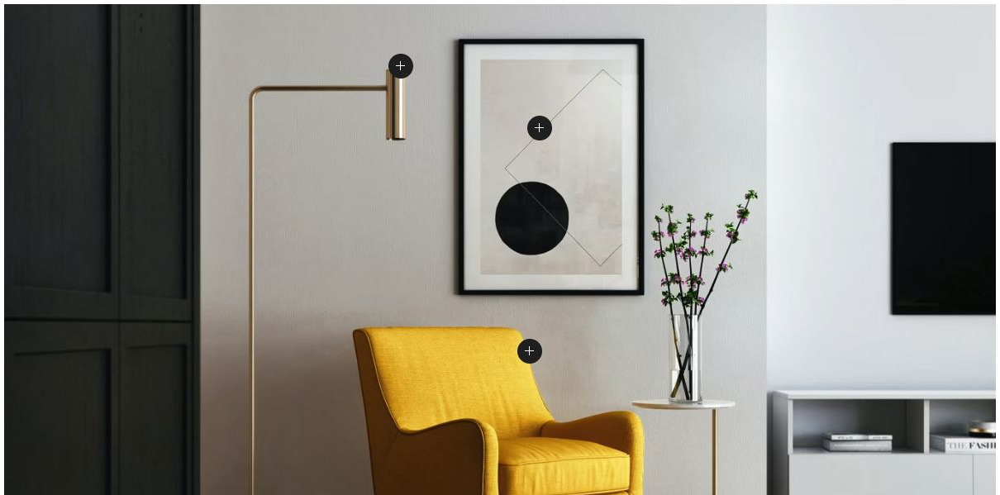
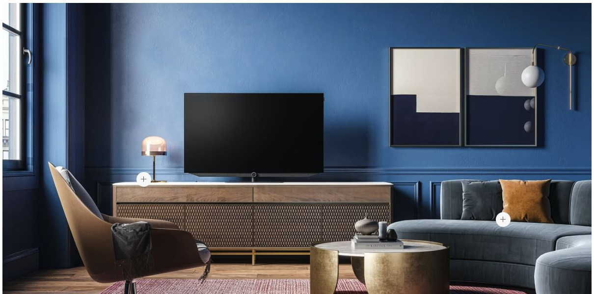
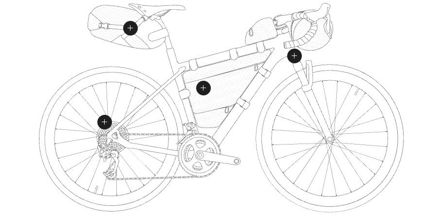
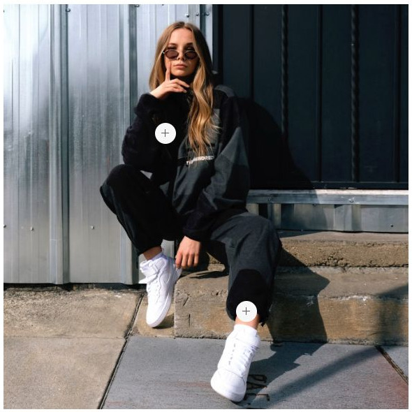
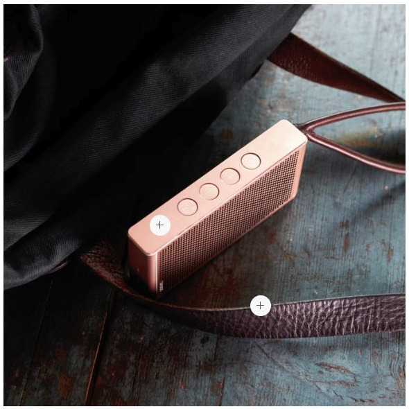
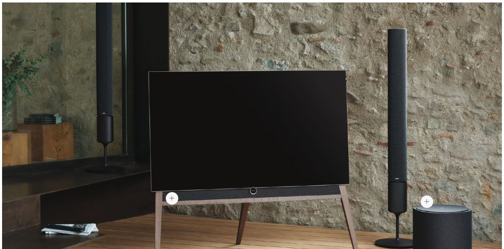

# Popover - Elementi a raccolta

[Indice del catalogo](../README.md) · [PDF offline](../../../output/pdf/catalogo-widget-yootheme.pdf)

Hotspot su planimetrie, prodotti, immagini e infografiche.

**Contenuti:** Immagine di fondo, coordinate e contenuto dei punti.

Fonte grafica: UIkit (demo elementi). Le demo generiche non dichiarano il tema originale di ogni preset; non viene dedotto dalle immagini.

| Variante | Demo |
|---|---|
| Popover a destra su hover | [Esempio](https://demo.yootheme.com/joomla/elements/uikit/multiple-items-elements/popover#popover-position-right-hover) |
| Popover a destra su clic | [Esempio](https://demo.yootheme.com/joomla/elements/uikit/multiple-items-elements/popover#popover-position-right-click) |
| Posizioni dei popover | [Esempio](https://demo.yootheme.com/joomla/elements/uikit/multiple-items-elements/popover#popover-positions) |
| Spaziatura interna ampia | [Esempio](https://demo.yootheme.com/joomla/elements/uikit/multiple-items-elements/popover#popover-padding-large) |
| Collegamento su titolo e immagine | [Esempio](https://demo.yootheme.com/joomla/elements/uikit/multiple-items-elements/popover#popover-link-title-image) |
| Pannello come collegamento | [Esempio](https://demo.yootheme.com/joomla/elements/uikit/multiple-items-elements/popover#popover-link-panel) |
| Intera scheda cliccabile | [Esempio](https://demo.yootheme.com/joomla/elements/uikit/multiple-items-elements/popover#popover-link-all) |
| Spaziatura interna ridotta | [Esempio](https://demo.yootheme.com/joomla/elements/uikit/multiple-items-elements/popover#popover-padding-small) |

### Popover a destra su hover

Una parte del contenuto cambia o compare al passaggio del mouse.

[Apri la demo](https://demo.yootheme.com/joomla/elements/uikit/multiple-items-elements/popover#popover-position-right-hover) · Riferimento: `popover-position-right-hover`.

### Popover a destra su clic

Un clic sul punto apre il pannello a destra del marcatore.

[Apri la demo](https://demo.yootheme.com/joomla/elements/uikit/multiple-items-elements/popover#popover-position-right-click) · Riferimento: `popover-position-right-click`.

### Posizioni dei popover

I pannelli sono collocati in direzioni diverse rispetto ai punti.

[Apri la demo](https://demo.yootheme.com/joomla/elements/uikit/multiple-items-elements/popover#popover-positions) · Riferimento: `popover-positions`.

### Spaziatura interna ampia

Il contenuto ha una distanza maggiore dai bordi del pannello.

[Apri la demo](https://demo.yootheme.com/joomla/elements/uikit/multiple-items-elements/popover#popover-padding-large) · Riferimento: `popover-padding-large`.

### Collegamento su titolo e immagine

Titolo e immagine sono le aree interattive della scheda.

[Apri la demo](https://demo.yootheme.com/joomla/elements/uikit/multiple-items-elements/popover#popover-link-title-image) · Riferimento: `popover-link-title-image`.

### Pannello come collegamento

Il pannello è trattato come area di collegamento.

[Apri la demo](https://demo.yootheme.com/joomla/elements/uikit/multiple-items-elements/popover#popover-link-panel) · Riferimento: `popover-link-panel`.

### Intera scheda cliccabile

Il collegamento comprende l’intera scheda.

[Apri la demo](https://demo.yootheme.com/joomla/elements/uikit/multiple-items-elements/popover#popover-link-all) · Riferimento: `popover-link-all`.

### Spaziatura interna ridotta

Il pannello usa una spaziatura interna compatta.

[Apri la demo](https://demo.yootheme.com/joomla/elements/uikit/multiple-items-elements/popover#popover-padding-small) · Riferimento: `popover-padding-small`.

