# Slideshow - Elementi a raccolta

[Indice del catalogo](../README.md) · [PDF offline](../../../output/pdf/catalogo-widget-yootheme.pdf)

Hero, campagne e presentazioni che mostrano una slide principale alla volta.

**Contenuti:** Immagine o video, titolo, testo breve e azione.

Fonte grafica: UIkit (demo elementi). Le demo generiche non dichiarano il tema originale di ogni preset; non viene dedotto dalle immagini.

| Variante | Demo |
|---|---|
| Content center thumbnav | [Esempio](https://demo.yootheme.com/joomla/elements/uikit/multiple-items-elements/slideshow#slideshow-content-center-thumbnav) |
| Viewport height content left | [Esempio](https://demo.yootheme.com/joomla/elements/uikit/multiple-items-elements/slideshow#slideshow-viewport-height-content-left) |
| Transizione pull | [Esempio](https://demo.yootheme.com/joomla/elements/uikit/multiple-items-elements/slideshow#slideshow-animation-pull) |
| Transizione push | [Esempio](https://demo.yootheme.com/joomla/elements/uikit/multiple-items-elements/slideshow#slideshow-animation-push) |
| Transizione slide | [Esempio](https://demo.yootheme.com/joomla/elements/uikit/multiple-items-elements/slideshow#slideshow-animation-slide) |
| Transizione scale | [Esempio](https://demo.yootheme.com/joomla/elements/uikit/multiple-items-elements/slideshow#slideshow-animation-scale) |
| Dissolvenza con effetto Ken Burns | [Esempio](https://demo.yootheme.com/joomla/elements/uikit/multiple-items-elements/slideshow#slideshow-animation-fade-ken-burns) |
| Content left dotnav | [Esempio](https://demo.yootheme.com/joomla/elements/uikit/multiple-items-elements/slideshow#slideshow-content-left-dotnav) |
| Images slidenav bottom right | [Esempio](https://demo.yootheme.com/joomla/elements/uikit/multiple-items-elements/slideshow#slideshow-images-slidenav-bottom-right) |
| Images dotnav bottom left | [Esempio](https://demo.yootheme.com/joomla/elements/uikit/multiple-items-elements/slideshow#slideshow-images-dotnav-bottom-left) |
| Thumbnav center | [Esempio](https://demo.yootheme.com/joomla/elements/uikit/multiple-items-elements/slideshow#slideshow-thumbnav-center) |
| Images thumbnav below left | [Esempio](https://demo.yootheme.com/joomla/elements/uikit/multiple-items-elements/slideshow#slideshow-images-thumbnav-below-left) |
| Images thumbnav below right | [Esempio](https://demo.yootheme.com/joomla/elements/uikit/multiple-items-elements/slideshow#slideshow-images-thumbnav-below-right) |
| Pannello sovrapposto al centro | [Esempio](https://demo.yootheme.com/joomla/elements/uikit/multiple-items-elements/slideshow#slideshow-overlay-default-center-center) |
| Riquadro in basso a destra | [Esempio](https://demo.yootheme.com/joomla/elements/uikit/multiple-items-elements/slideshow#slideshow-overlay-tile-bottom-right) |
| Riquadro in basso a sinistra | [Esempio](https://demo.yootheme.com/joomla/elements/uikit/multiple-items-elements/slideshow#slideshow-overlay-tile-bottom-left) |
| Riquadro nella parte inferiore | [Esempio](https://demo.yootheme.com/joomla/elements/uikit/multiple-items-elements/slideshow#slideshow-overlay-tile-bottom) |
| Content left parallax | [Esempio](https://demo.yootheme.com/joomla/elements/uikit/multiple-items-elements/slideshow#slideshow-content-left-parallax) |
| Video con avvio automatico | [Esempio](https://demo.yootheme.com/joomla/elements/uikit/multiple-items-elements/slideshow#slideshow-video-autoplay) |
| Viewport height content center | [Esempio](https://demo.yootheme.com/joomla/elements/uikit/multiple-items-elements/slideshow#slideshow-viewport-height-content-center) |

### Content center thumbnav

Miniature per selezionare il contenuto.

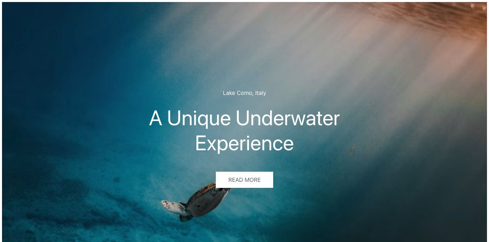

[Apri la demo](https://demo.yootheme.com/joomla/elements/uikit/multiple-items-elements/slideshow#slideshow-content-center-thumbnav) · Riferimento: `slideshow-content-center-thumbnav`.

### Viewport height content left

Altezza adattata alla finestra.

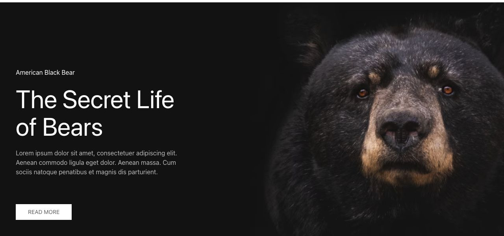

[Apri la demo](https://demo.yootheme.com/joomla/elements/uikit/multiple-items-elements/slideshow#slideshow-viewport-height-content-left) · Riferimento: `slideshow-viewport-height-content-left`.

### Transizione pull

La demo usa la transizione pull fra le slide. Apri il collegamento per confrontarne il movimento.

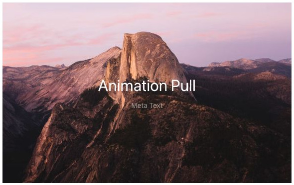

[Apri la demo](https://demo.yootheme.com/joomla/elements/uikit/multiple-items-elements/slideshow#slideshow-animation-pull) · Riferimento: `slideshow-animation-pull`.

### Transizione push

La demo usa la transizione push fra le slide. Apri il collegamento per confrontarne il movimento.

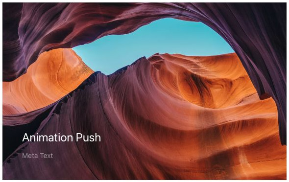

[Apri la demo](https://demo.yootheme.com/joomla/elements/uikit/multiple-items-elements/slideshow#slideshow-animation-push) · Riferimento: `slideshow-animation-push`.

### Transizione slide

La demo usa la transizione slide fra le slide. Apri il collegamento per confrontarne il movimento.

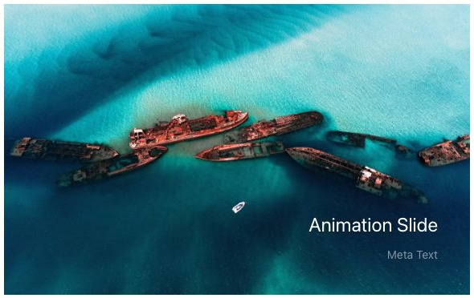

[Apri la demo](https://demo.yootheme.com/joomla/elements/uikit/multiple-items-elements/slideshow#slideshow-animation-slide) · Riferimento: `slideshow-animation-slide`.

### Transizione scale

La demo usa la transizione scale fra le slide. Apri il collegamento per confrontarne il movimento.

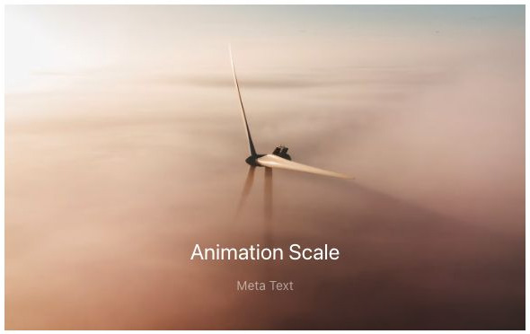

[Apri la demo](https://demo.yootheme.com/joomla/elements/uikit/multiple-items-elements/slideshow#slideshow-animation-scale) · Riferimento: `slideshow-animation-scale`.

### Dissolvenza con effetto Ken Burns

Zoom lento dell’immagine con dissolvenza.

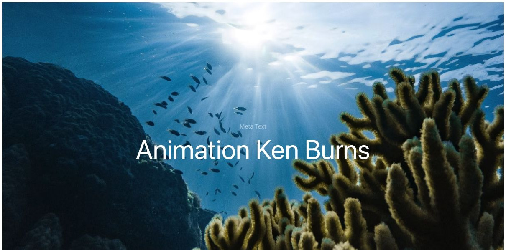

[Apri la demo](https://demo.yootheme.com/joomla/elements/uikit/multiple-items-elements/slideshow#slideshow-animation-fade-ken-burns) · Riferimento: `slideshow-animation-fade-ken-burns`.

### Content left dotnav

Puntini per selezionare il contenuto.

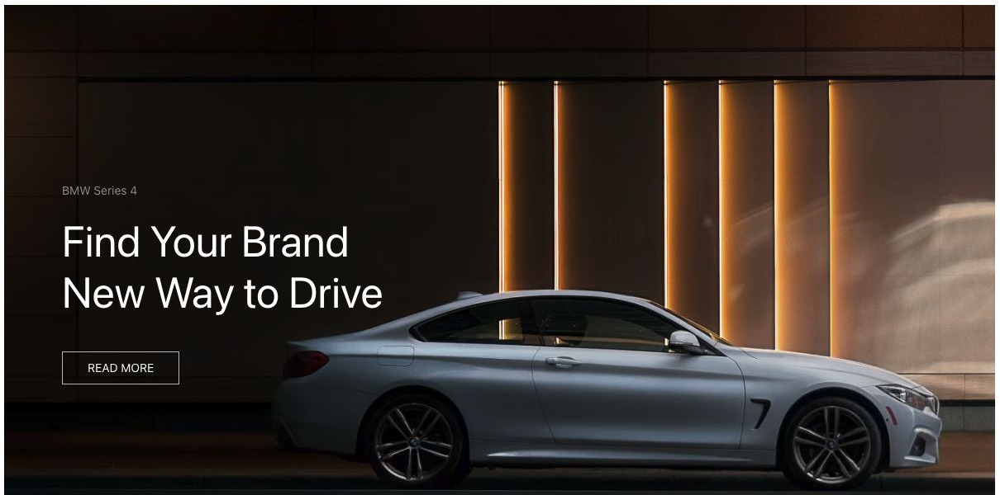

[Apri la demo](https://demo.yootheme.com/joomla/elements/uikit/multiple-items-elements/slideshow#slideshow-content-left-dotnav) · Riferimento: `slideshow-content-left-dotnav`.

### Images slidenav bottom right

Frecce per passare all’elemento precedente o successivo.

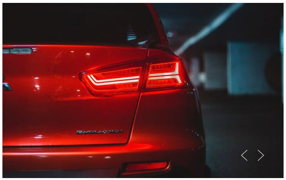

[Apri la demo](https://demo.yootheme.com/joomla/elements/uikit/multiple-items-elements/slideshow#slideshow-images-slidenav-bottom-right) · Riferimento: `slideshow-images-slidenav-bottom-right`.

### Images dotnav bottom left

Puntini per selezionare il contenuto.

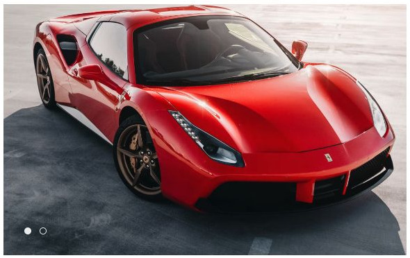

[Apri la demo](https://demo.yootheme.com/joomla/elements/uikit/multiple-items-elements/slideshow#slideshow-images-dotnav-bottom-left) · Riferimento: `slideshow-images-dotnav-bottom-left`.

### Thumbnav center

Miniature per selezionare il contenuto.

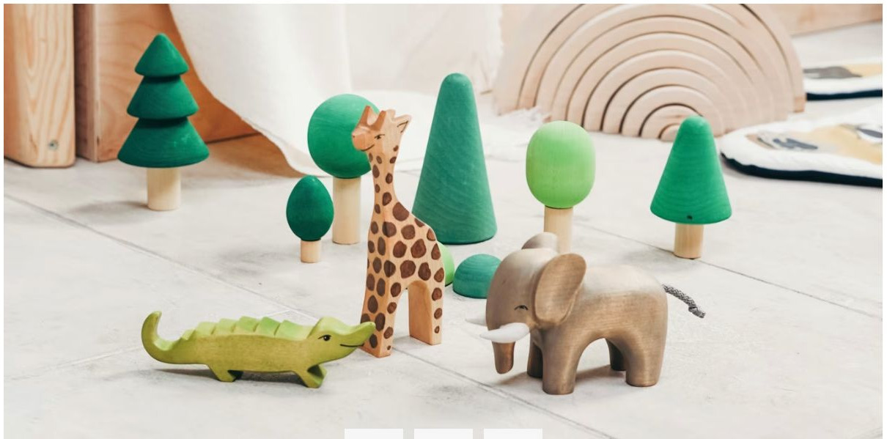

[Apri la demo](https://demo.yootheme.com/joomla/elements/uikit/multiple-items-elements/slideshow#slideshow-thumbnav-center) · Riferimento: `slideshow-thumbnav-center`.

### Images thumbnav below left

Miniature per selezionare il contenuto.

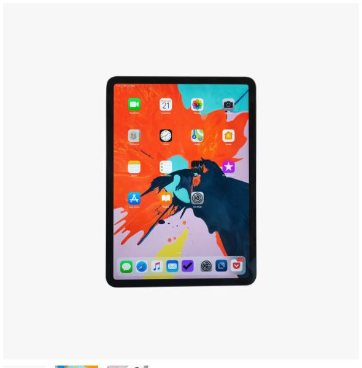

[Apri la demo](https://demo.yootheme.com/joomla/elements/uikit/multiple-items-elements/slideshow#slideshow-images-thumbnav-below-left) · Riferimento: `slideshow-images-thumbnav-below-left`.

### Images thumbnav below right

Miniature per selezionare il contenuto.

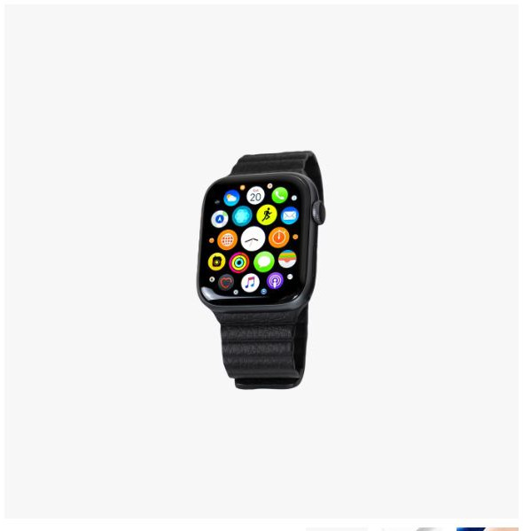

[Apri la demo](https://demo.yootheme.com/joomla/elements/uikit/multiple-items-elements/slideshow#slideshow-images-thumbnav-below-right) · Riferimento: `slideshow-images-thumbnav-below-right`.

### Pannello sovrapposto al centro

Il contenuto è centrato sopra al media dentro un pannello.

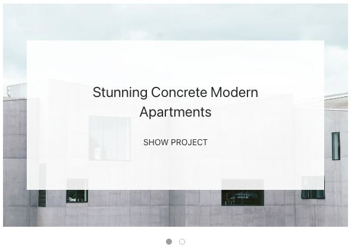

[Apri la demo](https://demo.yootheme.com/joomla/elements/uikit/multiple-items-elements/slideshow#slideshow-overlay-default-center-center) · Riferimento: `slideshow-overlay-default-center-center`.

### Riquadro in basso a destra

Il contenuto è raccolto in un riquadro sovrapposto nell’angolo inferiore destro.

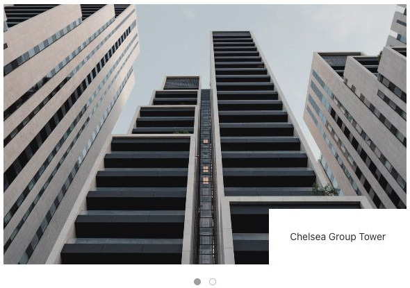

[Apri la demo](https://demo.yootheme.com/joomla/elements/uikit/multiple-items-elements/slideshow#slideshow-overlay-tile-bottom-right) · Riferimento: `slideshow-overlay-tile-bottom-right`.

### Riquadro in basso a sinistra

Il contenuto è raccolto in un riquadro sovrapposto nell’angolo inferiore sinistro.

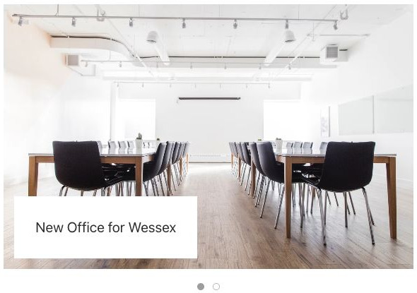

[Apri la demo](https://demo.yootheme.com/joomla/elements/uikit/multiple-items-elements/slideshow#slideshow-overlay-tile-bottom-left) · Riferimento: `slideshow-overlay-tile-bottom-left`.

### Riquadro nella parte inferiore

Il testo occupa una fascia o un riquadro sovrapposto in basso.

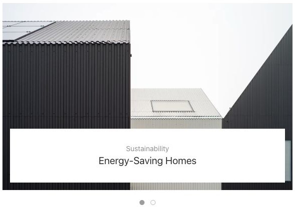

[Apri la demo](https://demo.yootheme.com/joomla/elements/uikit/multiple-items-elements/slideshow#slideshow-overlay-tile-bottom) · Riferimento: `slideshow-overlay-tile-bottom`.

### Content left parallax

Movimento collegato allo scorrimento della pagina.

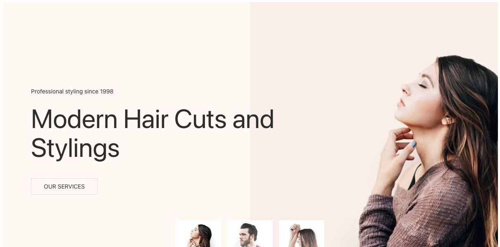

[Apri la demo](https://demo.yootheme.com/joomla/elements/uikit/multiple-items-elements/slideshow#slideshow-content-left-parallax) · Riferimento: `slideshow-content-left-parallax`.

### Video con avvio automatico

La slide contiene un video configurato per avviarsi automaticamente.

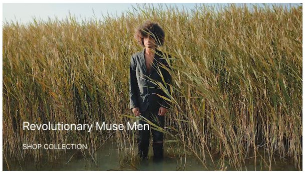

[Apri la demo](https://demo.yootheme.com/joomla/elements/uikit/multiple-items-elements/slideshow#slideshow-video-autoplay) · Riferimento: `slideshow-video-autoplay`.

### Viewport height content center

Altezza adattata alla finestra.

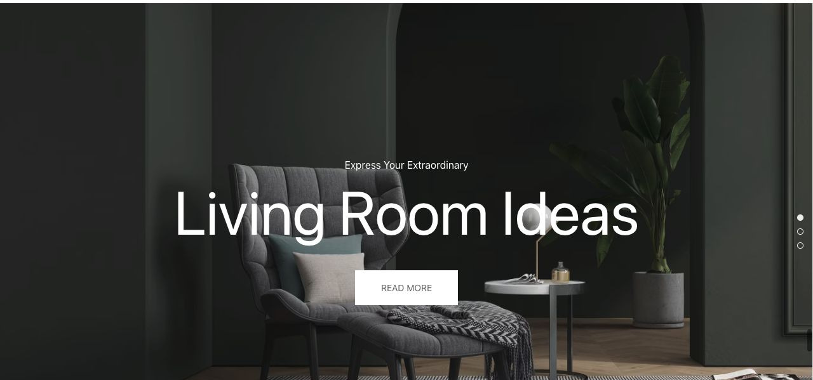

[Apri la demo](https://demo.yootheme.com/joomla/elements/uikit/multiple-items-elements/slideshow#slideshow-viewport-height-content-center) · Riferimento: `slideshow-viewport-height-content-center`.

