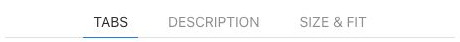

# Subnav - Elementi a raccolta

[Indice del catalogo](../README.md) · [PDF offline](../../../output/pdf/catalogo-widget-yootheme.pdf)

Navigazioni brevi in linea, filtri visivi e tab.

**Contenuti:** Etichette, link e voce attiva.

Fonte grafica: UIkit (demo elementi). Le demo generiche non dichiarano il tema originale di ogni preset; non viene dedotto dalle immagini.

| Variante | Demo |
|---|---|
| Stile base | [Esempio](https://demo.yootheme.com/joomla/elements/uikit/multiple-items-elements/subnav#subnav-style-default) |
| Voci con divisori | [Esempio](https://demo.yootheme.com/joomla/elements/uikit/multiple-items-elements/subnav#subnav-style-divider) |
| Navigazione pill | [Esempio](https://demo.yootheme.com/joomla/elements/uikit/multiple-items-elements/subnav#subnav-style-pill) |
| Navigazione a tab | [Esempio](https://demo.yootheme.com/joomla/elements/uikit/multiple-items-elements/subnav#subnav-style-tabs) |

### Stile base

Presentazione di riferimento della famiglia, utile per confrontare le altre varianti.

[Apri la demo](https://demo.yootheme.com/joomla/elements/uikit/multiple-items-elements/subnav#subnav-style-default) · Riferimento: `subnav-style-default`.

### Voci con divisori

Linee divisorie separano le voci o le parti del contenuto.

[Apri la demo](https://demo.yootheme.com/joomla/elements/uikit/multiple-items-elements/subnav#subnav-style-divider) · Riferimento: `subnav-style-divider`.

### Navigazione pill

Variazione di style pill.

[Apri la demo](https://demo.yootheme.com/joomla/elements/uikit/multiple-items-elements/subnav#subnav-style-pill) · Riferimento: `subnav-style-pill`.

### Navigazione a tab

Variazione di style tabs.

[Apri la demo](https://demo.yootheme.com/joomla/elements/uikit/multiple-items-elements/subnav#subnav-style-tabs) · Riferimento: `subnav-style-tabs`.

