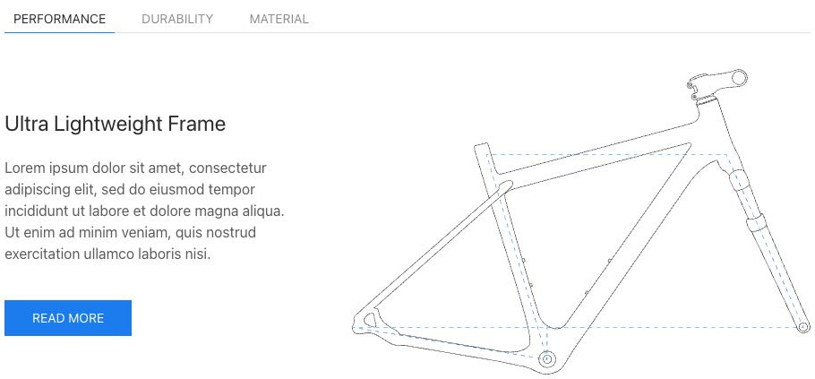
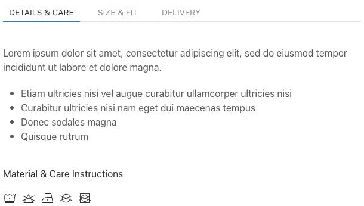
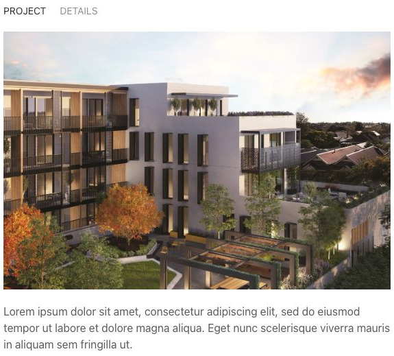
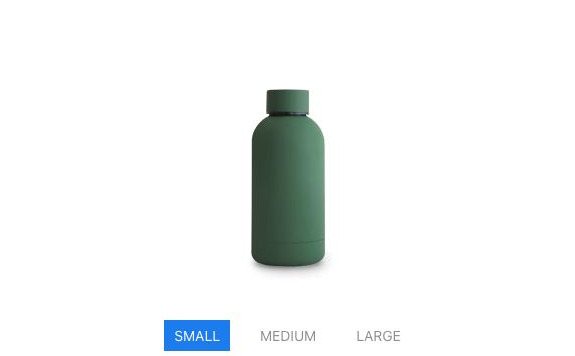
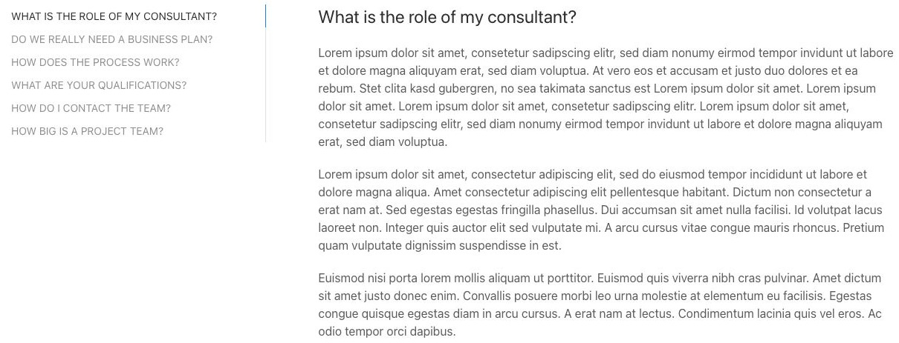
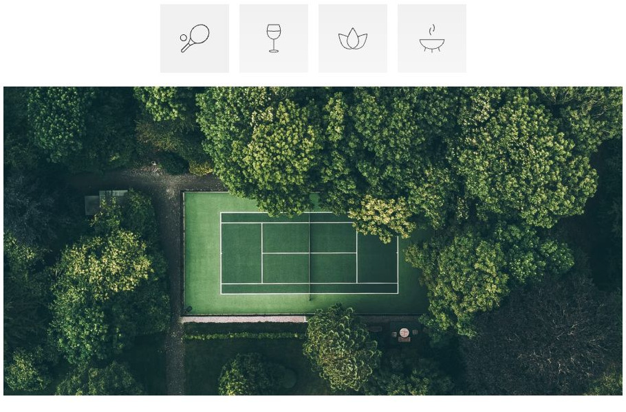
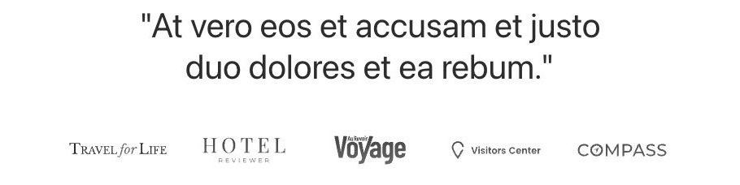
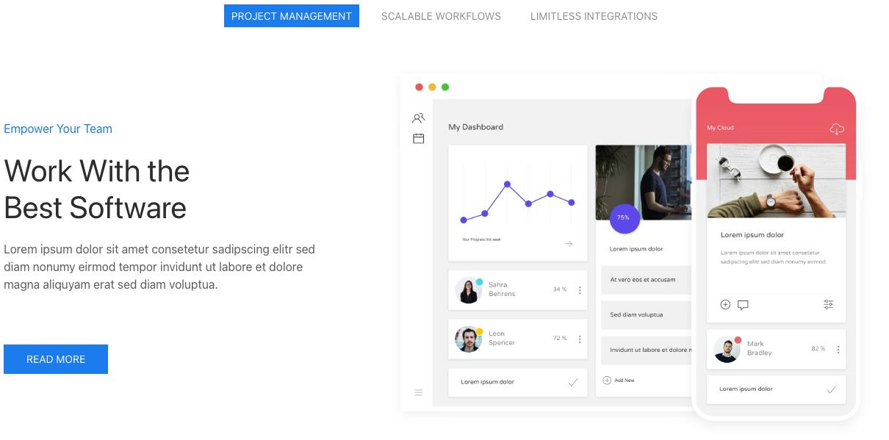
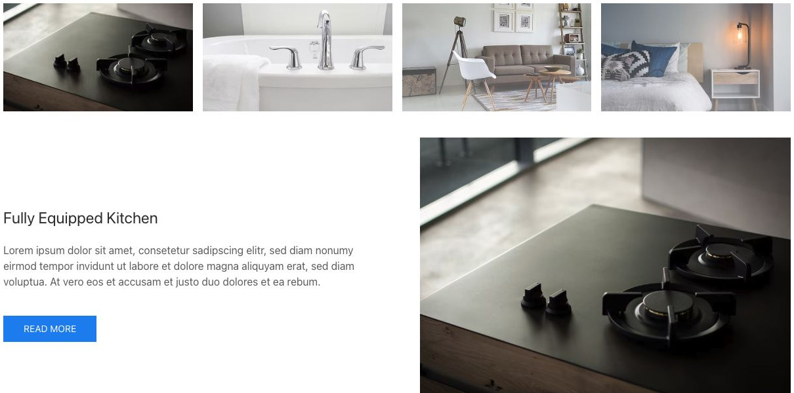

# Switcher - Elementi a raccolta

[Indice del catalogo](../README.md) · [PDF offline](../../../output/pdf/catalogo-widget-yootheme.pdf)

Approfondimenti raggruppati per argomento, categoria o caratteristica.

**Contenuti:** Etichette di navigazione e relativi pannelli.

Fonte grafica: UIkit (demo elementi). Le demo generiche non dichiarano il tema originale di ogni preset; non viene dedotto dalle immagini.

| Variante | Demo |
|---|---|
| Tabs top image right | [Esempio](https://demo.yootheme.com/joomla/elements/uikit/multiple-items-elements/switcher#switcher-tabs-top-image-right) |
| Tab sopra, immagine sotto | [Esempio](https://demo.yootheme.com/joomla/elements/uikit/multiple-items-elements/switcher#switcher-tabs-top-image-bottom) |
| Subnav top image top | [Esempio](https://demo.yootheme.com/joomla/elements/uikit/multiple-items-elements/switcher#switcher-subnav-top-image-top) |
| Pulsanti pill sotto il contenuto | [Esempio](https://demo.yootheme.com/joomla/elements/uikit/multiple-items-elements/switcher#switcher-subnav-pill-bottom) |
| Tab a sinistra | [Esempio](https://demo.yootheme.com/joomla/elements/uikit/multiple-items-elements/switcher#switcher-tabs-left) |
| Thumbnav top image top | [Esempio](https://demo.yootheme.com/joomla/elements/uikit/multiple-items-elements/switcher#switcher-thumbnav-top-image-top) |
| Thumbnav bottom | [Esempio](https://demo.yootheme.com/joomla/elements/uikit/multiple-items-elements/switcher#switcher-thumbnav-bottom) |
| Subnav pill top image right | [Esempio](https://demo.yootheme.com/joomla/elements/uikit/multiple-items-elements/switcher#switcher-subnav-pill-top-image-right) |
| Thumbnav top justify image right | [Esempio](https://demo.yootheme.com/joomla/elements/uikit/multiple-items-elements/switcher#switcher-thumbnav-top-justify-image-right) |

### Tabs top image right

Immagine affiancata a destra del testo.

[Apri la demo](https://demo.yootheme.com/joomla/elements/uikit/multiple-items-elements/switcher#switcher-tabs-top-image-right) · Riferimento: `switcher-tabs-top-image-right`.

### Tab sopra, immagine sotto

La navigazione precede il contenuto e il media si trova nella parte inferiore del pannello.

[Apri la demo](https://demo.yootheme.com/joomla/elements/uikit/multiple-items-elements/switcher#switcher-tabs-top-image-bottom) · Riferimento: `switcher-tabs-top-image-bottom`.

### Subnav top image top

Immagine sopra al contenuto.

[Apri la demo](https://demo.yootheme.com/joomla/elements/uikit/multiple-items-elements/switcher#switcher-subnav-top-image-top) · Riferimento: `switcher-subnav-top-image-top`.

### Pulsanti pill sotto il contenuto

La selezione si trova sotto il pannello e usa elementi arrotondati.

[Apri la demo](https://demo.yootheme.com/joomla/elements/uikit/multiple-items-elements/switcher#switcher-subnav-pill-bottom) · Riferimento: `switcher-subnav-pill-bottom`.

### Tab a sinistra

La navigazione verticale affianca il contenuto selezionato.

[Apri la demo](https://demo.yootheme.com/joomla/elements/uikit/multiple-items-elements/switcher#switcher-tabs-left) · Riferimento: `switcher-tabs-left`.

### Thumbnav top image top

Miniature per selezionare il contenuto. Immagine sopra al contenuto.

[Apri la demo](https://demo.yootheme.com/joomla/elements/uikit/multiple-items-elements/switcher#switcher-thumbnav-top-image-top) · Riferimento: `switcher-thumbnav-top-image-top`.

### Thumbnav bottom

Miniature per selezionare il contenuto.

[Apri la demo](https://demo.yootheme.com/joomla/elements/uikit/multiple-items-elements/switcher#switcher-thumbnav-bottom) · Riferimento: `switcher-thumbnav-bottom`.

### Subnav pill top image right

Immagine affiancata a destra del testo.

[Apri la demo](https://demo.yootheme.com/joomla/elements/uikit/multiple-items-elements/switcher#switcher-subnav-pill-top-image-right) · Riferimento: `switcher-subnav-pill-top-image-right`.

### Thumbnav top justify image right

Miniature per selezionare il contenuto. Immagine affiancata a destra del testo.

[Apri la demo](https://demo.yootheme.com/joomla/elements/uikit/multiple-items-elements/switcher#switcher-thumbnav-top-justify-image-right) · Riferimento: `switcher-thumbnav-top-justify-image-right`.

