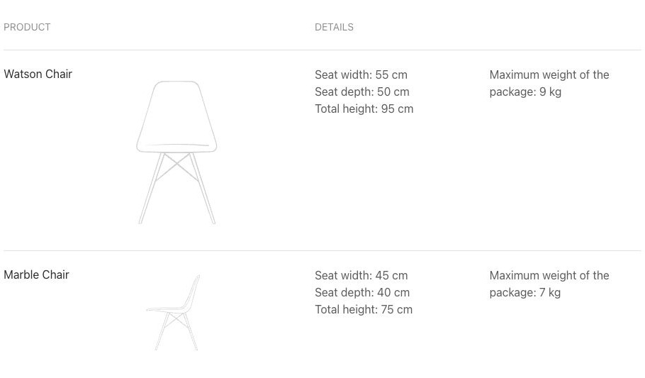
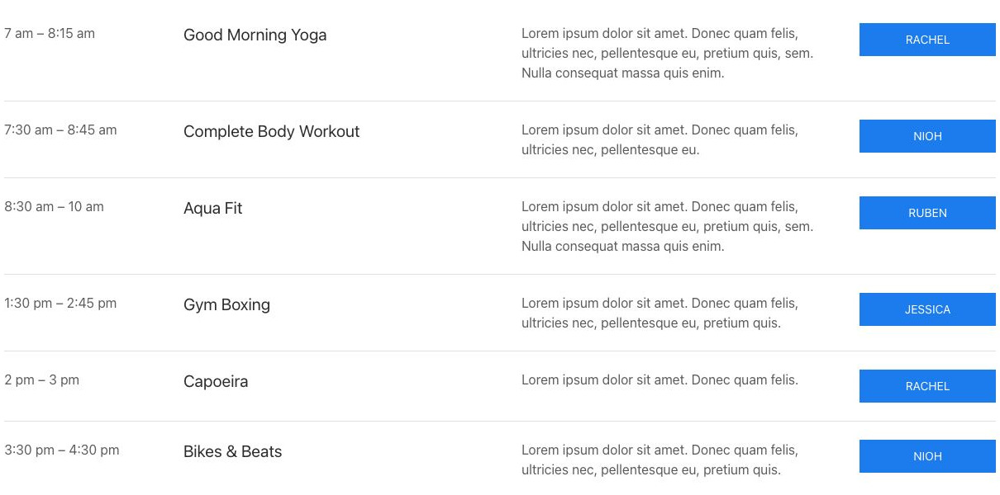

# Table - Elementi a raccolta

[Indice del catalogo](../README.md) · [PDF offline](../../../output/pdf/catalogo-widget-yootheme.pdf)

Confronti e dati che richiedono l’allineamento per colonne.

**Contenuti:** Righe, campi e intestazioni.

Fonte grafica: UIkit (demo elementi). Le demo generiche non dichiarano il tema originale di ogni preset; non viene dedotto dalle immagini.

| Variante | Demo |
|---|---|
| Size default columns expand two | [Esempio](https://demo.yootheme.com/joomla/elements/uikit/multiple-items-elements/table#table-size-default-columns-expand-two) |
| Size small style divider | [Esempio](https://demo.yootheme.com/joomla/elements/uikit/multiple-items-elements/table#table-size-small-style-divider) |
| Size small style default | [Esempio](https://demo.yootheme.com/joomla/elements/uikit/multiple-items-elements/table#table-size-small-style-default) |
| Size large columns shrink all center | [Esempio](https://demo.yootheme.com/joomla/elements/uikit/multiple-items-elements/table#table-size-large-columns-shrink-all-center) |
| Size large columns shrink all top | [Esempio](https://demo.yootheme.com/joomla/elements/uikit/multiple-items-elements/table#table-size-large-columns-shrink-all-top) |
| Size large columns fixed all | [Esempio](https://demo.yootheme.com/joomla/elements/uikit/multiple-items-elements/table#table-size-large-columns-fixed-all) |
| Size default columns expand one | [Esempio](https://demo.yootheme.com/joomla/elements/uikit/multiple-items-elements/table#table-size-default-columns-expand-one) |
| Size large columns expand one | [Esempio](https://demo.yootheme.com/joomla/elements/uikit/multiple-items-elements/table#table-size-large-columns-expand-one) |

### Size default columns expand two

Tabella con spaziatura standard e due colonne espandibili.

[Apri la demo](https://demo.yootheme.com/joomla/elements/uikit/multiple-items-elements/table#table-size-default-columns-expand-two) · Riferimento: `table-size-default-columns-expand-two`.

### Size small style divider

Linee divisorie separano le voci o le parti del contenuto.

[Apri la demo](https://demo.yootheme.com/joomla/elements/uikit/multiple-items-elements/table#table-size-small-style-divider) · Riferimento: `table-size-small-style-divider`.

### Size small style default

Variante di dimensione small style default del componente.

[Apri la demo](https://demo.yootheme.com/joomla/elements/uikit/multiple-items-elements/table#table-size-small-style-default) · Riferimento: `table-size-small-style-default`.

### Size large columns shrink all center

Tabella con spaziatura ampia e colonne aderenti al contenuto.

[Apri la demo](https://demo.yootheme.com/joomla/elements/uikit/multiple-items-elements/table#table-size-large-columns-shrink-all-center) · Riferimento: `table-size-large-columns-shrink-all-center`.

### Size large columns shrink all top

Tabella con spaziatura ampia e colonne aderenti al contenuto.

[Apri la demo](https://demo.yootheme.com/joomla/elements/uikit/multiple-items-elements/table#table-size-large-columns-shrink-all-top) · Riferimento: `table-size-large-columns-shrink-all-top`.

### Size large columns fixed all

Tabella con spaziatura ampia e colonne a larghezza fissa.

[Apri la demo](https://demo.yootheme.com/joomla/elements/uikit/multiple-items-elements/table#table-size-large-columns-fixed-all) · Riferimento: `table-size-large-columns-fixed-all`.

### Size default columns expand one

Tabella con spaziatura standard e una colonna espandibile.

[Apri la demo](https://demo.yootheme.com/joomla/elements/uikit/multiple-items-elements/table#table-size-default-columns-expand-one) · Riferimento: `table-size-default-columns-expand-one`.

### Size large columns expand one

Tabella con spaziatura ampia e una colonna espandibile.

[Apri la demo](https://demo.yootheme.com/joomla/elements/uikit/multiple-items-elements/table#table-size-large-columns-expand-one) · Riferimento: `table-size-large-columns-expand-one`.

