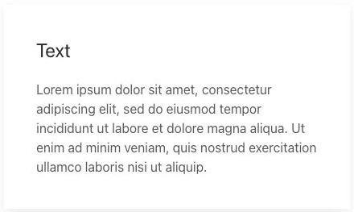
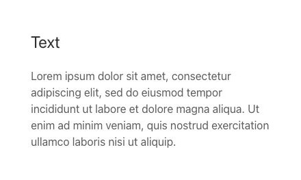
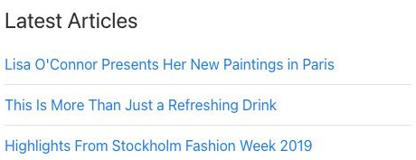
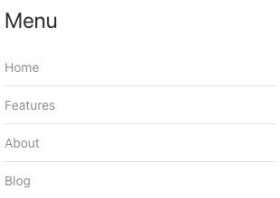

# Module / Widget - Elementi di sistema

[Indice del catalogo](../README.md) · [PDF offline](../../../output/pdf/catalogo-widget-yootheme.pdf)

Inserimento e presentazione di moduli del CMS ospite.

**Contenuti:** Modulo pubblicato e opzioni del contenitore.

Fonte grafica: UIkit (demo elementi). Le demo generiche non dichiarano il tema originale di ogni preset; non viene dedotto dalle immagini.

| Variante | Demo |
|---|---|
| Senza contenitore decorativo | [Esempio](https://demo.yootheme.com/joomla/elements/uikit/system-elements/module#module-style-none) |
| Style card default | [Esempio](https://demo.yootheme.com/joomla/elements/uikit/system-elements/module#module-style-card-default) |
| Style card hover | [Esempio](https://demo.yootheme.com/joomla/elements/uikit/system-elements/module#module-style-card-hover) |
| Title decoration divider | [Esempio](https://demo.yootheme.com/joomla/elements/uikit/system-elements/module#module-title-decoration-divider) |
| Title decoration bullet | [Esempio](https://demo.yootheme.com/joomla/elements/uikit/system-elements/module#module-title-decoration-bullet) |
| Title decoration line | [Esempio](https://demo.yootheme.com/joomla/elements/uikit/system-elements/module#module-title-decoration-line) |
| List style divider | [Esempio](https://demo.yootheme.com/joomla/elements/uikit/system-elements/module#module-list-style-divider) |
| Menu style nav | [Esempio](https://demo.yootheme.com/joomla/elements/uikit/system-elements/module#module-menu-style-nav) |
| Menu style nav dividers | [Esempio](https://demo.yootheme.com/joomla/elements/uikit/system-elements/module#module-menu-style-nav-dividers) |
| Menu style subnav | [Esempio](https://demo.yootheme.com/joomla/elements/uikit/system-elements/module#module-menu-style-subnav) |

### Senza contenitore decorativo

Il contenuto è presentato senza la cornice di una card.

[Apri la demo](https://demo.yootheme.com/joomla/elements/uikit/system-elements/module#module-style-none) · Riferimento: `module-style-none`.

### Style card default

Il contenuto è raccolto in schede con un contenitore riconoscibile.

[Apri la demo](https://demo.yootheme.com/joomla/elements/uikit/system-elements/module#module-style-card-default) · Riferimento: `module-style-card-default`.

### Style card hover

Una parte del contenuto cambia o compare al passaggio del mouse.

[Apri la demo](https://demo.yootheme.com/joomla/elements/uikit/system-elements/module#module-style-card-hover) · Riferimento: `module-style-card-hover`.

### Title decoration divider

Linee divisorie separano le voci o le parti del contenuto.

[Apri la demo](https://demo.yootheme.com/joomla/elements/uikit/system-elements/module#module-title-decoration-divider) · Riferimento: `module-title-decoration-divider`.

### Title decoration bullet

Una decorazione accompagna il titolo o il media: bullet.

[Apri la demo](https://demo.yootheme.com/joomla/elements/uikit/system-elements/module#module-title-decoration-bullet) · Riferimento: `module-title-decoration-bullet`.

### Title decoration line

Una decorazione accompagna il titolo o il media: line.

[Apri la demo](https://demo.yootheme.com/joomla/elements/uikit/system-elements/module#module-title-decoration-line) · Riferimento: `module-title-decoration-line`.

### List style divider

Linee divisorie separano le voci o le parti del contenuto.

[Apri la demo](https://demo.yootheme.com/joomla/elements/uikit/system-elements/module#module-list-style-divider) · Riferimento: `module-list-style-divider`.

### Menu style nav

Variazione di menu style nav.

[Apri la demo](https://demo.yootheme.com/joomla/elements/uikit/system-elements/module#module-menu-style-nav) · Riferimento: `module-menu-style-nav`.

### Menu style nav dividers

Linee divisorie separano le voci o le parti del contenuto.

[Apri la demo](https://demo.yootheme.com/joomla/elements/uikit/system-elements/module#module-menu-style-nav-dividers) · Riferimento: `module-menu-style-nav-dividers`.

### Menu style subnav

Variazione di menu style subnav.

[Apri la demo](https://demo.yootheme.com/joomla/elements/uikit/system-elements/module#module-menu-style-subnav) · Riferimento: `module-menu-style-subnav`.

