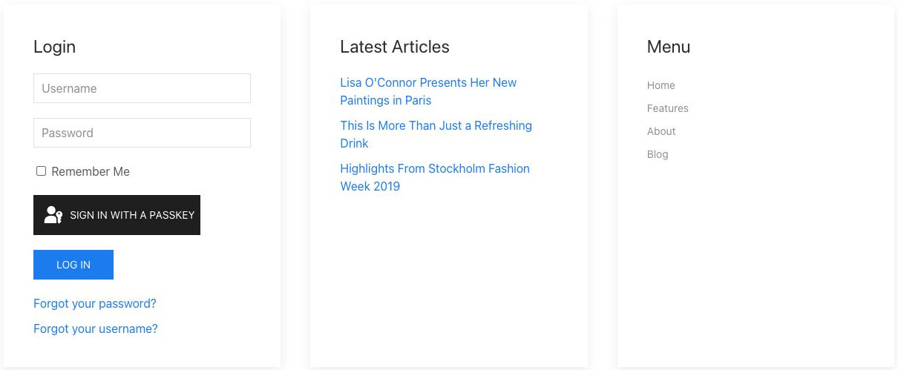

# Position / Area - Elementi di sistema

[Indice del catalogo](../README.md) · [PDF offline](../../../output/pdf/catalogo-widget-yootheme.pdf)

Composizione dei moduli pubblicati in un’area del CMS.

**Contenuti:** Area, moduli e struttura della griglia.

Fonte grafica: UIkit (demo elementi). Le demo generiche non dichiarano il tema originale di ogni preset; non viene dedotto dalle immagini.

| Variante | Demo |
|---|---|
| Moduli in griglia | [Esempio](https://demo.yootheme.com/joomla/elements/uikit/system-elements/position#position-grid) |
| Griglia con divisori | [Esempio](https://demo.yootheme.com/joomla/elements/uikit/system-elements/position#position-grid-dividers) |
| Altezze uniformate | [Esempio](https://demo.yootheme.com/joomla/elements/uikit/system-elements/position#position-match-height) |

### Moduli in griglia

I moduli pubblicati nell’area sono disposti su colonne.

[Apri la demo](https://demo.yootheme.com/joomla/elements/uikit/system-elements/position#position-grid) · Riferimento: `position-grid`.

### Griglia con divisori

Le colonne dei moduli sono separate da linee verticali.

[Apri la demo](https://demo.yootheme.com/joomla/elements/uikit/system-elements/position#position-grid-dividers) · Riferimento: `position-grid-dividers`.

### Altezze uniformate

I contenitori nella stessa riga sono allineati in altezza.

[Apri la demo](https://demo.yootheme.com/joomla/elements/uikit/system-elements/position#position-match-height) · Riferimento: `position-match-height`.

