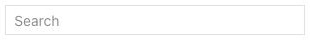
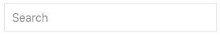
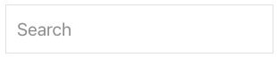
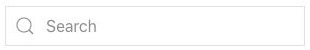
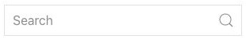

# Search - Elementi di sistema

[Indice del catalogo](../README.md) · [PDF offline](../../../output/pdf/catalogo-widget-yootheme.pdf)

Campo di ricerca del sito.

**Contenuti:** Etichetta, icona, query e integrazione con la ricerca.

Fonte grafica: UIkit (demo elementi). Le demo generiche non dichiarano il tema originale di ogni preset; non viene dedotto dalle immagini.

| Variante | Demo |
|---|---|
| Style large | [Esempio](https://demo.yootheme.com/joomla/elements/uikit/system-elements/search#search-style-large) |
| Size small | [Esempio](https://demo.yootheme.com/joomla/elements/uikit/system-elements/search#search-size-small) |
| Size default | [Esempio](https://demo.yootheme.com/joomla/elements/uikit/system-elements/search#search-size-default) |
| Size large | [Esempio](https://demo.yootheme.com/joomla/elements/uikit/system-elements/search#search-size-large) |
| Icona a sinistra | [Esempio](https://demo.yootheme.com/joomla/elements/uikit/system-elements/search#search-icon-left) |
| Icona cliccabile a destra | [Esempio](https://demo.yootheme.com/joomla/elements/uikit/system-elements/search#search-icon-right-clickable) |

### Style large

Variazione di style large.

[Apri la demo](https://demo.yootheme.com/joomla/elements/uikit/system-elements/search#search-style-large) · Riferimento: `search-style-large`.

### Size small

Variante di dimensione small del componente.

[Apri la demo](https://demo.yootheme.com/joomla/elements/uikit/system-elements/search#search-size-small) · Riferimento: `search-size-small`.

### Size default

Variante di dimensione default del componente.

[Apri la demo](https://demo.yootheme.com/joomla/elements/uikit/system-elements/search#search-size-default) · Riferimento: `search-size-default`.

### Size large

Variante di dimensione large del componente.

[Apri la demo](https://demo.yootheme.com/joomla/elements/uikit/system-elements/search#search-size-large) · Riferimento: `search-size-large`.

### Icona a sinistra

L’icona precede l’etichetta o il campo.

[Apri la demo](https://demo.yootheme.com/joomla/elements/uikit/system-elements/search#search-icon-left) · Riferimento: `search-icon-left`.

### Icona cliccabile a destra

L’icona sul lato destro del campo avvia l’azione di ricerca.

[Apri la demo](https://demo.yootheme.com/joomla/elements/uikit/system-elements/search#search-icon-right-clickable) · Riferimento: `search-icon-right-clickable`.

