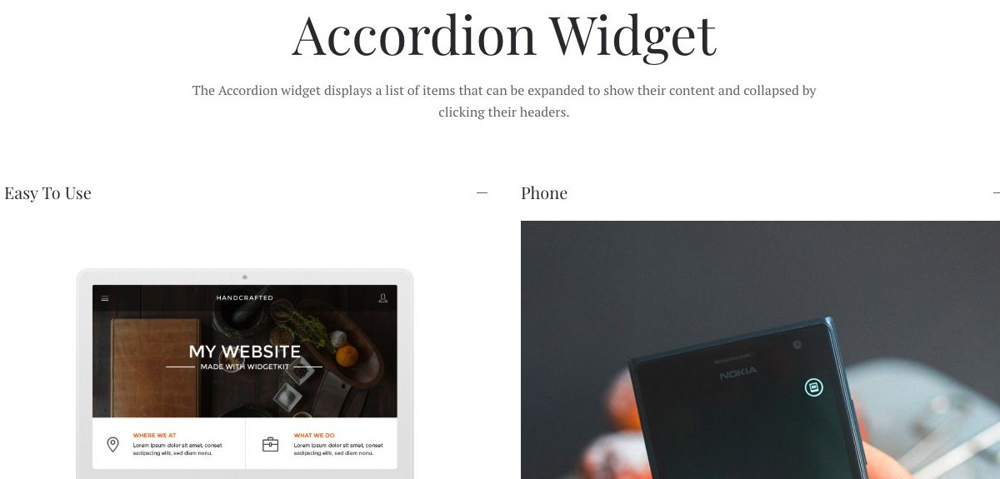
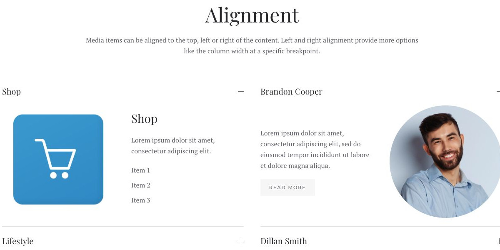

# Accordion - Widgetkit

[Indice del catalogo](../README.md) · [PDF offline](../../../output/pdf/catalogo-widget-yootheme.pdf)

FAQ, dettagli tecnici e informazioni secondarie da aprire quando servono.

**Contenuti:** Titolo di apertura e contenuto di ogni pannello.

Fonte grafica: Fuse (demo Widgetkit). Le demo generiche non dichiarano il tema originale di ogni preset; non viene dedotto dalle immagini.

| Variante | Demo |
|---|---|
| Esempio base | [Esempio](https://demo.yootheme.com/joomla/widgetkit/fuse/home/accordion#accordion) |
| Allineamento | [Esempio](https://demo.yootheme.com/joomla/widgetkit/fuse/home/accordion#alignment) |

### Esempio base

Esempio della sezione Accordion Widget.

[Apri la demo](https://demo.yootheme.com/joomla/widgetkit/fuse/home/accordion#accordion) · Riferimento: `accordion`.

### Allineamento

Esempio della sezione Alignment.

[Apri la demo](https://demo.yootheme.com/joomla/widgetkit/fuse/home/accordion#alignment) · Riferimento: `alignment`.

