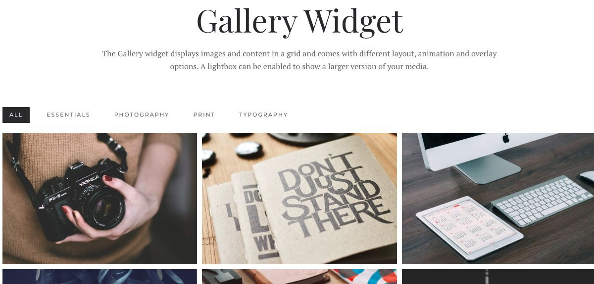
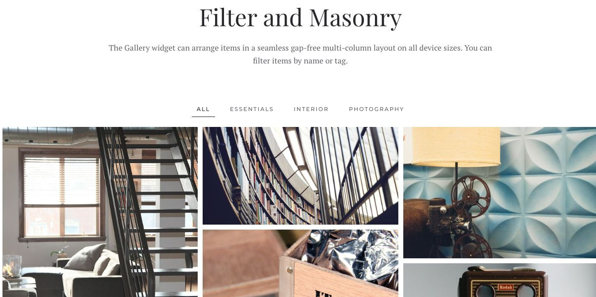
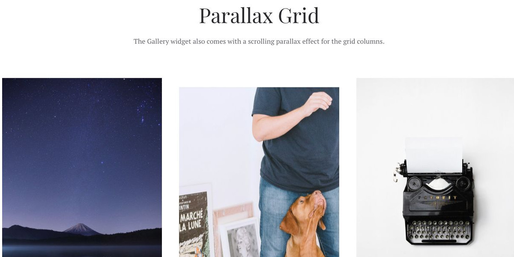
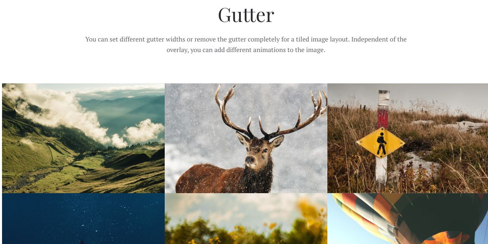
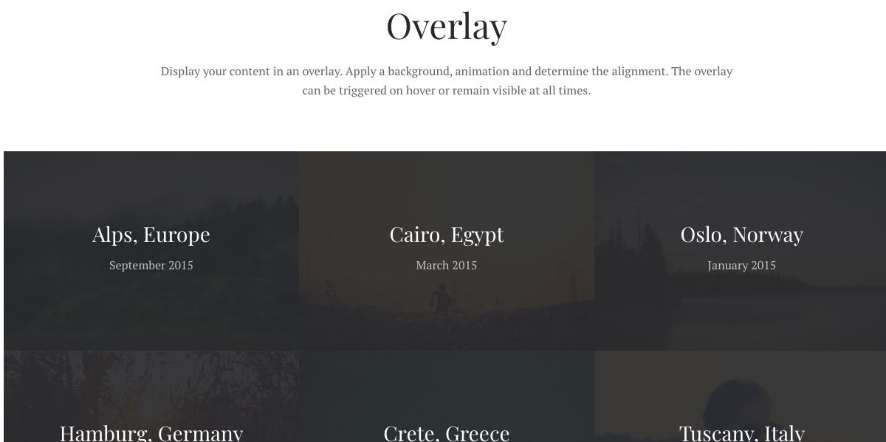
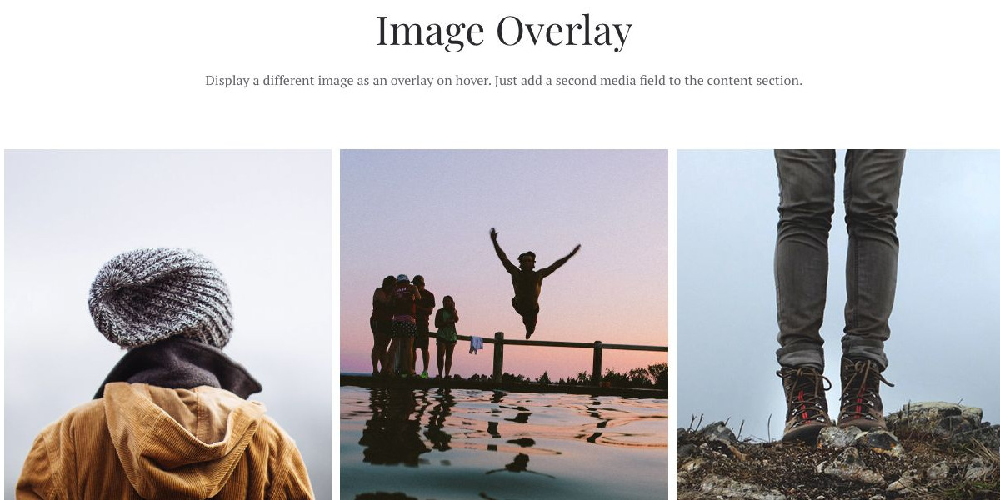
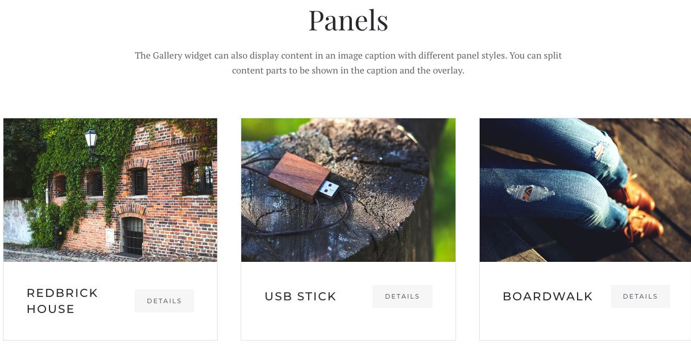

# Gallery - Widgetkit

[Indice del catalogo](../README.md) · [PDF offline](../../../output/pdf/catalogo-widget-yootheme.pdf)

Portfolio e raccolte fotografiche in cui l’immagine è il contenuto principale.

**Contenuti:** Immagini, didascalie, eventuali tag e destinazioni lightbox.

Fonte grafica: Fuse (demo Widgetkit). Le demo generiche non dichiarano il tema originale di ogni preset; non viene dedotto dalle immagini.

| Variante | Demo |
|---|---|
| Esempio base | [Esempio](https://demo.yootheme.com/joomla/widgetkit/fuse/home/gallery#gallery) |
| Filtro e disposizione masonry | [Esempio](https://demo.yootheme.com/joomla/widgetkit/fuse/home/gallery#dynamic) |
| Griglia con parallax | [Esempio](https://demo.yootheme.com/joomla/widgetkit/fuse/home/gallery#parallax) |
| Spaziatura fra gli elementi | [Esempio](https://demo.yootheme.com/joomla/widgetkit/fuse/home/gallery#gutter) |
| Testo sovrapposto | [Esempio](https://demo.yootheme.com/joomla/widgetkit/fuse/home/gallery#overlay) |
| Immagine sovrapposta | [Esempio](https://demo.yootheme.com/joomla/widgetkit/fuse/home/gallery#image-overlay) |
| Varianti del contenitore | [Esempio](https://demo.yootheme.com/joomla/widgetkit/fuse/home/gallery#panels) |

### Esempio base

Esempio della sezione Gallery Widget.

[Apri la demo](https://demo.yootheme.com/joomla/widgetkit/fuse/home/gallery#gallery) · Riferimento: `gallery`.

### Filtro e disposizione masonry

Esempio della sezione Filter and Masonry.

[Apri la demo](https://demo.yootheme.com/joomla/widgetkit/fuse/home/gallery#dynamic) · Riferimento: `dynamic`.

### Griglia con parallax

Movimento collegato allo scorrimento della pagina.

[Apri la demo](https://demo.yootheme.com/joomla/widgetkit/fuse/home/gallery#parallax) · Riferimento: `parallax`.

### Spaziatura fra gli elementi

Esempio della sezione Gutter.

[Apri la demo](https://demo.yootheme.com/joomla/widgetkit/fuse/home/gallery#gutter) · Riferimento: `gutter`.

### Testo sovrapposto

Esempio della sezione Overlay.

[Apri la demo](https://demo.yootheme.com/joomla/widgetkit/fuse/home/gallery#overlay) · Riferimento: `overlay`.

### Immagine sovrapposta

Esempio della sezione Image Overlay.

[Apri la demo](https://demo.yootheme.com/joomla/widgetkit/fuse/home/gallery#image-overlay) · Riferimento: `image-overlay`.

### Varianti del contenitore

Esempio della sezione Panels.

[Apri la demo](https://demo.yootheme.com/joomla/widgetkit/fuse/home/gallery#panels) · Riferimento: `panels`.

