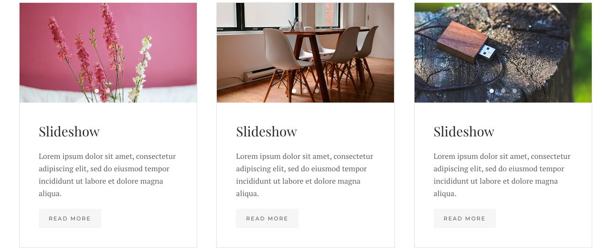
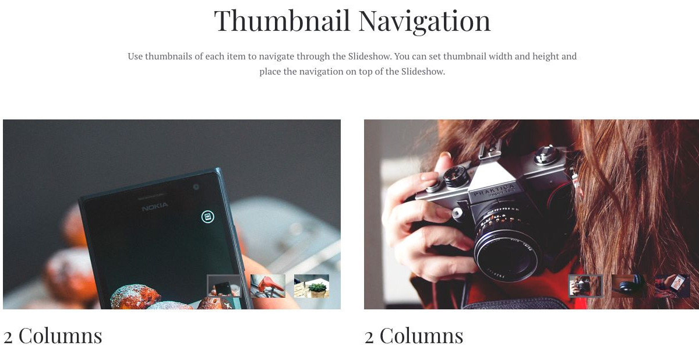
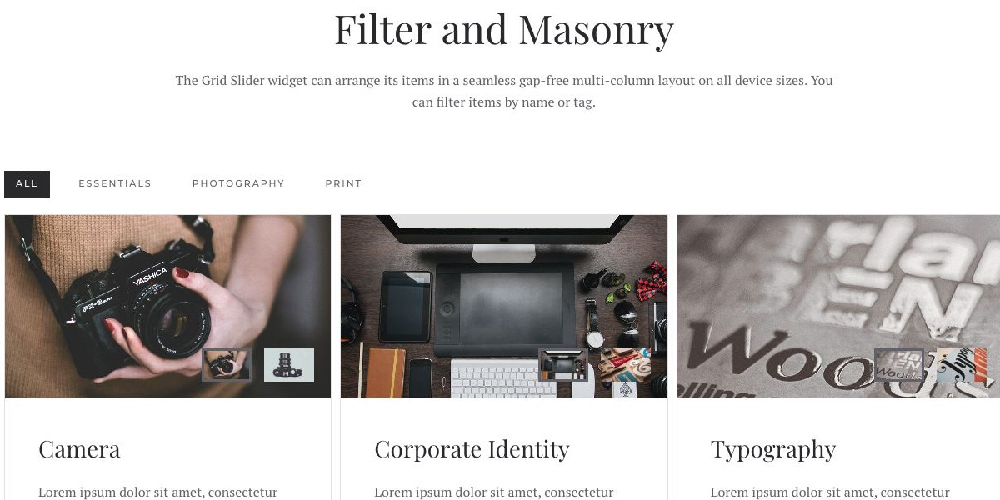

# Grid Slider - Widgetkit

[Indice del catalogo](../README.md) · [PDF offline](../../../output/pdf/catalogo-widget-yootheme.pdf)

Schede nelle quali la parte multimediale contiene a sua volta uno slideshow.

**Contenuti:** Schede con più immagini associate.

Fonte grafica: Fuse (demo Widgetkit). Le demo generiche non dichiarano il tema originale di ogni preset; non viene dedotto dalle immagini.

| Variante | Demo |
|---|---|
| Esempio base | [Esempio](https://demo.yootheme.com/joomla/widgetkit/fuse/home/grid-slider#grid-slider) |
| Navigazione a miniature | [Esempio](https://demo.yootheme.com/joomla/widgetkit/fuse/home/grid-slider#thumbnav) |
| Filtro e disposizione masonry | [Esempio](https://demo.yootheme.com/joomla/widgetkit/fuse/home/grid-slider#dynamic) |

### Esempio base

Esempio della sezione Grid Slider Widget.

[Apri la demo](https://demo.yootheme.com/joomla/widgetkit/fuse/home/grid-slider#grid-slider) · Riferimento: `grid-slider`.

### Navigazione a miniature

Miniature per selezionare il contenuto.

[Apri la demo](https://demo.yootheme.com/joomla/widgetkit/fuse/home/grid-slider#thumbnav) · Riferimento: `thumbnav`.

### Filtro e disposizione masonry

Esempio della sezione Filter and Masonry.

[Apri la demo](https://demo.yootheme.com/joomla/widgetkit/fuse/home/grid-slider#dynamic) · Riferimento: `dynamic`.

