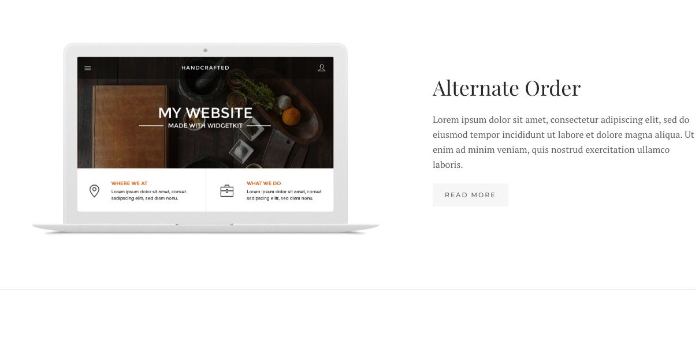
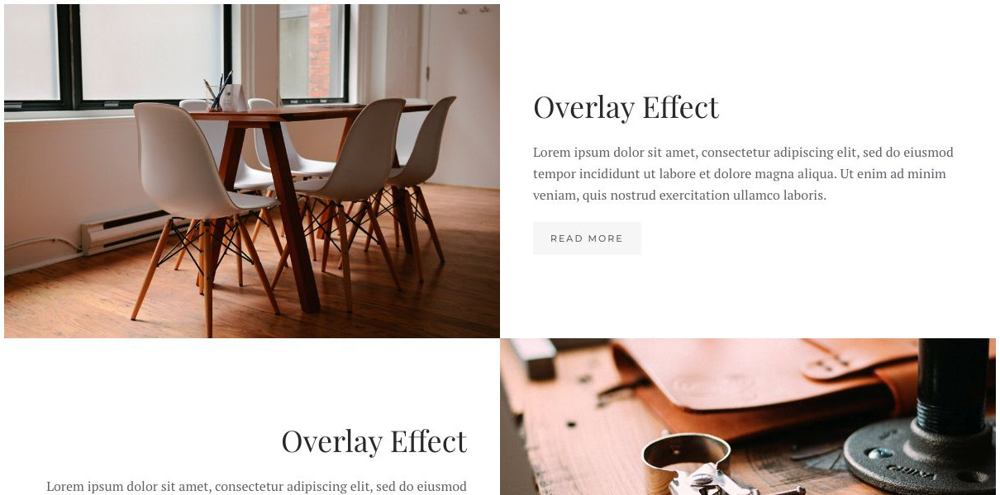
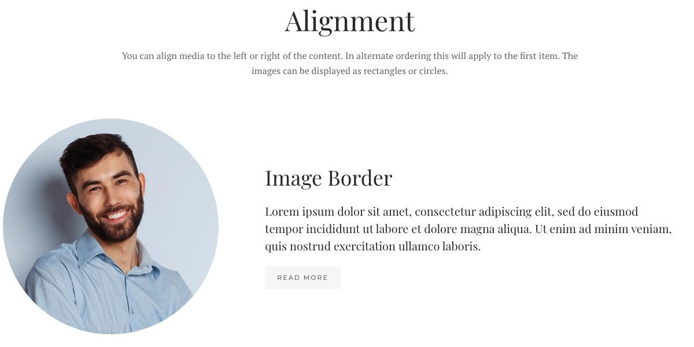

# Grid Stack - Widgetkit

[Indice del catalogo](../README.md) · [PDF offline](../../../output/pdf/catalogo-widget-yootheme.pdf)

Racconti editoriali con righe di immagine e testo, anche alternate.

**Contenuti:** Coppie di media e contenuto.

Fonte grafica: Fuse (demo Widgetkit). Le demo generiche non dichiarano il tema originale di ogni preset; non viene dedotto dalle immagini.

| Variante | Demo |
|---|---|
| Esempio base | [Esempio](https://demo.yootheme.com/joomla/widgetkit/fuse/home/grid-stack#grid-stack) |
| Righe senza margini | [Esempio](https://demo.yootheme.com/joomla/widgetkit/fuse/home/grid-stack#marginless) |
| Allineamento | [Esempio](https://demo.yootheme.com/joomla/widgetkit/fuse/home/grid-stack#alignment) |

### Esempio base

Esempio della sezione Grid Stack.

[Apri la demo](https://demo.yootheme.com/joomla/widgetkit/fuse/home/grid-stack#grid-stack) · Riferimento: `grid-stack`.

### Righe senza margini

Esempio della sezione Marginless.

[Apri la demo](https://demo.yootheme.com/joomla/widgetkit/fuse/home/grid-stack#marginless) · Riferimento: `marginless`.

### Allineamento

Esempio della sezione Alignment.

[Apri la demo](https://demo.yootheme.com/joomla/widgetkit/fuse/home/grid-stack#alignment) · Riferimento: `alignment`.

