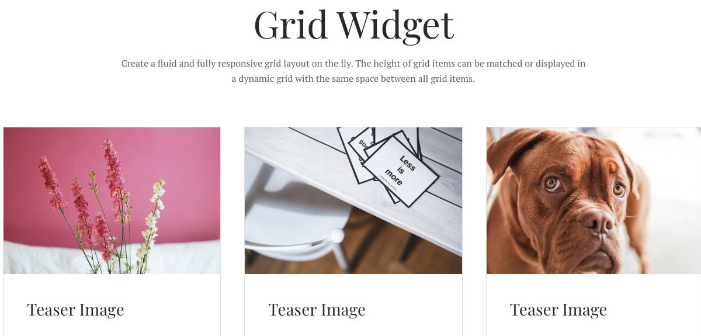
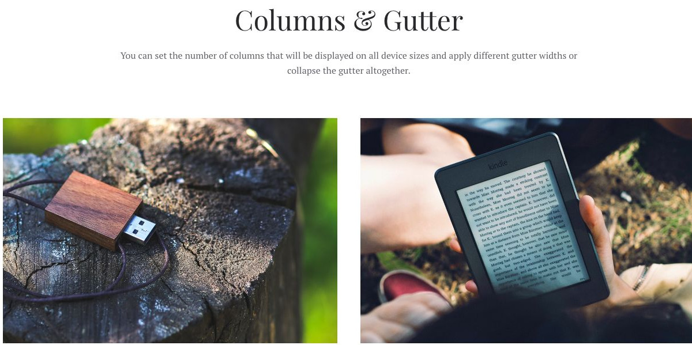
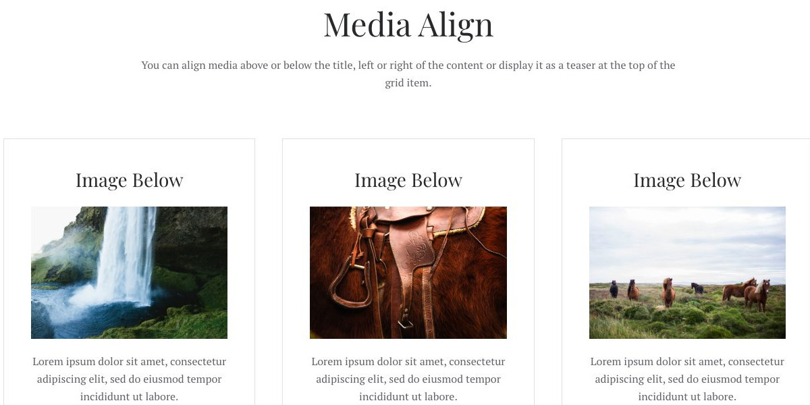
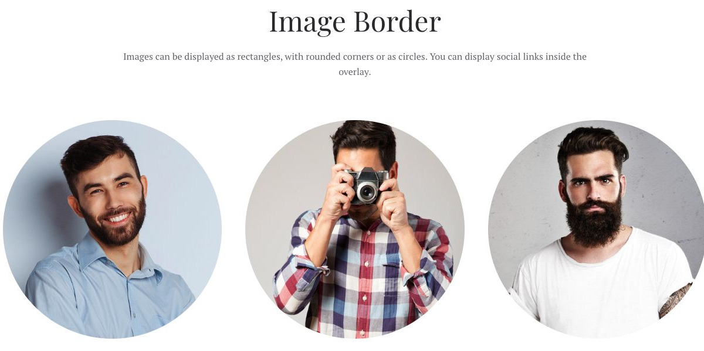
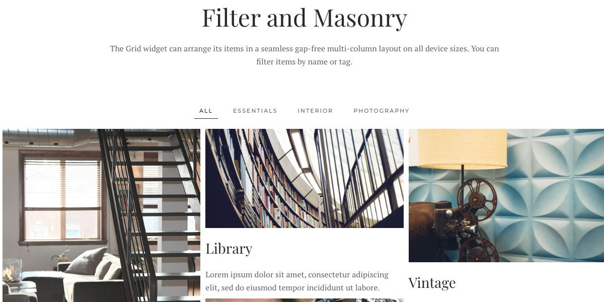
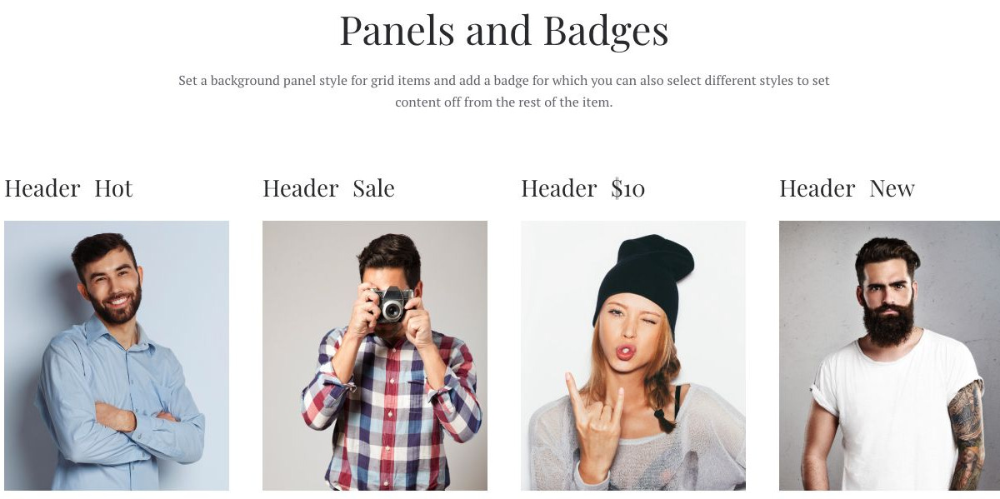

# Grid - Widgetkit

[Indice del catalogo](../README.md) · [PDF offline](../../../output/pdf/catalogo-widget-yootheme.pdf)

Schede di prodotti, servizi, articoli o persone da confrontare a colpo d’occhio.

**Contenuti:** Titolo, testo, immagine o icona, metadati e link.

Fonte grafica: Fuse (demo Widgetkit). Le demo generiche non dichiarano il tema originale di ogni preset; non viene dedotto dalle immagini.

| Variante | Demo |
|---|---|
| Esempio base | [Esempio](https://demo.yootheme.com/joomla/widgetkit/fuse/home/grid#grid) |
| Columns & gutter | [Esempio](https://demo.yootheme.com/joomla/widgetkit/fuse/home/grid#columns) |
| Media align | [Esempio](https://demo.yootheme.com/joomla/widgetkit/fuse/home/grid#alignment) |
| Image border | [Esempio](https://demo.yootheme.com/joomla/widgetkit/fuse/home/grid#border) |
| Filtro e disposizione masonry | [Esempio](https://demo.yootheme.com/joomla/widgetkit/fuse/home/grid#dynamic) |
| Panels and badges | [Esempio](https://demo.yootheme.com/joomla/widgetkit/fuse/home/grid#panels) |

### Esempio base

Esempio della sezione Grid Widget.

[Apri la demo](https://demo.yootheme.com/joomla/widgetkit/fuse/home/grid#grid) · Riferimento: `grid`.

### Columns & gutter

Esempio della sezione Columns & Gutter.

[Apri la demo](https://demo.yootheme.com/joomla/widgetkit/fuse/home/grid#columns) · Riferimento: `columns`.

### Media align

Esempio della sezione Media Align.

[Apri la demo](https://demo.yootheme.com/joomla/widgetkit/fuse/home/grid#alignment) · Riferimento: `alignment`.

### Image border

Esempio della sezione Image Border.

[Apri la demo](https://demo.yootheme.com/joomla/widgetkit/fuse/home/grid#border) · Riferimento: `border`.

### Filtro e disposizione masonry

Esempio della sezione Filter and Masonry.

[Apri la demo](https://demo.yootheme.com/joomla/widgetkit/fuse/home/grid#dynamic) · Riferimento: `dynamic`.

### Panels and badges

Esempio della sezione Panels and Badges.

[Apri la demo](https://demo.yootheme.com/joomla/widgetkit/fuse/home/grid#panels) · Riferimento: `panels`.

