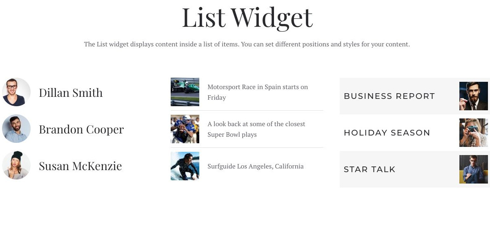

# List - Widgetkit

[Indice del catalogo](../README.md) · [PDF offline](../../../output/pdf/catalogo-widget-yootheme.pdf)

Elenchi di vantaggi, contatti, caratteristiche o voci sintetiche.

**Contenuti:** Testo, icone o immagini e link opzionali.

Fonte grafica: Fuse (demo Widgetkit). Le demo generiche non dichiarano il tema originale di ogni preset; non viene dedotto dalle immagini.

| Variante | Demo |
|---|---|
| Esempio base | [Esempio](https://demo.yootheme.com/joomla/widgetkit/fuse/home/list#list) |

### Esempio base

Esempio della sezione List Widget.

[Apri la demo](https://demo.yootheme.com/joomla/widgetkit/fuse/home/list#list) · Riferimento: `list`.

