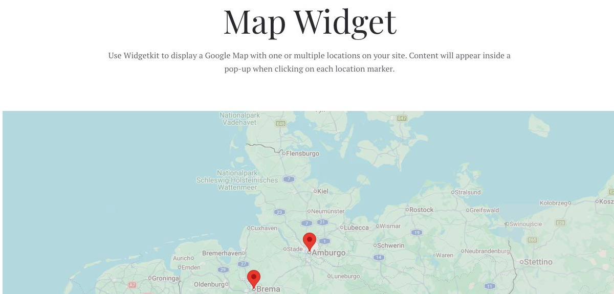
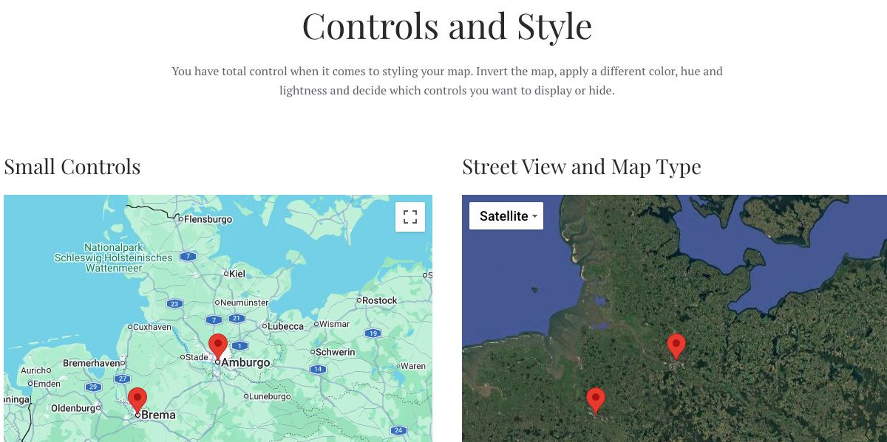

# Map - Widgetkit

[Indice del catalogo](../README.md) · [PDF offline](../../../output/pdf/catalogo-widget-yootheme.pdf)

Sedi, destinazioni, punti di interesse e insiemi di luoghi.

**Contenuti:** Coordinate, etichette e contenuto dei marker.

Fonte grafica: Fuse (demo Widgetkit). Le demo generiche non dichiarano il tema originale di ogni preset; non viene dedotto dalle immagini.

| Variante | Demo |
|---|---|
| Esempio base | [Esempio](https://demo.yootheme.com/joomla/widgetkit/fuse/home/map#map) |
| Controls and style | [Esempio](https://demo.yootheme.com/joomla/widgetkit/fuse/home/map#controls) |

### Esempio base

Esempio della sezione Map Widget.

[Apri la demo](https://demo.yootheme.com/joomla/widgetkit/fuse/home/map#map) · Riferimento: `map`.

### Controls and style

Esempio della sezione Controls and Style.

[Apri la demo](https://demo.yootheme.com/joomla/widgetkit/fuse/home/map#controls) · Riferimento: `controls`.

