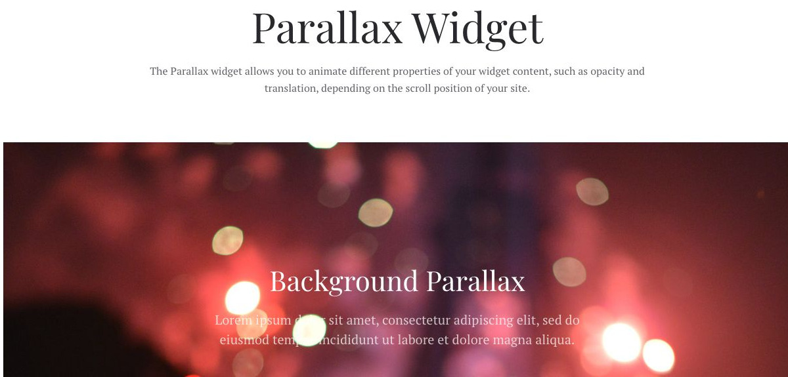
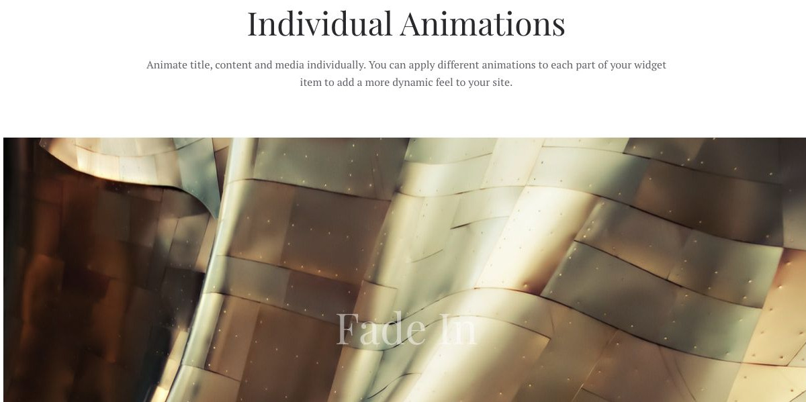
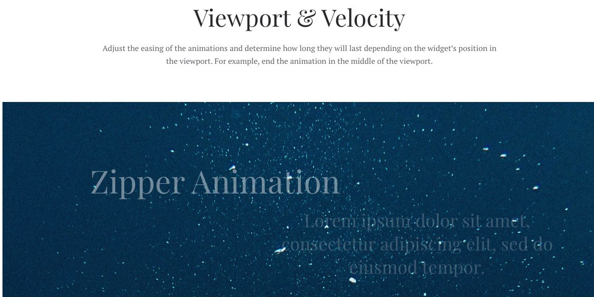
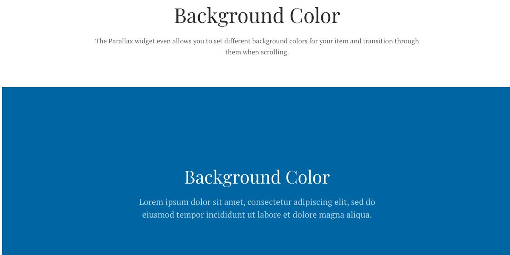

# Parallax - Widgetkit

[Indice del catalogo](../README.md) · [PDF offline](../../../output/pdf/catalogo-widget-yootheme.pdf)

Sezioni narrative con movimento legato allo scorrimento.

**Contenuti:** Sfondo e contenuti da animare.

Fonte grafica: Fuse (demo Widgetkit). Le demo generiche non dichiarano il tema originale di ogni preset; non viene dedotto dalle immagini.

| Variante | Demo |
|---|---|
| Esempio base | [Esempio](https://demo.yootheme.com/joomla/widgetkit/fuse/home/parallax#parallax) |
| Individual animations | [Esempio](https://demo.yootheme.com/joomla/widgetkit/fuse/home/parallax#animation) |
| Viewport & velocity | [Esempio](https://demo.yootheme.com/joomla/widgetkit/fuse/home/parallax#viewport) |
| Background color | [Esempio](https://demo.yootheme.com/joomla/widgetkit/fuse/home/parallax#background) |

### Esempio base

Movimento collegato allo scorrimento della pagina.

[Apri la demo](https://demo.yootheme.com/joomla/widgetkit/fuse/home/parallax#parallax) · Riferimento: `parallax`.

### Individual animations

Esempio della sezione Individual Animations.

[Apri la demo](https://demo.yootheme.com/joomla/widgetkit/fuse/home/parallax#animation) · Riferimento: `animation`.

### Viewport & velocity

Esempio della sezione Viewport & Velocity.

[Apri la demo](https://demo.yootheme.com/joomla/widgetkit/fuse/home/parallax#viewport) · Riferimento: `viewport`.

### Background color

Esempio della sezione Background Color.

[Apri la demo](https://demo.yootheme.com/joomla/widgetkit/fuse/home/parallax#background) · Riferimento: `background`.

