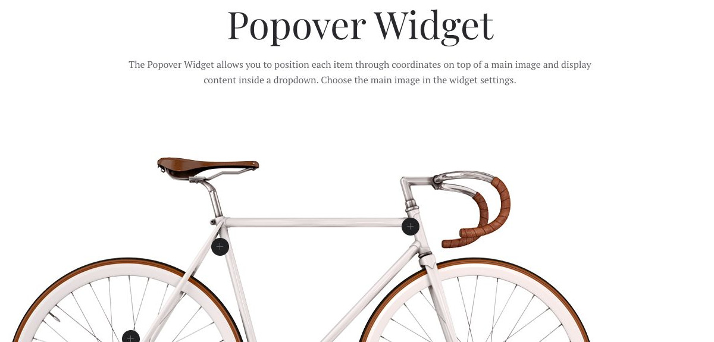
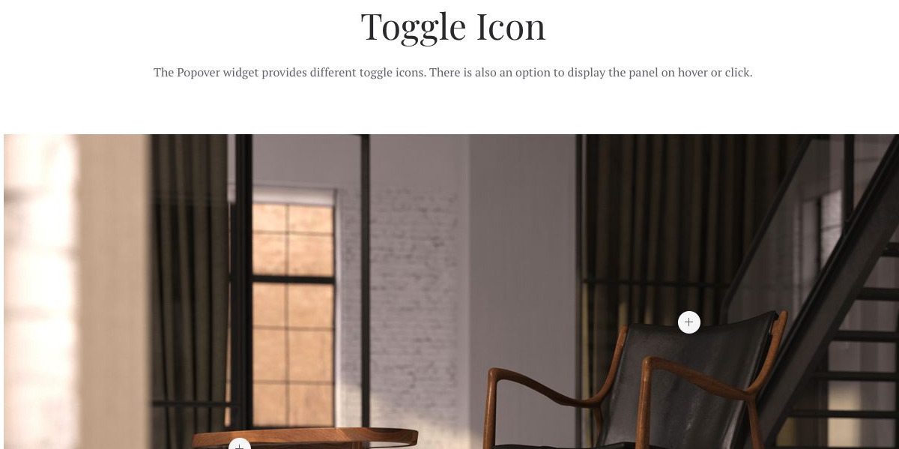
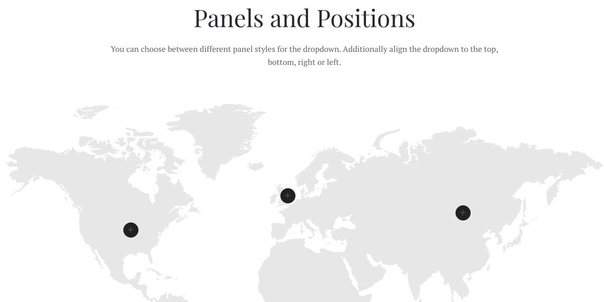

# Popover - Widgetkit

[Indice del catalogo](../README.md) · [PDF offline](../../../output/pdf/catalogo-widget-yootheme.pdf)

Hotspot su planimetrie, prodotti, immagini e infografiche.

**Contenuti:** Immagine di fondo, coordinate e contenuto dei punti.

Fonte grafica: Fuse (demo Widgetkit). Le demo generiche non dichiarano il tema originale di ogni preset; non viene dedotto dalle immagini.

| Variante | Demo |
|---|---|
| Esempio base | [Esempio](https://demo.yootheme.com/joomla/widgetkit/fuse/home/popover#popover) |
| Icona del punto interattivo | [Esempio](https://demo.yootheme.com/joomla/widgetkit/fuse/home/popover#toggle-icon) |
| Pannelli e posizionamento | [Esempio](https://demo.yootheme.com/joomla/widgetkit/fuse/home/popover#panels-positions) |

### Esempio base

Esempio della sezione Popover Widget.

[Apri la demo](https://demo.yootheme.com/joomla/widgetkit/fuse/home/popover#popover) · Riferimento: `popover`.

### Icona del punto interattivo

Esempio della sezione Toggle Icon.

[Apri la demo](https://demo.yootheme.com/joomla/widgetkit/fuse/home/popover#toggle-icon) · Riferimento: `toggle-icon`.

### Pannelli e posizionamento

Esempio della sezione Panels and Positions.

[Apri la demo](https://demo.yootheme.com/joomla/widgetkit/fuse/home/popover#panels-positions) · Riferimento: `panels-positions`.

