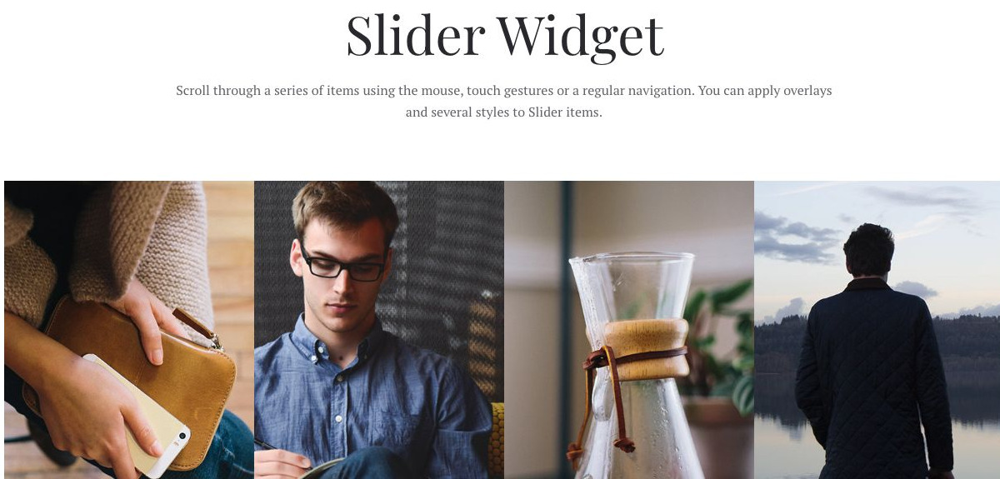
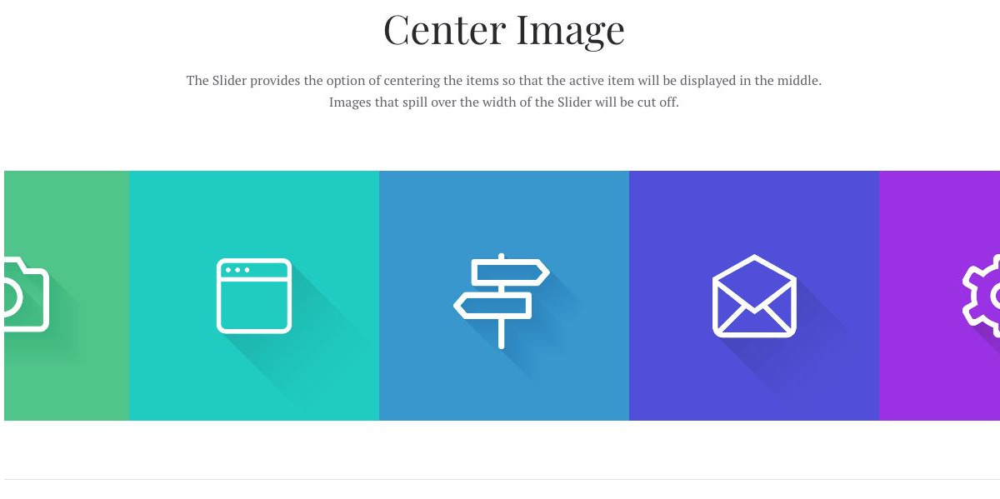
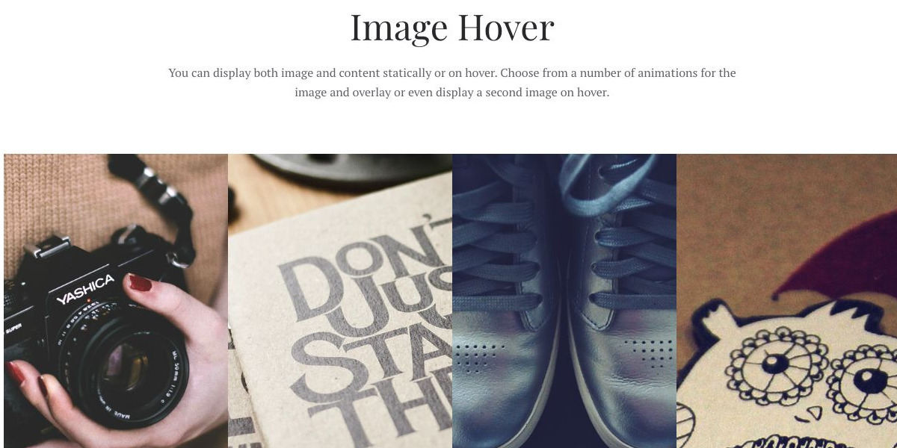

# Slider - Widgetkit

[Indice del catalogo](../README.md) · [PDF offline](../../../output/pdf/catalogo-widget-yootheme.pdf)

Scorrimento orizzontale di immagini o schede, anche con la slide attiva centrata.

**Contenuti:** Una raccolta di elementi omogenei.

Fonte grafica: Fuse (demo Widgetkit). Le demo generiche non dichiarano il tema originale di ogni preset; non viene dedotto dalle immagini.

| Variante | Demo |
|---|---|
| Esempio base | [Esempio](https://demo.yootheme.com/joomla/widgetkit/fuse/home/slider#slider) |
| Center image | [Esempio](https://demo.yootheme.com/joomla/widgetkit/fuse/home/slider#center) |
| Image hover | [Esempio](https://demo.yootheme.com/joomla/widgetkit/fuse/home/slider#image) |
| Infinite scrolling | [Esempio](https://demo.yootheme.com/joomla/widgetkit/fuse/home/slider#infinite) |

### Esempio base

Esempio della sezione Slider Widget.

[Apri la demo](https://demo.yootheme.com/joomla/widgetkit/fuse/home/slider#slider) · Riferimento: `slider`.

### Center image

Esempio della sezione Center Image.

[Apri la demo](https://demo.yootheme.com/joomla/widgetkit/fuse/home/slider#center) · Riferimento: `center`.

### Image hover

Esempio della sezione Image Hover.

[Apri la demo](https://demo.yootheme.com/joomla/widgetkit/fuse/home/slider#image) · Riferimento: `image`.

### Infinite scrolling

Esempio della sezione Infinite Scrolling.

[Apri la demo](https://demo.yootheme.com/joomla/widgetkit/fuse/home/slider#infinite) · Riferimento: `infinite`.

