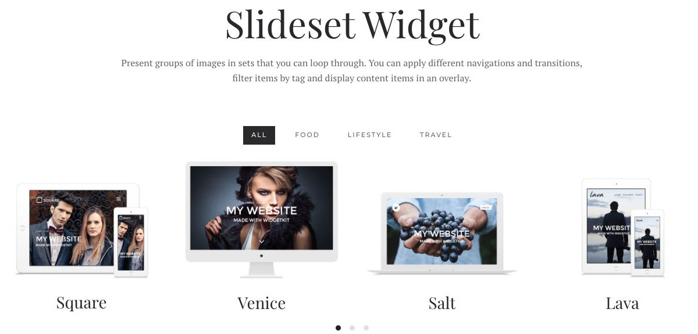
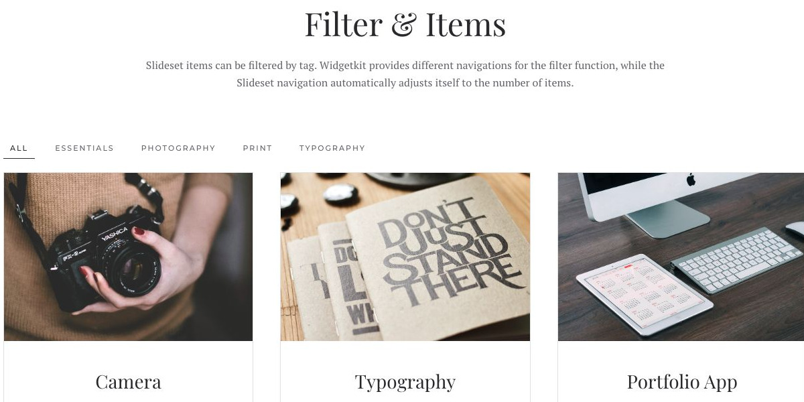
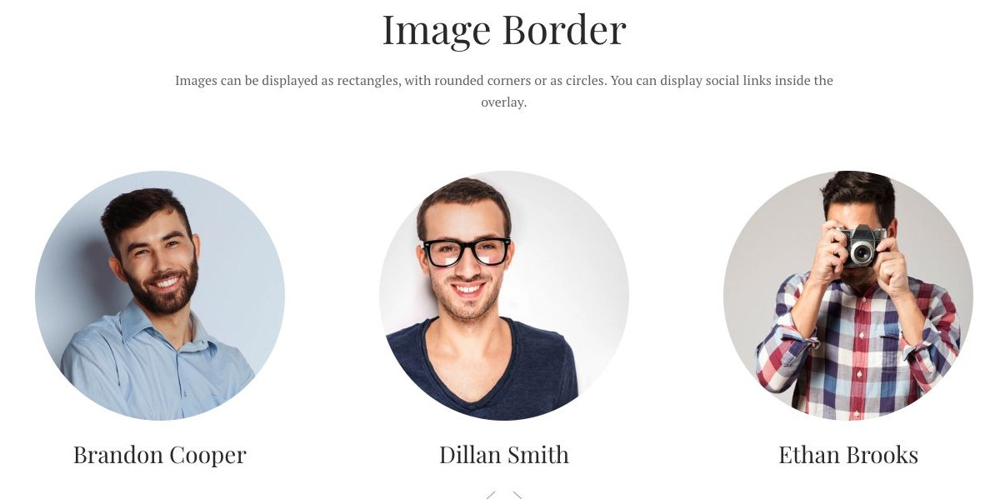
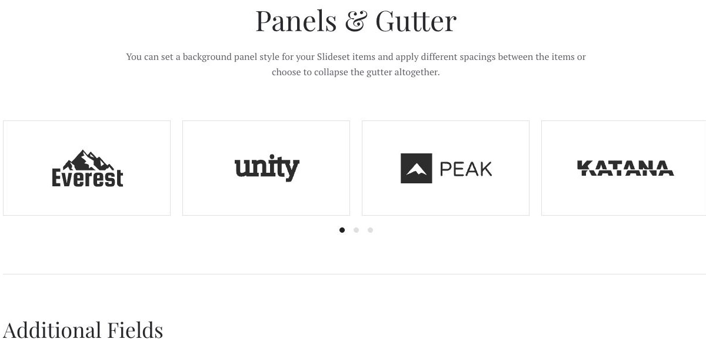

# Slideset - Widgetkit

[Indice del catalogo](../README.md) · [PDF offline](../../../output/pdf/catalogo-widget-yootheme.pdf)

Raccolte da navigare per gruppi, con eventuale selezione per categoria.

**Contenuti:** Elementi ripetuti e tag opzionali.

Fonte grafica: Fuse (demo Widgetkit). Le demo generiche non dichiarano il tema originale di ogni preset; non viene dedotto dalle immagini.

| Variante | Demo |
|---|---|
| Esempio base | [Esempio](https://demo.yootheme.com/joomla/widgetkit/fuse/home/slideset#slideset) |
| Filter & items | [Esempio](https://demo.yootheme.com/joomla/widgetkit/fuse/home/slideset#filter) |
| Image border | [Esempio](https://demo.yootheme.com/joomla/widgetkit/fuse/home/slideset#border) |
| Panels & gutter | [Esempio](https://demo.yootheme.com/joomla/widgetkit/fuse/home/slideset#panels) |

### Esempio base

Esempio della sezione Slideset Widget.

[Apri la demo](https://demo.yootheme.com/joomla/widgetkit/fuse/home/slideset#slideset) · Riferimento: `slideset`.

### Filter & items

Navigazione per filtrare gli elementi.

[Apri la demo](https://demo.yootheme.com/joomla/widgetkit/fuse/home/slideset#filter) · Riferimento: `filter`.

### Image border

Esempio della sezione Image Border.

[Apri la demo](https://demo.yootheme.com/joomla/widgetkit/fuse/home/slideset#border) · Riferimento: `border`.

### Panels & gutter

Esempio della sezione Panels & Gutter.

[Apri la demo](https://demo.yootheme.com/joomla/widgetkit/fuse/home/slideset#panels) · Riferimento: `panels`.

