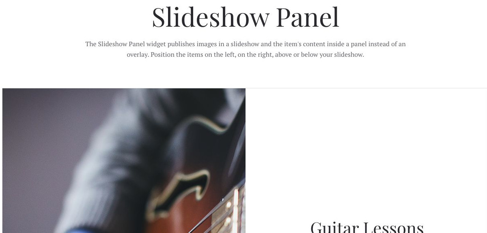
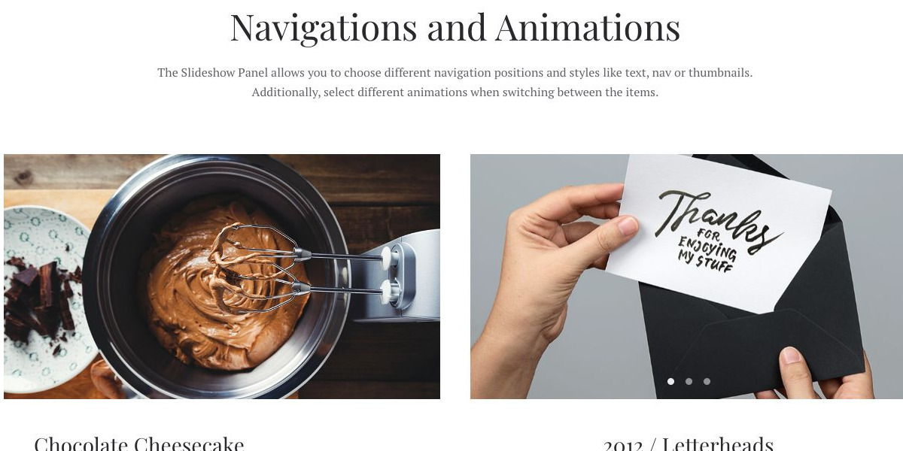

# Slideshow Panel - Widgetkit

[Indice del catalogo](../README.md) · [PDF offline](../../../output/pdf/catalogo-widget-yootheme.pdf)

Presentazioni in cui il testo resta separato dall’immagine, in un pannello affiancato.

**Contenuti:** Slide multimediali con pannello di contenuto.

Fonte grafica: Fuse (demo Widgetkit). Le demo generiche non dichiarano il tema originale di ogni preset; non viene dedotto dalle immagini.

| Variante | Demo |
|---|---|
| Esempio base | [Esempio](https://demo.yootheme.com/joomla/widgetkit/fuse/home/slideshow-panel#slideshow-panel) |
| Navigations and animations | [Esempio](https://demo.yootheme.com/joomla/widgetkit/fuse/home/slideshow-panel#videos) |

### Esempio base

Esempio della sezione Slideshow Panel.

[Apri la demo](https://demo.yootheme.com/joomla/widgetkit/fuse/home/slideshow-panel#slideshow-panel) · Riferimento: `slideshow-panel`.

### Navigations and animations

Esempio della sezione Navigations and Animations.

[Apri la demo](https://demo.yootheme.com/joomla/widgetkit/fuse/home/slideshow-panel#videos) · Riferimento: `videos`.

