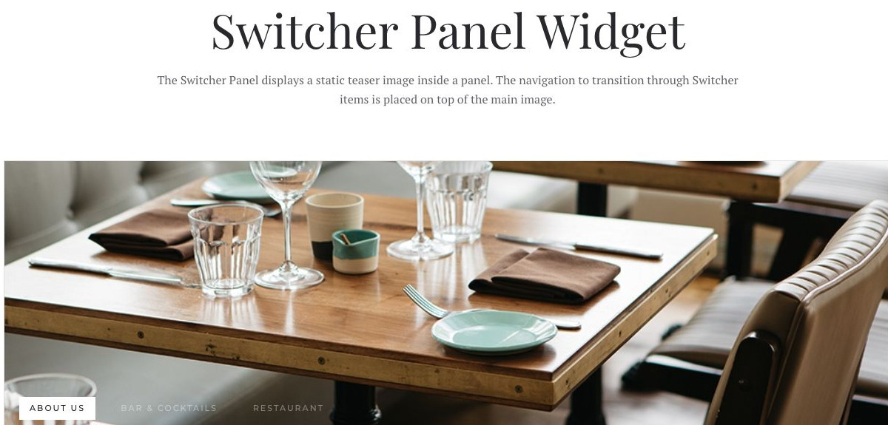
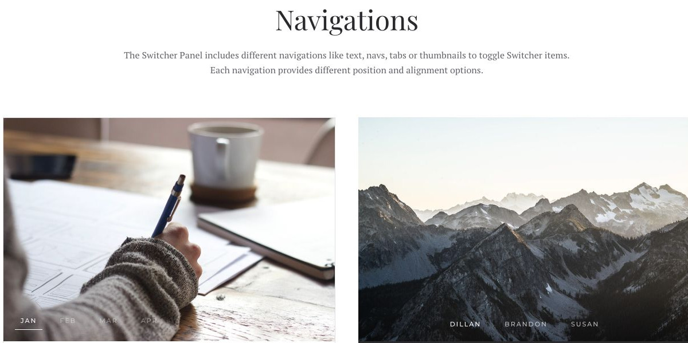

# Switcher Panel - Widgetkit

[Indice del catalogo](../README.md) · [PDF offline](../../../output/pdf/catalogo-widget-yootheme.pdf)

Contenuti selezionabili tramite navigazione associata a un’immagine introduttiva.

**Contenuti:** Immagine principale, voci di navigazione e pannelli.

Fonte grafica: Fuse (demo Widgetkit). Le demo generiche non dichiarano il tema originale di ogni preset; non viene dedotto dalle immagini.

| Variante | Demo |
|---|---|
| Esempio base | [Esempio](https://demo.yootheme.com/joomla/widgetkit/fuse/home/switcher-panel#switcher-panel) |
| Varianti di navigazione | [Esempio](https://demo.yootheme.com/joomla/widgetkit/fuse/home/switcher-panel#videos) |

### Esempio base

Esempio della sezione Switcher Panel Widget.

[Apri la demo](https://demo.yootheme.com/joomla/widgetkit/fuse/home/switcher-panel#switcher-panel) · Riferimento: `switcher-panel`.

### Varianti di navigazione

Esempio della sezione Navigations.

[Apri la demo](https://demo.yootheme.com/joomla/widgetkit/fuse/home/switcher-panel#videos) · Riferimento: `videos`.

