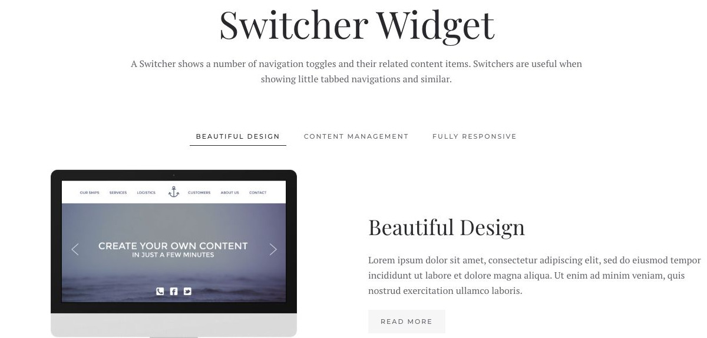
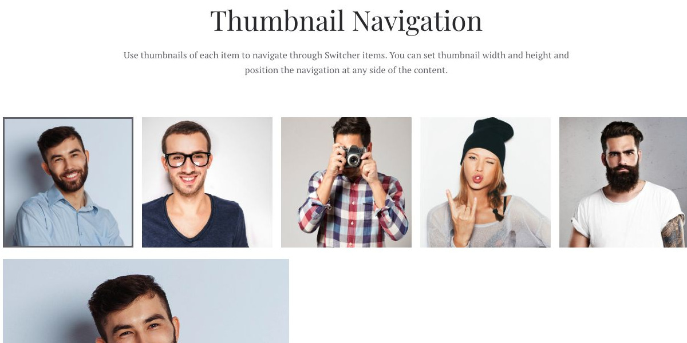
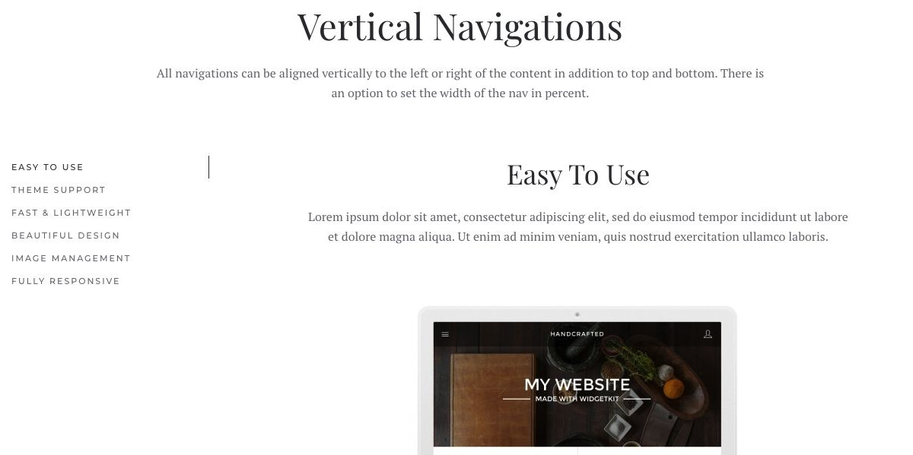
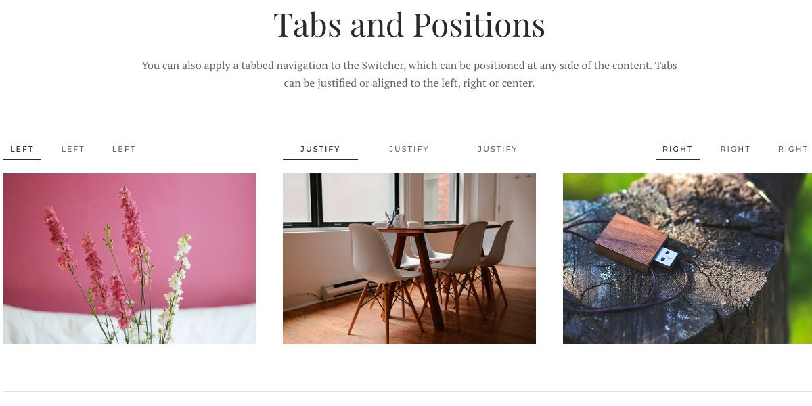
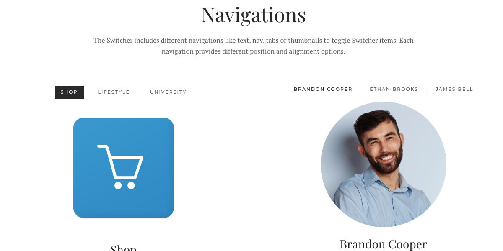

# Switcher - Widgetkit

[Indice del catalogo](../README.md) · [PDF offline](../../../output/pdf/catalogo-widget-yootheme.pdf)

Approfondimenti raggruppati per argomento, categoria o caratteristica.

**Contenuti:** Etichette di navigazione e relativi pannelli.

Fonte grafica: Fuse (demo Widgetkit). Le demo generiche non dichiarano il tema originale di ogni preset; non viene dedotto dalle immagini.

| Variante | Demo |
|---|---|
| Esempio base | [Esempio](https://demo.yootheme.com/joomla/widgetkit/fuse/home/switcher#switcher) |
| Navigazione a miniature | [Esempio](https://demo.yootheme.com/joomla/widgetkit/fuse/home/switcher#thumbnav) |
| Vertical navigations | [Esempio](https://demo.yootheme.com/joomla/widgetkit/fuse/home/switcher#vertical) |
| Tabs and positions | [Esempio](https://demo.yootheme.com/joomla/widgetkit/fuse/home/switcher#tabs) |
| Varianti di navigazione | [Esempio](https://demo.yootheme.com/joomla/widgetkit/fuse/home/switcher#navigations) |

### Esempio base

Esempio della sezione Switcher Widget.

[Apri la demo](https://demo.yootheme.com/joomla/widgetkit/fuse/home/switcher#switcher) · Riferimento: `switcher`.

### Navigazione a miniature

Miniature per selezionare il contenuto.

[Apri la demo](https://demo.yootheme.com/joomla/widgetkit/fuse/home/switcher#thumbnav) · Riferimento: `thumbnav`.

### Vertical navigations

Esempio della sezione Vertical Navigations.

[Apri la demo](https://demo.yootheme.com/joomla/widgetkit/fuse/home/switcher#vertical) · Riferimento: `vertical`.

### Tabs and positions

Esempio della sezione Tabs and Positions.

[Apri la demo](https://demo.yootheme.com/joomla/widgetkit/fuse/home/switcher#tabs) · Riferimento: `tabs`.

### Varianti di navigazione

Esempio della sezione Navigations.

[Apri la demo](https://demo.yootheme.com/joomla/widgetkit/fuse/home/switcher#navigations) · Riferimento: `navigations`.

