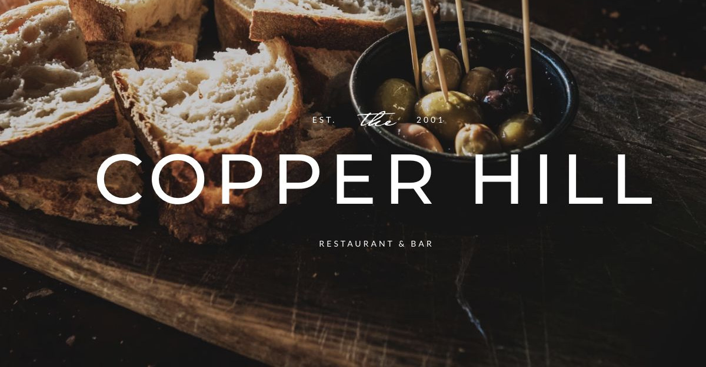

# Copper Hill

[Indice del catalogo](../README.md) · [Scheda ufficiale](https://yootheme.com/joomla-templates/copper-hill)

Layout e applicazioni dei widget nel tema. Le palette alternative sono escluse.

## Home Layout

**Composizione** · Home Layout

Anteprima della composizione iniziale del layout.

[Apri l’esempio](https://demo.yootheme.com/joomla/themes/copper-hill/index.php)

## Layout censiti

I tipi elencati sono riconosciuti dal markup UIkit. Un componente può ripetersi in più layout o avere una versione desktop e una mobile. La tabella non conta preset univoci.

| Layout | Componenti rilevati | Stato |
|---|---|---|
| [Home Layout](https://demo.yootheme.com/joomla/themes/copper-hill/index.php) | Map × 1, Button × 1 | HTML letto |
| [Lunch Menu Layout](https://demo.yootheme.com/joomla/themes/copper-hill/index.php?option=com_content&view=article&id=4&Itemid=110) | Nessun componente delle famiglie rilevate | HTML letto |
| [Dining Menu Layout](https://demo.yootheme.com/joomla/themes/copper-hill/index.php?option=com_content&view=article&id=5&Itemid=111) | Slideshow × 3 | HTML letto |
| [About Layout](https://demo.yootheme.com/joomla/themes/copper-hill/index.php?option=com_content&view=article&id=2&Itemid=108) | Grid × 1 | HTML letto |
| [Gallery Layout](https://demo.yootheme.com/joomla/themes/copper-hill/index.php?option=com_content&view=article&id=3&Itemid=112) | Grid × 2 | HTML letto |
| [Contact Layout](https://demo.yootheme.com/joomla/themes/copper-hill/index.php?option=com_content&view=article&id=19&Itemid=118) | Map × 1 | HTML letto |
| [Post Index Layout](https://demo.yootheme.com/joomla/themes/copper-hill/index.php?option=com_content&view=category&layout=blog&id=8&Itemid=117) | Grid × 1 | HTML letto |
| [Post Layout](https://demo.yootheme.com/joomla/themes/copper-hill/index.php?option=com_content&view=article&id=10&catid=8&Itemid=117) | Nessun componente delle famiglie rilevate | HTML letto |

## Riferimenti nel layout

### Home Layout

- Map: Book a Table.
- Button: Book a Table.

### Dining Menu Layout

- Slideshow: Starters.
- Slideshow: Main Course.
- Slideshow: Desserts.

### About Layout

- Grid: Our Philosophy.

### Gallery Layout

- Grid: Gallery.
- Grid: Follow us on Instagram.

### Contact Layout

- Map: Call for Reservations.

### Post Index Layout

- Grid: (inizio pagina).

