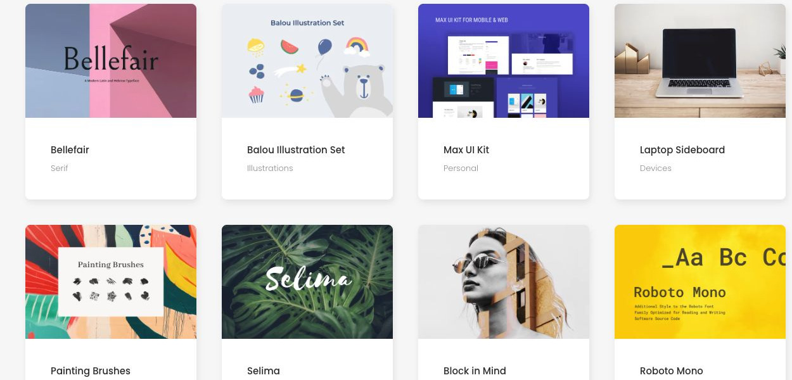

# Design Bites

[Indice del catalogo](../README.md) · [Scheda ufficiale](https://yootheme.com/joomla-templates/design-bites)

Layout e applicazioni dei widget nel tema. Le palette alternative sono escluse.

## Latest Resources

**Grid** · Home Layout

[Apri l’esempio](https://demo.yootheme.com/joomla/themes/design-bites/index.php)

## Layout censiti

I tipi elencati sono riconosciuti dal markup UIkit. Un componente può ripetersi in più layout o avere una versione desktop e una mobile. La tabella non conta preset univoci.

| Layout | Componenti rilevati | Stato |
|---|---|---|
| [Home Layout](https://demo.yootheme.com/joomla/themes/design-bites/index.php) | Grid × 3 | HTML letto |
| [About Layout](https://demo.yootheme.com/joomla/themes/design-bites/index.php?option=com_content&view=article&id=160&Itemid=110) | Accordion × 4 | HTML letto |
| [Imprint Layout](https://demo.yootheme.com/joomla/themes/design-bites/index.php?option=com_content&view=article&id=5&catid=2&Itemid=136) | Nessun componente delle famiglie rilevate | HTML letto |
| [Resource Categories Layout](https://demo.yootheme.com/joomla/themes/design-bites/index.php?option=com_content&view=article&id=161&Itemid=108) | Grid × 7 | HTML letto |
| [Resource Category Layout](https://demo.yootheme.com/joomla/themes/design-bites/index.php?option=com_content&view=category&id=10&Itemid=124) | Grid × 2 | HTML letto |
| [Resource Index Layout](https://demo.yootheme.com/joomla/themes/design-bites/index.php?option=com_content&view=category&layout=blog&id=9&Itemid=138) | Grid × 1 | HTML letto |
| [Resource Post Layout](https://demo.yootheme.com/joomla/themes/design-bites/index.php?option=com_content&view=article&id=24&catid=17&Itemid=124) | Slideshow × 1, Grid × 2 | HTML letto |
| [Post Index Layout](https://demo.yootheme.com/joomla/themes/design-bites/index.php?option=com_content&view=category&layout=blog&id=8&Itemid=117) | Grid × 2 | HTML letto |
| [Post Layout](https://demo.yootheme.com/joomla/themes/design-bites/index.php?option=com_content&view=article&id=153&catid=8&Itemid=117) | Nessun componente delle famiglie rilevate | HTML letto |
| [Search Layout](https://demo.yootheme.com/joomla/themes/design-bites/index.php?option=com_finder&q=kit) | Grid × 1 | HTML letto |

## Riferimenti nel layout

### Home Layout

- Grid: Latest Resources.
- Grid: Explore Our Assets by Category.
- Grid: Popular Resources.

### About Layout

- Accordion: License & FAQ.
- Accordion: License & FAQ.
- Accordion: License & FAQ.
- Accordion: License & FAQ.

### Resource Categories Layout

- Grid: All Assets You Are Looking For.
- Grid: Fonts.
- Grid: Brushes.
- Grid: Vectors.
- Grid: Graphics.
- Grid: Mockups.
- Grid: UI Kits.

### Resource Category Layout

- Grid: Fonts.
- Grid: All Items.

### Resource Index Layout

- Grid: All Items.

### Resource Post Layout

- Slideshow: Bellefair.
- Grid: Bellefair.
- Grid: You Might Also Like.

### Post Index Layout

- Grid: News & Inspiration.
- Grid: How Social Media Impacts Web Design.

### Search Layout

- Grid: Search Results for "kit".

