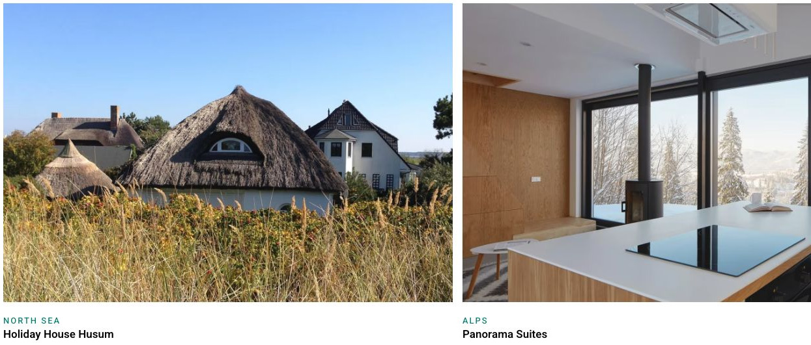
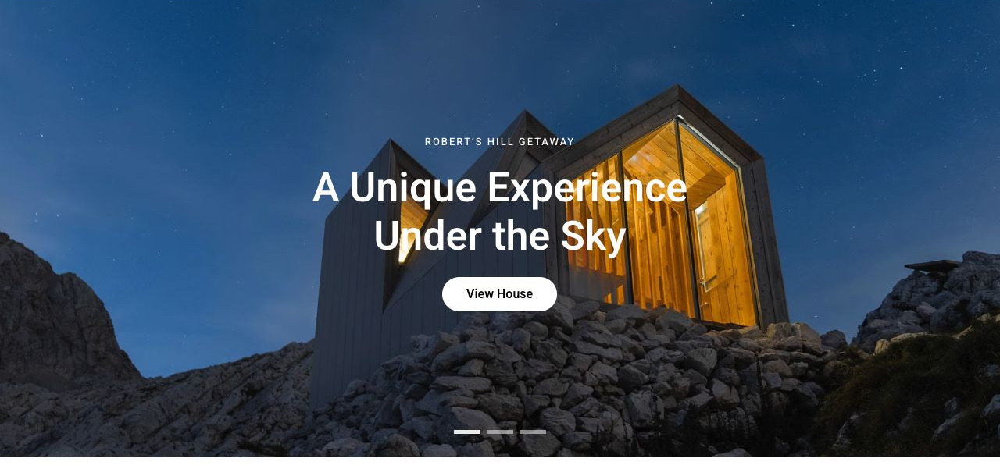
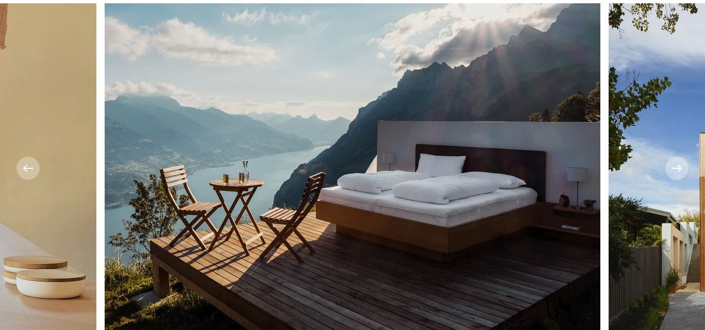
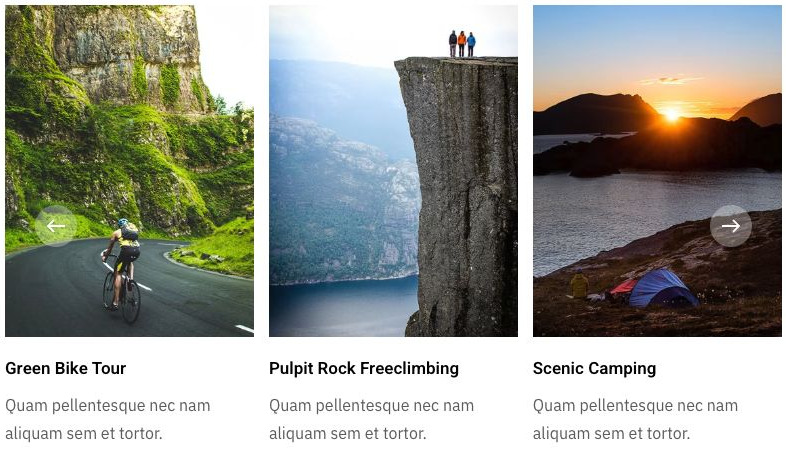

# Design Escapes

[Indice del catalogo](../README.md) · [Scheda ufficiale](https://yootheme.com/joomla-templates/design-escapes)

Layout e applicazioni dei widget nel tema. Le palette alternative sono escluse.

## Latest Homes

**Panel Slider** · Home Layout

Fotografie ampie, spazi ridotti e testo sotto il media: località in evidenza e nome della casa. Il ritaglio lascia intravedere la scheda successiva. Utile per alloggi, prodotti o contenuti con un’etichetta sempre leggibile.

[Apri l’esempio](https://demo.yootheme.com/joomla/themes/design-escapes/index.php)

## Home Layout

**Slideshow** · Home Layout

Navigazione a puntini.

[Apri l’esempio](https://demo.yootheme.com/joomla/themes/design-escapes/index.php)

## Creating Unique Experiences

**Panel Slider** · About Layout

Carosello di immagini con slide attiva centrata e frecce laterali. Le immagini adiacenti restano parzialmente visibili.

[Apri l’esempio](https://demo.yootheme.com/joomla/themes/design-escapes/index.php?option=com_content&view=article&id=4&Itemid=110)

## Activities in Norway

**Panel Slider** · Discover Country Layout

Schede con contenuto separato dal media. Effetti di transizione presenti nel markup.

[Apri l’esempio](https://demo.yootheme.com/joomla/themes/design-escapes/index.php?option=com_content&view=article&id=40&catid=2&Itemid=123)

## Layout censiti

I tipi elencati sono riconosciuti dal markup UIkit. Un componente può ripetersi in più layout o avere una versione desktop e una mobile. La tabella non conta preset univoci.

| Layout | Componenti rilevati | Stato |
|---|---|---|
| [Home Layout](https://demo.yootheme.com/joomla/themes/design-escapes/index.php) | Slideshow × 1, Panel Slider × 1, Grid × 5, Button × 1 | HTML letto |
| [Landing Page Layout](https://demo.yootheme.com/joomla/themes/design-escapes/index.php?option=com_content&view=article&id=23&catid=2&Itemid=139) | Grid × 7, Map × 1 | HTML letto |
| [Map Layout](https://demo.yootheme.com/joomla/themes/design-escapes/index.php?option=com_content&view=article&id=52&Itemid=129) | Map × 1 | HTML letto |
| [About Layout](https://demo.yootheme.com/joomla/themes/design-escapes/index.php?option=com_content&view=article&id=4&Itemid=110) | Grid × 3, Panel Slider × 1, Button × 1, Accordion × 1 | HTML letto |
| [Error 404 Layout](https://demo.yootheme.com/joomla/themes/design-escapes/404) | Nessun componente delle famiglie rilevate | Pagina 404 dimostrativa |
| [Accommodation Index Layout](https://demo.yootheme.com/joomla/themes/design-escapes/index.php?option=com_content&view=category&layout=blog&id=11&Itemid=139) | Grid × 1 | HTML letto |
| [Accommodation Category Layout](https://demo.yootheme.com/joomla/themes/design-escapes/index.php?option=com_content&view=category&id=9&Itemid=139) | Grid × 1 | HTML letto |
| [Accommodation Post Layout](https://demo.yootheme.com/joomla/themes/design-escapes/index.php?option=com_content&view=article&id=56&catid=44&Itemid=139) | Panel Slider × 3, Grid × 7, Map × 2 | HTML letto |
| [Accommodation Tag Layout](https://demo.yootheme.com/joomla/themes/design-escapes/index.php?option=com_tags&view=tag&layout=list&id[0]=18:apartment) | Grid × 1 | HTML letto |
| [Discover Tags Layout](https://demo.yootheme.com/joomla/themes/design-escapes/index.php?option=com_content&view=article&id=19&Itemid=119) | Panel Slider × 1, Grid × 5 | HTML letto |
| [Discover Country Layout](https://demo.yootheme.com/joomla/themes/design-escapes/index.php?option=com_content&view=article&id=40&catid=2&Itemid=123) | Panel Slider × 3, Grid × 3 | HTML letto |
| [Post Index Layout](https://demo.yootheme.com/joomla/themes/design-escapes/index.php?option=com_content&view=category&layout=blog&id=8&Itemid=117) | Grid × 2 | HTML letto |
| [Post Category Layout](https://demo.yootheme.com/joomla/themes/design-escapes/index.php?option=com_content&view=category&id=49&Itemid=142) | Grid × 1 | HTML letto |
| [Post Layout](https://demo.yootheme.com/joomla/themes/design-escapes/index.php?option=com_content&view=article&id=88&catid=49&Itemid=142) | Grid × 2 | HTML letto |
| [Author Index Layout](https://demo.yootheme.com/joomla/themes/design-escapes/index.php?option=com_contact&view=contact&id=1:isabelle-anders&catid=4&Itemid=101) | Grid × 1 | HTML letto |
| [Search Layout](https://demo.yootheme.com/joomla/themes/design-escapes/index.php?q=house&option=com_finder&Itemid=101) | Nessun componente delle famiglie rilevate | Demo non disponibile alla verifica |

## Riferimenti nel layout

### Home Layout

- Slideshow: (inizio pagina).
- Panel Slider: Latest Homes.
- Grid: What Makes Us Special.
- Grid: Cozy Places.
- Grid: Get Inspired.
- Grid: Get Inspired.
- Button: Get Inspired.
- Grid: Latest Articles.

### Landing Page Layout

- Grid: An Architectural Gem in Italy.
- Grid: Living Room.
- Grid: Kitchen.
- Grid: Bedroom 1.
- Grid: Bedroom 2.
- Grid: Bathroom.
- Grid: Garden.
- Map: Book Your Stay.

### Map Layout

- Map: (inizio pagina).

### About Layout

- Grid: Handpicked, Exclusive & Unique Houses.
- Grid: Architecture & Sustainable Design.
- Panel Slider: Creating Unique Experiences.
- Grid: We've won several awards and were featured in these shows and magazines..
- Button: Get listed today and become part of the most exclusive luxury vacation home network worldwide..
- Accordion: Find Answers to Common Questions.

### Accommodation Index Layout

- Grid: All Accommodations.

### Accommodation Category Layout

- Grid: All Accommodations in Norway.

### Accommodation Post Layout

- Panel Slider: (inizio pagina).
- Grid: Villa Lorenzo.
- Grid: Villa Lorenzo.
- Grid: Amenities.
- Grid: Amenities.
- Grid: In the Area.
- Map: In the Area.
- Grid: In the Area.
- Map: In the Area.
- Panel Slider: Exclusive Tips.
- Panel Slider: Exclusive Tips.
- Grid: Exclusive Tips.

### Accommodation Tag Layout

- Grid: All Accommodations in 'Apartment'.

### Discover Tags Layout

- Panel Slider: (inizio pagina).
- Grid: Find Your Home Away From Home.
- Grid: Find Your Home Away From Home.
- Grid: Find Your Home Away From Home.
- Grid: Find Your Home Away From Home.
- Grid: Find Your Home Away From Home.

### Discover Country Layout

- Panel Slider: Western Fjords.
- Panel Slider: Oslo Region.
- Grid: Tiny Homes.
- Grid: Cozy Places.
- Grid: Winter Escapes.
- Panel Slider: Activities in Norway.

### Post Index Layout

- Grid: Warm Breeze and the Scent of Lavender – Why We Love Provence.
- Grid: Why Everyone Loves Standup Paddling.

### Post Category Layout

- Grid: Inspiration.

### Post Layout

- Grid: Nearby Accommodations.
- Grid: Latest Articles.

### Author Index Layout

- Grid: Isabelle Anders.

