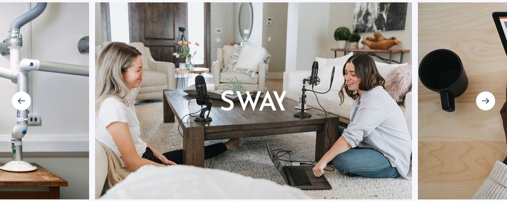

# DevStack

[Indice del catalogo](../README.md) · [Scheda ufficiale](https://yootheme.com/joomla-templates/devstack)

Layout e applicazioni dei widget nel tema. Le palette alternative sono escluse.

## Reach Your Digital Goals With a Solution Trusted by Many Industry Experts

**Panel Slider** · Home Layout

Schede con contenuto separato dal media. Slide attiva centrata. Effetti di transizione presenti nel markup.

[Apri l’esempio](https://demo.yootheme.com/joomla/themes/devstack/index.php)

## Layout censiti

I tipi elencati sono riconosciuti dal markup UIkit. Un componente può ripetersi in più layout o avere una versione desktop e una mobile. La tabella non conta preset univoci.

| Layout | Componenti rilevati | Stato |
|---|---|---|
| [Home Layout](https://demo.yootheme.com/joomla/themes/devstack/index.php) | Button × 1, Grid × 4, Panel Slider × 1 | HTML letto |
| [Landing Page Layout](https://demo.yootheme.com/joomla/themes/devstack/why-devstack) | Button × 1, Panel Slider × 3, Grid × 3 | HTML letto |
| [Landing Page Layout](https://demo.yootheme.com/joomla/themes/devstack/enterprise) | Button × 1, Panel Slider × 2, Grid × 7 | HTML letto |
| [Pricing Layout](https://demo.yootheme.com/joomla/themes/devstack/pricing) | Grid × 1, Accordion × 1 | HTML letto |
| [Services Layout](https://demo.yootheme.com/joomla/themes/devstack/developers/support) | Grid × 2 | HTML letto |
| [Feature Index Layout](https://demo.yootheme.com/joomla/themes/devstack/developers/feature-index) | Grid × 9 | HTML letto |
| [About Layout](https://demo.yootheme.com/joomla/themes/devstack/company/about) | Grid × 6, Panel Slider × 2 | HTML letto |
| [About Layout](https://demo.yootheme.com/joomla/themes/devstack/company/our-story) | Grid × 4 | HTML letto |
| [Careers Layout](https://demo.yootheme.com/joomla/themes/devstack/company/careers) | Grid × 4 | HTML letto |
| [Job Description Layout](https://demo.yootheme.com/joomla/themes/devstack/company/job-description) | Grid × 1 | HTML letto |
| [Error 404 Layout](https://demo.yootheme.com/joomla/themes/devstack/404) | Nessun componente delle famiglie rilevate | Pagina 404 dimostrativa |
| [Post Index Layout](https://demo.yootheme.com/joomla/themes/devstack/company/blog) | Grid × 1 | HTML letto |
| [Post Category Layout](https://demo.yootheme.com/joomla/themes/devstack/company/blog/11-customer-stories) | Grid × 1 | HTML letto |
| [Post Layout](https://demo.yootheme.com/joomla/themes/devstack/company/blog/12-learning/15-the-ultimate-guide-to-performance-testing) | Grid × 2 | HTML letto |
| [Author Index Layout](https://demo.yootheme.com/joomla/themes/devstack/mike-marinelli) | Nessun componente delle famiglie rilevate | Demo non disponibile alla verifica |
| [Search Layout](https://demo.yootheme.com/joomla/themes/devstack/component/finder/search?q=automation&option=com_finder) | Grid × 1 | HTML letto |

## Riferimenti nel layout

### Home Layout

- Button: Build Anything on DevStack.
- Grid: Build Anything on DevStack.
- Grid: The Best Tools from the Leading DevOps Platform.
- Panel Slider: Reach Your Digital Goals With a Solution Trusted by Many Industry Experts.
- Grid: Reinvent Your Business With DevStack Solutions.
- Grid: Latest News.

### Landing Page Layout

- Button: Ship Faster With the Leading DevOps Platform.
- Panel Slider: Ship Faster With the Leading DevOps Platform.
- Grid: A Better Way to Automate Deployment.
- Panel Slider: Seamless Integration With the Tools You Need.
- Panel Slider: Seamless Integration With the Tools You Need.
- Grid: Packed With Features Your Team Will Love.
- Grid: Simple, flexible pricing. Unlimited repositories and deployments..

### Landing Page Layout

- Button: Endless Possibilities With DevStack Enterprise.
- Panel Slider: Endless Possibilities With DevStack Enterprise.
- Grid: Powerful API for Clean Code.
- Grid: Powerful API for Clean Code.
- Grid: Fast and Efficient Way to Create.
- Grid: Keep All Work in One Place.
- Panel Slider: Trusted By Clients and Industry Experts Alike.
- Grid: Our Community.
- Grid: We’ll Set You up for Success.
- Grid: Simple, flexible pricing. Unlimited repositories and deployments..

### Pricing Layout

- Grid: Pricing That Suits All Business Sizes.
- Accordion: Frequently Asked Questions.

### Services Layout

- Grid: DevStack Support.
- Grid: Popular Tutorials.

### Feature Index Layout

- Grid: Deployment.
- Grid: DevOps.
- Grid: Automation.
- Grid: Project Management.
- Grid: CI/CD.
- Grid: Infrastructure.
- Grid: Security.
- Grid: Integrations.
- Grid: Features.

### About Layout

- Grid: Small Team With Big Ambitions & Having Fun.
- Grid: Combining Love for Technology With Love for Support.
- Grid: Proud of Our Loyal and Constantly Growing Customer Base.
- Panel Slider: Come Visit Us in Our Office.
- Grid: Meet Our Leadership Team.
- Grid: Meet Our Leadership Team.
- Panel Slider: We Love What We Do.
- Grid: Become a Partner.

### About Layout

- Grid: 2020.
- Grid: 2018.
- Grid: 2017.
- Grid: 2016.

### Careers Layout

- Grid: Benefits Working for DevStack.
- Grid: Benefits Working for DevStack.
- Grid: Our Open Positions.
- Grid: Our Open Positions.

### Job Description Layout

- Grid: Frontend Engineer.

### Post Index Layout

- Grid: Welcome to the DevStack Blog.

### Post Category Layout

- Grid: Customer Stories.

### Post Layout

- Grid: (inizio pagina).
- Grid: Latest Posts.

### Search Layout

- Grid: Search Results for 'automation'.

