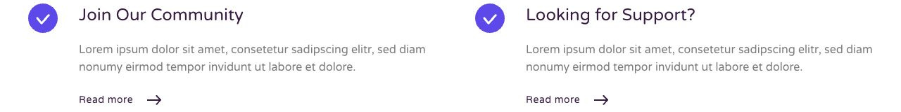

# Flow

[Indice del catalogo](../README.md) · [Scheda ufficiale](https://yootheme.com/joomla-templates/flow)

Layout e applicazioni dei widget nel tema. Le palette alternative sono escluse.

## Flow Is a Simple Way to Manage Projects With Your Entire Team

**Grid** · Home Layout

[Apri l’esempio](https://demo.yootheme.com/joomla/themes/flow/index.php)

## Layout censiti

I tipi elencati sono riconosciuti dal markup UIkit. Un componente può ripetersi in più layout o avere una versione desktop e una mobile. La tabella non conta preset univoci.

| Layout | Componenti rilevati | Stato |
|---|---|---|
| [Home Layout](https://demo.yootheme.com/joomla/themes/flow/index.php) | Button × 1, Grid × 1 | HTML letto |
| [Landing Page Layout](https://demo.yootheme.com/joomla/themes/flow/index.php?option=com_content&view=article&id=2&Itemid=108) | Grid × 1 | HTML letto |
| [About Layout](https://demo.yootheme.com/joomla/themes/flow/index.php?option=com_content&view=article&id=19&Itemid=118) | Slideshow × 1, Grid × 2, Button × 2, Map × 1 | HTML letto |
| [Portfolio Layout](https://demo.yootheme.com/joomla/themes/flow/index.php?option=com_content&view=article&id=21&Itemid=120) | Grid × 1, Button × 1 | HTML letto |
| [Support Layout](https://demo.yootheme.com/joomla/themes/flow/index.php?option=com_content&view=article&id=23&Itemid=122) | Gallery × 1, Button × 1 | HTML letto |
| [Pricing Layout](https://demo.yootheme.com/joomla/themes/flow/index.php?option=com_content&view=article&id=22&Itemid=123) | Grid × 2 | HTML letto |
| [Post Index Layout](https://demo.yootheme.com/joomla/themes/flow/index.php?option=com_content&view=category&layout=blog&id=8&Itemid=117) | Grid × 1 | HTML letto |
| [Post Layout](https://demo.yootheme.com/joomla/themes/flow/index.php?option=com_content&view=article&id=10&catid=8&Itemid=117) | Nessun componente delle famiglie rilevate | HTML letto |

## Riferimenti nel layout

### Home Layout

- Button: Benefit From a Huge Collection of Extensions.
- Grid: Flow Is a Simple Way to Manage Projects With Your Entire Team.

### Landing Page Layout

- Grid: Mighty Tools.

### About Layout

- Slideshow: One Big and Super Creative Family.
- Grid: Our Team.
- Grid: We Are Proud to Present You Our Achievements in 2017.
- Button: Be Part of Our Creative Community.
- Button: Contact.
- Map: Social.

### Portfolio Layout

- Grid: Featured Plugins.
- Button: Create Your Own Extension.

### Support Layout

- Gallery: Popular Tutorial Videos.
- Button: Be Part of Our Creative Community.

### Pricing Layout

- Grid: Frequently Asked Questions.
- Grid: Our Clients.

### Post Index Layout

- Grid: Follow Us to Get All the News.

