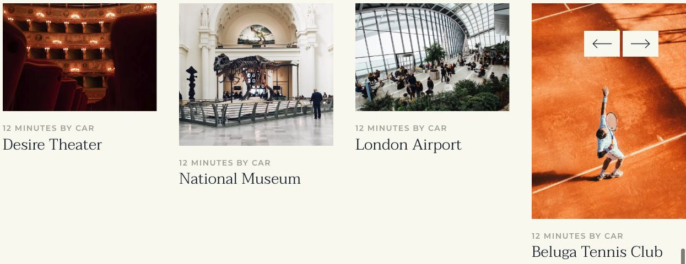

# Gravity Tower

[Indice del catalogo](../README.md) · [Scheda ufficiale](https://yootheme.com/joomla-templates/gravity-tower)

Layout e applicazioni dei widget nel tema. Le palette alternative sono escluse.

## Neighbourhood

**Panel Slider** · Home Layout

Schede con contenuto separato dal media.

[Apri l’esempio](https://demo.yootheme.com/joomla/themes/gravity-tower/index.php)

## Layout censiti

I tipi elencati sono riconosciuti dal markup UIkit. Un componente può ripetersi in più layout o avere una versione desktop e una mobile. La tabella non conta preset univoci.

| Layout | Componenti rilevati | Stato |
|---|---|---|
| [Home Layout](https://demo.yootheme.com/joomla/themes/gravity-tower/index.php) | Panel Slider × 1, Button × 1 | HTML letto |
| [Landing Page Layout](https://demo.yootheme.com/joomla/themes/gravity-tower/index.php?option=com_content&view=article&id=19&Itemid=122) | Grid × 2, Button × 1 | HTML letto |
| [Landing Page Layout](https://demo.yootheme.com/joomla/themes/gravity-tower/index.php?option=com_content&view=article&id=2&Itemid=119) | Button × 1 | HTML letto |
| [Case Study Layout](https://demo.yootheme.com/joomla/themes/gravity-tower/index.php?option=com_content&view=article&id=6&Itemid=120) | Grid × 1, Button × 1 | HTML letto |
| [Contact Layout](https://demo.yootheme.com/joomla/themes/gravity-tower/index.php?option=com_content&view=article&id=3&Itemid=123) | Grid × 2, Button × 1 | HTML letto |
| [Imprint Layout](https://demo.yootheme.com/joomla/themes/gravity-tower/index.php?option=com_content&view=article&id=25&catid=2&Itemid=133) | Nessun componente delle famiglie rilevate | HTML letto |
| [Error 404 Layout](https://demo.yootheme.com/joomla/themes/gravity-tower/404) | Nessun componente delle famiglie rilevate | Pagina 404 dimostrativa |
| [Post Index Layout](https://demo.yootheme.com/joomla/themes/gravity-tower/index.php?option=com_content&view=category&layout=blog&id=8&Itemid=121) | Nessun componente delle famiglie rilevate | HTML letto |
| [Post Layout](https://demo.yootheme.com/joomla/themes/gravity-tower/index.php?option=com_content&view=article&id=18&catid=8&Itemid=121) | Panel Slider × 1 | HTML letto |

## Riferimenti nel layout

### Home Layout

- Panel Slider: Neighbourhood.
- Button: Neighbourhood.

### Landing Page Layout

- Grid: Amenities.
- Grid: Building Partners.
- Button: Building Partners.

### Landing Page Layout

- Button: Surroundings.

### Case Study Layout

- Grid: Apartment’s Equipment.
- Button: Available.

### Contact Layout

- Grid: Contact Us.
- Grid: Contact Us.
- Button: Contact Us.

### Post Layout

- Panel Slider: Recent.

