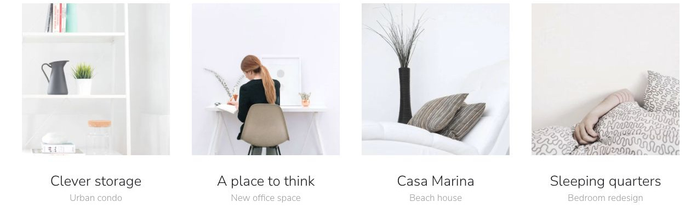

# Juno

[Indice del catalogo](../README.md) · [Scheda ufficiale](https://yootheme.com/joomla-templates/juno)

Layout e applicazioni dei widget nel tema. Le palette alternative sono escluse.

## Featured Projects

**Grid** · Home Layout

[Apri l’esempio](https://demo.yootheme.com/joomla/themes/juno/index.php)

## Layout censiti

I tipi elencati sono riconosciuti dal markup UIkit. Un componente può ripetersi in più layout o avere una versione desktop e una mobile. La tabella non conta preset univoci.

| Layout | Componenti rilevati | Stato |
|---|---|---|
| [Home Layout](https://demo.yootheme.com/joomla/themes/juno/index.php) | Grid × 1 | HTML letto |
| [Portfolio Layout](https://demo.yootheme.com/joomla/themes/juno/index.php?option=com_content&view=article&id=2&Itemid=108) | Nessun componente delle famiglie rilevate | HTML letto |
| [Case Study Layout](https://demo.yootheme.com/joomla/themes/juno/index.php?option=com_content&view=article&id=20&Itemid=121) | Grid × 1 | HTML letto |
| [Portfolio Layout](https://demo.yootheme.com/joomla/themes/juno/index.php?option=com_content&view=article&id=6&Itemid=112) | Grid × 1 | HTML letto |
| [Case Study Layout](https://demo.yootheme.com/joomla/themes/juno/index.php?option=com_content&view=article&id=19&Itemid=122) | Nessun componente delle famiglie rilevate | HTML letto |
| [About Layout](https://demo.yootheme.com/joomla/themes/juno/index.php?option=com_content&view=article&id=4&Itemid=110) | Grid × 2, Map × 1 | HTML letto |
| [Pricing Layout](https://demo.yootheme.com/joomla/themes/juno/index.php?option=com_content&view=article&id=8&Itemid=113) | Grid × 1, Accordion × 1 | HTML letto |
| [Post Index Layout](https://demo.yootheme.com/joomla/themes/juno/index.php?option=com_content&view=category&layout=blog&id=8&Itemid=117) | Nessun componente delle famiglie rilevate | HTML letto |
| [Post Layout](https://demo.yootheme.com/joomla/themes/juno/index.php?option=com_content&view=article&id=10&catid=8&Itemid=117) | Grid × 1 | HTML letto |

## Riferimenti nel layout

### Home Layout

- Grid: Featured Projects.

### Case Study Layout

- Grid: Other products.

### Portfolio Layout

- Grid: Related products.

### About Layout

- Grid: Our mission is to find the perfect design for you.
- Grid: Distribution.
- Map: Distribution.

### Pricing Layout

- Grid: Find the right service package for you.
- Accordion: Frequently asked questions.

### Post Layout

- Grid: Latest Articles.

