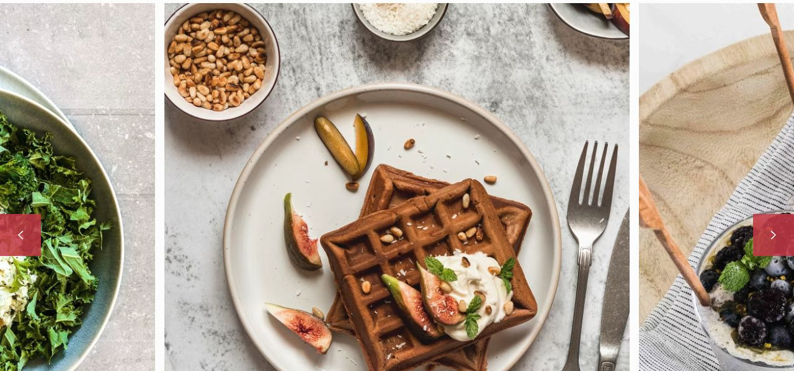

# Kitchen Daily

[Indice del catalogo](../README.md) · [Scheda ufficiale](https://yootheme.com/joomla-templates/kitchen-daily)

Layout e applicazioni dei widget nel tema. Le palette alternative sono escluse.

## All Your Favourite Recipes Made Simple

**Overlay Slider** · Home Layout

Contenuto sovrapposto alle immagini. Slide attiva centrata. Effetti di transizione presenti nel markup.

[Apri l’esempio](https://demo.yootheme.com/joomla/themes/kitchen-daily/index.php)

## Layout censiti

I tipi elencati sono riconosciuti dal markup UIkit. Un componente può ripetersi in più layout o avere una versione desktop e una mobile. La tabella non conta preset univoci.

| Layout | Componenti rilevati | Stato |
|---|---|---|
| [Home Layout](https://demo.yootheme.com/joomla/themes/kitchen-daily/index.php) | Overlay Slider × 2, Grid × 6, Gallery × 1 | HTML letto |
| [Gallery Layout](https://demo.yootheme.com/joomla/themes/kitchen-daily/index.php?option=com_content&view=article&id=83&Itemid=112) | Gallery × 2, Grid × 2 | HTML letto |
| [About Layout](https://demo.yootheme.com/joomla/themes/kitchen-daily/index.php?option=com_content&view=article&id=4&Itemid=110) | Grid × 1 | HTML letto |
| [Recipe Categories Layout](https://demo.yootheme.com/joomla/themes/kitchen-daily/index.php?option=com_content&view=article&id=52&Itemid=108) | Grid × 6 | HTML letto |
| [Recipe Category Layout](https://demo.yootheme.com/joomla/themes/kitchen-daily/index.php?option=com_content&view=category&id=10&Itemid=124) | Grid × 2 | HTML letto |
| [Recipe Index Layout](https://demo.yootheme.com/joomla/themes/kitchen-daily/index.php?option=com_content&view=category&layout=blog&id=16&Itemid=131) | Grid × 2 | HTML letto |
| [Recipe Post Layout](https://demo.yootheme.com/joomla/themes/kitchen-daily/index.php?option=com_content&view=article&id=73&catid=28&Itemid=120) | Grid × 4 | HTML letto |
| [Post Index Layout](https://demo.yootheme.com/joomla/themes/kitchen-daily/index.php?option=com_content&view=category&layout=blog&id=8&Itemid=130) | Grid × 1 | HTML letto |
| [Post Layout](https://demo.yootheme.com/joomla/themes/kitchen-daily/index.php?option=com_content&view=article&id=50&catid=8&Itemid=130) | Grid × 2 | HTML letto |
| [Search Layout](https://demo.yootheme.com/joomla/themes/kitchen-daily/index.php?option=com_finder&q=cake) | Grid × 1 | HTML letto |

## Riferimenti nel layout

### Home Layout

- Overlay Slider: All Your Favourite Recipes Made Simple.
- Overlay Slider: All Your Favourite Recipes Made Simple.
- Grid: 120 recipes everyone can make. Browse through all categories and pick your favorite dish for every occasion..
- Grid: Hi, I’m Julie, Explore My Latest Recipes.
- Grid: When Apples Are in Season.
- Grid: Popular Recipes.
- Grid: Asparagus Season: Fresh From the Field to the Table.
- Grid: Asparagus Season: Fresh From the Field to the Table.
- Gallery: Discover My YouTube Channel.

### Gallery Layout

- Gallery: Latest Videos.
- Gallery: Popular Videos.
- Grid: Follow Me on Social Media.
- Grid: Follow Me on Social Media.

### About Layout

- Grid: Featured On.

### Recipe Categories Layout

- Grid: Breakfast.
- Grid: Salads.
- Grid: Soups & Stews.
- Grid: Main Dishes.
- Grid: Desserts.
- Grid: Drinks.

### Recipe Category Layout

- Grid: Delicious Main Dish Recipes.
- Grid: Easy Thai Red Tofu Curry.

### Recipe Index Layout

- Grid: Browse All Recipes.
- Grid: Homemade Apple Peach Iced Tea.

### Recipe Post Layout

- Grid: Slow Cooker Beef Tomato Stew.
- Grid: Goes Great with.
- Grid: Method.
- Grid: More Delicious Ideas for You.

### Post Index Layout

- Grid: Welcome to my journal! Here you can explore family recipes, inspiring food photography and travel tips..

### Post Layout

- Grid: Related Recipes.
- Grid: Latest Stories.

### Search Layout

- Grid: Search Results for "cake".

